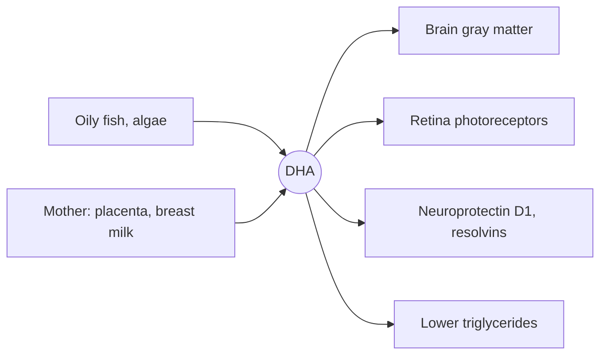

# Docosahexaenoic acid (DHA)

## Summary

Docosahexaenoic acid (DHA, 22:6 n-3) is the longest common omega-3 fatty acid and a main structural fat of the brain and the retina. The fetus and infant need it for brain and eye development, which is why it is added to infant formula and recommended in pregnancy. Adults get it from oily fish and algae. Supplements in adults without deficiency have not been shown to prevent cognitive decline.

*This note is educational. It is not medical advice and does not replace a doctor, dietitian or pharmacist, especially during pregnancy, illness or when taking medicines.*

## Prerequisites

- [Omega-3 fatty acids](omega-3-fatty-acids.md)

## Core concepts

### Definition

*DHA* is a 22-carbon omega-3 fatty acid with six cis double bonds, which makes membranes containing it very flexible. It makes up a large share of the omega-3 fat in the brain gray matter, and in the outer segments of rod and cone cells in the retina it is the dominant fatty acid. Sources: oily fish, fish oil, algal oil and, in small amounts, eggs from hens fed omega-3.

### Analogy

DHA in a membrane is like a very flexible joint in a machine that must change shape fast. Photoreceptor proteins in the eye (rhodopsin) must change shape within a thousandth of a second when light hits them, and a DHA-rich membrane lets them. The analogy breaks because DHA has signaling roles too, forming protectins and resolvins.

### Mechanism

- In the last trimester and the first two years of life, DHA accumulates rapidly in the brain. The mother supplies it through the placenta and breast milk.
- In the retina, DHA supports the fast shape change of rhodopsin.
- DHA forms neuroprotectin D1 and D-series resolvins.
- DHA lowers triglycerides and may slightly raise LDL and HDL cholesterol.

The diagram shows where DHA goes in the body.

## Worked example

EFSA advises an extra 100 to 200 mg of DHA per day during pregnancy and lactation on top of the 250 mg EPA + DHA for adults. One portion of 150 g of salmon per week supplies about 1.5 to 2 g of DHA, roughly 200 to 300 mg a day on average, which covers this. A woman who eats no fish could take an algal DHA supplement of 200 mg.

## Trade offs and when to use it

DHA from fish comes with methylmercury in some species. Pregnant women are advised to choose low-mercury fish (salmon, sardines, herring, trout) and avoid large predators (shark, swordfish, king mackerel).

## Common mistakes

- **Avoiding all fish in pregnancy because of mercury.** Low-mercury fish supply DHA with little risk.

## Practice

1. Which two tissues are richest in DHA?
2. What extra DHA does EFSA advise in pregnancy?

### Answers

1. The brain gray matter and the retina.
2. 100 to 200 mg per day.

## Further reading

- Middleton, P., Gomersall, J. C., Gould, J. F. et al. (2018). Omega-3 fatty acid addition during pregnancy. Cochrane Database of Systematic Reviews, CD003402. [DOI](https://doi.org/10.1002/14651858.CD003402.pub3). Cochrane review of omega-3 in pregnancy.
- EFSA Panel on Dietetic Products, Nutrition, and Allergies (2010). Scientific Opinion on Dietary Reference Values for fats, including saturated fatty acids, polyunsaturated fatty acids, monounsaturated fatty acids, trans fatty acids, and cholesterol. EFSA Journal, 8(3), 1461. [DOI](https://doi.org/10.2903/j.efsa.2010.1461). DHA recommendation for pregnancy and lactation.
- NIH Office of Dietary Supplements. Omega-3 Fatty Acids: Fact Sheet for Health Professionals. [Link](https://ods.od.nih.gov/factsheets/Omega3FattyAcids-HealthProfessional/). DHA in infant development.
