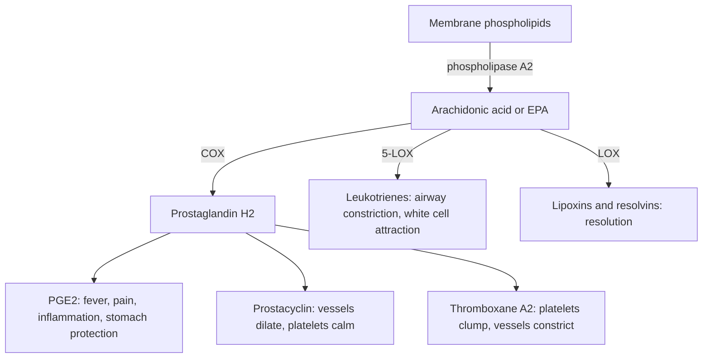

# Eicosanoids

## Summary

Eicosanoids are short-lived signaling molecules made from 20-carbon fatty acids, mainly arachidonic acid (omega-6) and EPA (omega-3). They act locally, near the cell that made them, and control inflammation, pain, fever, blood clotting, blood vessel tone, airway tone and the protection of the stomach lining. Many common drugs, from aspirin to asthma medicines, work by changing eicosanoid production.

## Prerequisites

- [Arachidonic acid](arachidonic-acid.md)

## Core concepts

### Definition

*Eicosanoids* (from Greek *eikosi*, twenty) are oxygenated derivatives of 20-carbon polyunsaturated fatty acids. The main classes are *prostaglandins*, *prostacyclin* and *thromboxanes* (made by cyclooxygenase, COX), *leukotrienes* and *lipoxins* (made by lipoxygenase, LOX), and epoxides (made by cytochrome P450). They are *autocrine* and *paracrine* signals: they act on the producing cell and its neighbors and are broken down within seconds to minutes.

### Analogy

Eicosanoids are like walkie-talkie messages between neighbors rather than radio broadcasts. A hormone such as insulin is a broadcast heard throughout the body. An eicosanoid is a short message to cells nearby, gone a few minutes later. The analogy breaks because some eicosanoid effects add up to whole-body effects, such as fever.

### Mechanism

1. A stimulus (injury, infection, hormone) activates phospholipase A2, which releases arachidonic acid or EPA from membrane phospholipids.
2. COX-1 (always active in many tissues) and COX-2 (induced by inflammation) form prostaglandin H2, which other enzymes turn into specific prostaglandins, prostacyclin or thromboxane.
3. 5-lipoxygenase forms leukotrienes in white blood cells.
4. The products bind G-protein-coupled receptors on nearby cells.

The diagram shows the main classes and their effects.

### Drugs that act on eicosanoids

| Drug | Target | Use and consequence |
| --- | --- | --- |
| Aspirin | COX-1 and COX-2, irreversible | Pain, fever, prevention of clots; can harm the stomach |
| Ibuprofen, naproxen | COX-1 and COX-2, reversible | Pain, fever, inflammation; stomach and kidney side effects |
| Celecoxib | COX-2 | Inflammation with less stomach harm; cardiovascular risk |
| Corticosteroids | Reduce phospholipase A2 and COX-2 | Strong anti-inflammatory action |
| Montelukast | Leukotriene receptor | Asthma and allergy |

Paracetamol (acetaminophen) reduces pain and fever with only weak peripheral COX inhibition, and its exact mechanism is still debated.

## Worked example

Why do anti-inflammatory painkillers irritate the stomach? Prostaglandin E2 made by COX-1 in the stomach lining increases mucus and bicarbonate secretion and blood flow, protecting the lining from acid. Blocking COX-1 removes this protection. Taking ibuprofen regularly at 1,200 mg a day for weeks therefore raises the risk of gastric ulcers, which is why such treatment is sometimes combined with a proton pump inhibitor on medical advice.

## Trade offs and when to use it

- Blocking eicosanoids relieves pain and inflammation but removes protective functions (stomach, kidney blood flow, clot balance).
- Dietary omega-3 shifts the balance towards weaker and pro-resolving eicosanoids, with smaller effects than drugs.

## Common mistakes

- **Treating all prostaglandins as inflammatory.** Several protect tissues or end inflammation.
- **Thinking eicosanoids circulate like hormones.** They act locally and briefly.

## Practice

1. Which enzyme class makes prostaglandins and thromboxanes?
2. Why do COX inhibitors cause stomach ulcers?
3. Which eicosanoids does montelukast block?

### Answers

1. Cyclooxygenases (COX-1 and COX-2).
2. They block the prostaglandins that protect the stomach lining.
3. Leukotrienes, at their receptor.

## Further reading

- Berg, J. M., Tymoczko, J. L., Stryer, L. (2002). *Biochemistry (5th ed.)*. W. H. Freeman, free on NCBI Bookshelf. [Link](https://www.ncbi.nlm.nih.gov/books/NBK21154/). Eicosanoid biosynthesis and the action of aspirin.
