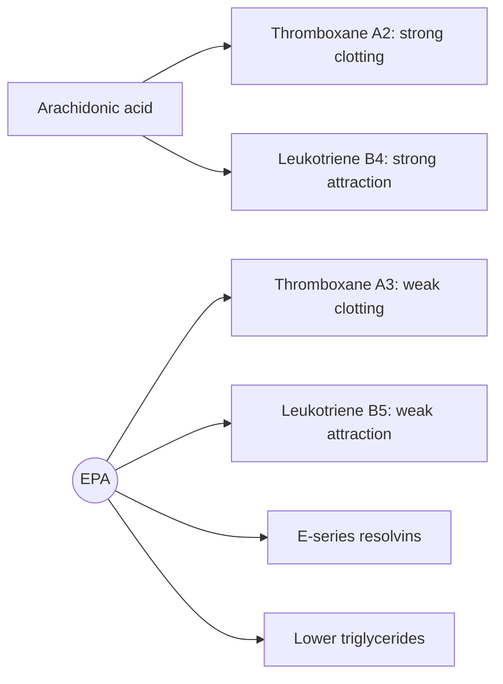

# Eicosapentaenoic acid (EPA)

## Summary

Eicosapentaenoic acid (EPA, 20:5 n-3) is a long-chain omega-3 fatty acid found mainly in oily fish and fish oil. It competes with arachidonic acid to form less inflammatory eicosanoids, gives rise to resolvins that end inflammation, and lowers blood triglycerides. A purified prescription form (icosapent ethyl) reduced cardiovascular events in high-risk patients, and EPA-rich preparations show a small benefit as an add-on in depression.

*This note is educational. It is not medical advice and does not replace a doctor, dietitian or pharmacist, especially during pregnancy, illness or when taking medicines.*

## Prerequisites

- [Omega-3 fatty acids](omega-3-fatty-acids.md)

## Core concepts

### Definition

*EPA* is a 20-carbon omega-3 fatty acid with five cis double bonds. It is made in small amounts from ALA and is obtained from oily fish (which get it from algae in their food chain), fish oil, krill oil and some algal oils.

### Analogy

EPA is like a quieter replacement part. Arachidonic acid and EPA fit the same machines (COX and LOX enzymes), but EPA produces signals that are weaker alarms. Swapping some arachidonic acid in membranes for EPA turns the overall volume down. The analogy breaks because EPA also starts new processes of its own (resolvins), not just a quieter version of the old ones.

### Mechanism

- Built into membrane phospholipids, partly replacing arachidonic acid.
- Converted by COX into series-3 prostaglandins and thromboxane A3 (weaker platelet clumping) and by LOX into series-5 leukotrienes (weaker attraction of white cells).
- Converted into E-series resolvins.
- Reduces VLDL production in the liver, lowering triglycerides. Unlike DHA, EPA does not raise LDL cholesterol.

The diagram compares EPA and arachidonic acid products.

## Worked example

The REDUCE-IT trial gave 4 g per day of icosapent ethyl or a mineral oil placebo to over 8,000 patients with high triglycerides and cardiovascular disease or diabetes. Major events fell from about 22 to 17 percent over about five years. Critics noted that the mineral oil placebo slightly raised LDL and inflammation markers, which may have exaggerated the benefit.

## Trade offs and when to use it

EPA at high doses is a prescription treatment for selected patients. As a supplement, it is safe at usual doses but may slightly raise the risk of atrial fibrillation at gram doses.

## Common mistakes

- **Assuming any fish oil gives the REDUCE-IT effect.** That trial used 4 g of purified EPA in a high-risk group.

## Practice

1. Which eicosanoid from EPA causes weaker platelet clumping than its arachidonic acid counterpart?
2. Why was the REDUCE-IT placebo criticized?

### Answers

1. Thromboxane A3.
2. Mineral oil may have raised LDL and inflammation in the placebo group.

## Further reading

- Bhatt, D. L., Steg, P. G., Miller, M. et al. (2019). Cardiovascular risk reduction with icosapent ethyl for hypertriglyceridemia. New England Journal of Medicine, 380(1), 11-22. [DOI](https://doi.org/10.1056/NEJMoa1812792). REDUCE-IT trial.
- NIH Office of Dietary Supplements. Omega-3 Fatty Acids: Fact Sheet for Health Professionals. [Link](https://ods.od.nih.gov/factsheets/Omega3FattyAcids-HealthProfessional/). Summary of EPA and DHA evidence.
