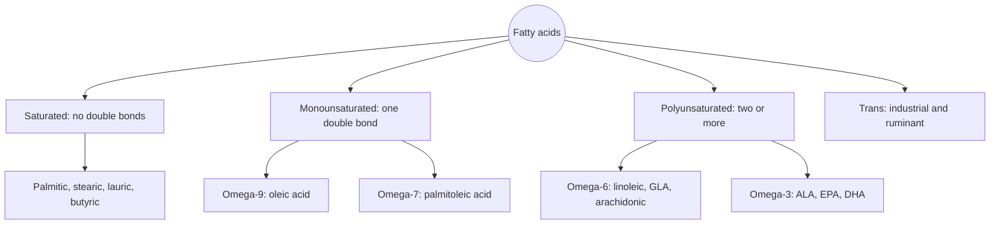
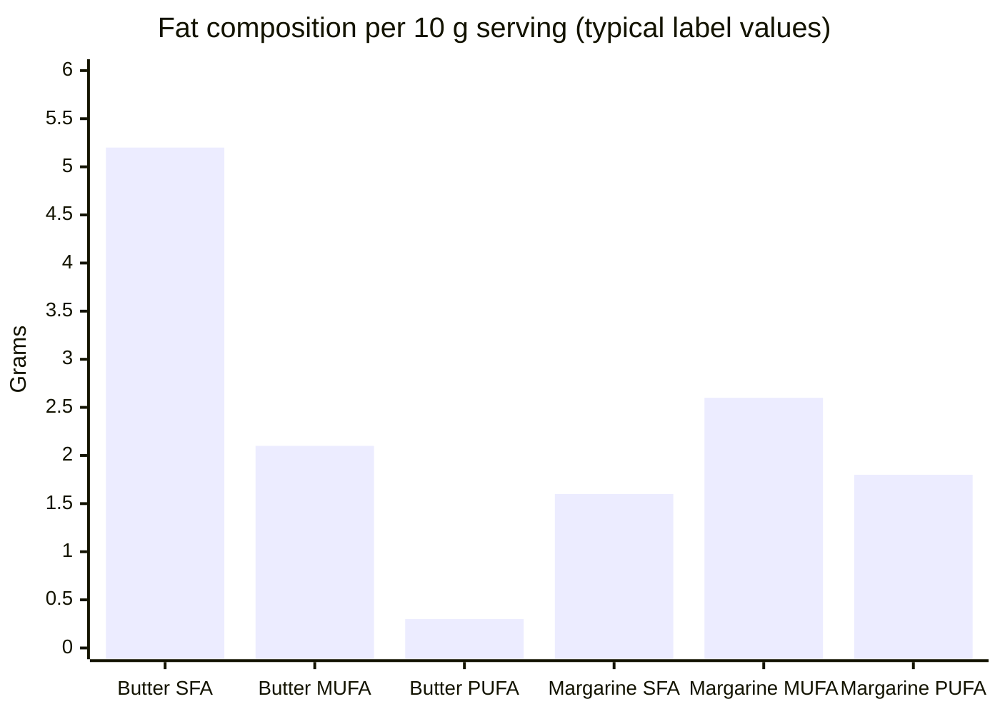

# Fatty acids

## Summary

Fatty acids are chains of carbon atoms ending in a carboxyl group (-COOH). They are the main components of fats and oils, build cell membranes, provide energy and are precursors of hormones and of substances that regulate inflammation. Their properties depend on chain length and on the number and position of double bonds: saturated fatty acids have none, monounsaturated have one, and polyunsaturated have two or more. A balanced intake of the different types matters for the heart, the brain and overall health.

## Prerequisites

- [Lipids overview](lipids-overview.md)

## Core concepts

### Definition

A *fatty acid* is a carboxylic acid with a hydrocarbon chain, usually of 4 to 24 carbons, almost always an even number in nature. Fatty acids are classified by:

- **Saturation.** *Saturated* fatty acids have only single bonds between carbons. *Monounsaturated* fatty acids (MUFA) have one double bond, and *polyunsaturated* fatty acids (PUFA) have two or more.
- **Chain length.** Short-chain (2 to 5 carbons, such as butyric acid), medium-chain (6 to 12, such as caprylic and lauric acid), long-chain (13 to 21) and very long-chain (22 or more, such as DHA).
- **Position of the first double bond counted from the methyl end** (the omega or n- end): omega-3, omega-6 and omega-9 families.
- **Geometry of the double bond:** *cis* (the natural form, with a bend in the chain) or *trans* (a straighter chain).

### Analogy

Saturated fatty acids are like straight pencils: they stack tightly in a box, so fats rich in them (butter, lard) are solid at room temperature. Each cis double bond puts a kink in the pencil, so kinked pencils pile loosely and stay fluid, like oils. The analogy breaks for trans double bonds: they make a fatty acid nearly straight even though it is unsaturated, which is why industrial trans fats behave like saturated ones.

### Mechanism

**Naming.** The shorthand "18:1 n-9" means 18 carbons, one double bond, the first double bond at carbon 9 from the methyl end. Examples:

| Fatty acid | Shorthand | Family | Main sources |
| --- | --- | --- | --- |
| Butyric acid | 4:0 | Saturated, short-chain | Butter; made by gut bacteria |
| Lauric acid | 12:0 | Saturated, medium-chain | Coconut and palm kernel oil |
| Palmitic acid | 16:0 | Saturated | Palm oil, meat, dairy |
| Stearic acid | 18:0 | Saturated | Cocoa butter, beef fat |
| Palmitoleic acid | 16:1 n-7 | Monounsaturated | Macadamia nuts, fish |
| Oleic acid | 18:1 n-9 | Monounsaturated (omega-9) | Olive oil, avocado, rapeseed oil |
| Linoleic acid (LA) | 18:2 n-6 | Polyunsaturated (omega-6) | Sunflower, corn, soybean oil |
| Arachidonic acid (AA) | 20:4 n-6 | Polyunsaturated (omega-6) | Meat, eggs; made from LA |
| Alpha-linolenic acid (ALA) | 18:3 n-3 | Polyunsaturated (omega-3) | Flaxseed, walnuts, rapeseed oil |
| EPA | 20:5 n-3 | Polyunsaturated (omega-3) | Oily fish |
| DHA | 22:6 n-3 | Polyunsaturated (omega-3) | Oily fish, algae |

**Essential fatty acids.** Humans cannot insert double bonds beyond carbon 9 from the carboxyl end, so they cannot make linoleic acid (omega-6) or alpha-linolenic acid (omega-3). These two are *essential fatty acids* and must come from food. Longer omega-3 and omega-6 fatty acids can be made from them, although conversion of ALA to EPA and DHA is limited.

**Roles.** Fatty acids are oxidized for energy ([Beta-oxidation](../beta-oxidation.md)), built into triglycerides and phospholipids, and the 20-carbon omega-6 and omega-3 fatty acids are converted into [Eicosanoids](eicosanoids.md), which regulate inflammation, clotting and blood vessel tone. The fatty acid composition of membranes affects their fluidity and the function of membrane proteins.

The diagram groups fatty acids by saturation and family.

### Food sources by type

- **Saturated:** meat, dairy products, animal fats, coconut oil and palm oil.
- **Monounsaturated:** olive oil, avocado, nuts, rapeseed (canola) oil.
- **Polyunsaturated:** oily fish (salmon, mackerel), flaxseed, walnuts, vegetable oils such as soybean, corn and sunflower oil.

All natural fats are mixtures. Olive oil contains about 14 percent saturated fat, and lard contains about 45 percent monounsaturated fat.

## Worked example

Comparing two spreads per 10 g serving (typical label values): butter has about 8.1 g of fat, of which 5.2 g saturated, 2.1 g monounsaturated and 0.3 g polyunsaturated. A soft margarine made from rapeseed and sunflower oils has about 6 g of fat, of which 1.6 g saturated, 2.6 g monounsaturated and 1.8 g polyunsaturated. The chart shows the difference in composition.

Replacing saturated with unsaturated fat lowers LDL cholesterol, which is why dietary guidelines (WHO 2023, EFSA 2010) recommend keeping saturated fat low, usually below 10 percent of energy.

## Trade offs and when to use it

- Unsaturated fatty acids are healthier for the heart in most comparisons, but polyunsaturated fats oxidize more easily, so they are less suited to repeated deep frying.
- Saturated fatty acids differ among themselves: stearic acid barely raises LDL, while palmitic, myristic and lauric acids raise it.

## Common mistakes

- **Calling an oil "an omega-6 oil" as if it contained nothing else.** Every fat is a mixture.
- **Assuming plant fats are always unsaturated.** Coconut and palm oils are rich in saturated fatty acids.
- **Counting ALA as equivalent to EPA and DHA.** Conversion in humans is low.

## Practice

1. What does the shorthand 20:5 n-3 describe?
2. Which two fatty acids are essential, and why?
3. Why is butter solid and olive oil liquid at room temperature?

### Answers

1. A fatty acid with 20 carbons and 5 double bonds, the first at carbon 3 from the methyl end: EPA.
2. Linoleic acid and alpha-linolenic acid, because humans cannot insert double bonds at the omega-6 and omega-3 positions.
3. Butter is rich in saturated fatty acids with straight chains that pack tightly, while olive oil is mostly oleic acid with a cis kink that prevents tight packing.

## Further reading

- EFSA Panel on Dietetic Products, Nutrition, and Allergies (2010). Scientific Opinion on Dietary Reference Values for fats, including saturated fatty acids, polyunsaturated fatty acids, monounsaturated fatty acids, trans fatty acids, and cholesterol. EFSA Journal, 8(3), 1461. [DOI](https://doi.org/10.2903/j.efsa.2010.1461). European reference values for fat intake.
- World Health Organization (2023). *Saturated fatty acid and trans-fatty acid intake for adults and children: WHO guideline*. WHO. WHO guideline on saturated and trans fat intake.
- Berg, J. M., Tymoczko, J. L., Stryer, L. (2002). *Biochemistry (5th ed.)*. W. H. Freeman, free on NCBI Bookshelf. [Link](https://www.ncbi.nlm.nih.gov/books/NBK21154/). Fatty acid structure and nomenclature.
