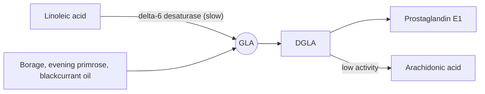

# Gamma-linolenic acid

## Summary

Gamma-linolenic acid (GLA, 18:3 n-6) is an omega-6 fatty acid made from linoleic acid. It is rare in food but rich in evening primrose, borage and blackcurrant seed oils. Its metabolite DGLA forms anti-inflammatory prostaglandin E1, which is why GLA is sold for eczema, arthritis and premenstrual symptoms. Trials have mostly not confirmed benefits, except possibly modest effects in rheumatoid arthritis.

*This note is educational. It is not medical advice and does not replace a doctor, dietitian or pharmacist, especially during pregnancy, illness or when taking medicines.*

## Prerequisites

- [Omega-6 fatty acids](omega-6-fatty-acids.md)

## Core concepts

### Definition

*Gamma-linolenic acid* is an 18-carbon omega-6 fatty acid with three double bonds. It is formed from linoleic acid by delta-6 desaturase, the slow step of the pathway. Supplements bypass this step. Sources: borage oil (about 20 to 24 percent GLA), blackcurrant seed oil (15 to 18 percent), evening primrose oil (8 to 10 percent), hemp seed oil (2 to 4 percent).

### Analogy

GLA supplements are like taking a shortcut past a traffic light. Normally LA must wait at the slow light (delta-6 desaturase) before becoming GLA. Taking GLA directly skips the light. The analogy breaks because skipping the light does not guarantee the destination: GLA can become DGLA (anti-inflammatory) or continue to arachidonic acid, depending on other enzymes.

### Mechanism

GLA is elongated to DGLA, which competes with arachidonic acid for COX enzymes and produces prostaglandin E1 and 15-HETrE, both with anti-inflammatory effects. Part of the DGLA is converted to arachidonic acid, but humans have low delta-5 desaturase activity, so GLA mainly raises DGLA.

The diagram shows the path.

### Proposed effects and evidence

Each entry states the proposed effect and how strong the human evidence is, using the grades defined in the [Evidence grades](../../../../applied-sciences/medicine-and-health/nutrition/evidence-grades.md) note.

- **Eczema (atopic dermatitis).** Cochrane review (Bamford et al., 2013) of 27 studies found no benefit of evening primrose or borage oil over placebo. Evidence: not supported.
- **Rheumatoid arthritis.** Small trials found less joint pain and stiffness with 1.4 to 2.8 g GLA per day over months. Evidence: limited.
- **Premenstrual syndrome and breast pain.** Reviews have not found clear benefit of evening primrose oil. Evidence: not supported.
- **Diabetic neuropathy.** Older trials suggested benefit; evidence is limited. Evidence: limited.

## Worked example

To get 1.4 g of GLA, a person would need about 6 to 7 g of borage oil or 14 to 17 g of evening primrose oil a day, roughly 6 to 7 large evening primrose capsules of 1 g each plus some extra. This shows why trial doses are hard to match with typical one-capsule products.

## Trade offs and when to use it

GLA oils are generally safe but may cause mild gut upset. Borage oil can contain liver-toxic pyrrolizidine alkaloids, so certified alkaloid-free products are preferred. GLA may increase bleeding risk with anticoagulants.

## Common mistakes

- **Expecting evening primrose oil to cure eczema.** The Cochrane review found no benefit.

## Practice

1. Which oil is richest in GLA?
2. Into which metabolite is GLA mainly converted in humans?

### Answers

1. Borage oil.
2. DGLA.

## Further reading

- Bamford, J. T., Ray, S., Musekiwa, A. et al. (2013). Oral evening primrose oil and borage oil for eczema. Cochrane Database of Systematic Reviews, CD004416. [DOI](https://doi.org/10.1002/14651858.CD004416.pub2). Cochrane review of evening primrose and borage oil for eczema.
- Berg, J. M., Tymoczko, J. L., Stryer, L. (2002). *Biochemistry (5th ed.)*. W. H. Freeman, free on NCBI Bookshelf. [Link](https://www.ncbi.nlm.nih.gov/books/NBK21154/). Omega-6 pathway enzymes.
