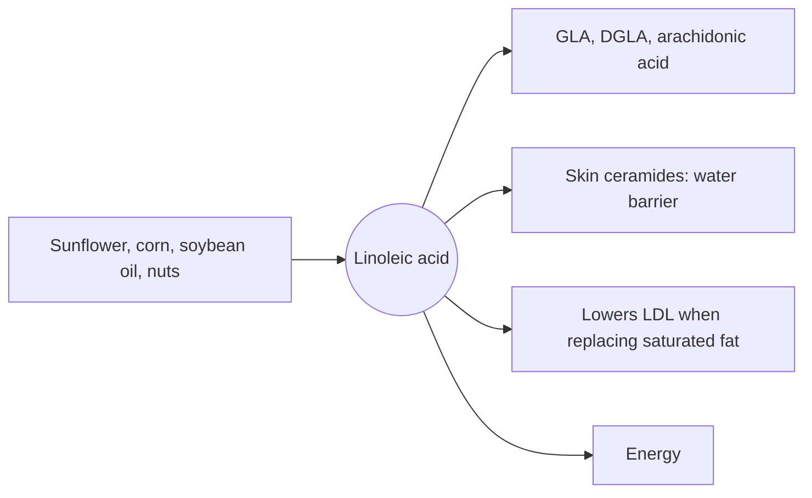

# Linoleic acid

## Summary

Linoleic acid (LA, 18:2 n-6) is the essential omega-6 fatty acid and the most abundant polyunsaturated fatty acid in the human diet. It comes from vegetable oils, nuts and seeds. Besides being the precursor of the whole omega-6 family, it is part of the skin's water barrier. Replacing saturated fat with LA lowers LDL cholesterol.

## Prerequisites

- [Omega-6 fatty acids](omega-6-fatty-acids.md)

## Core concepts

### Definition

*Linoleic acid* is an 18-carbon fatty acid with two cis double bonds at carbons 9 and 12 (counted from the carboxyl end), so the first one from the methyl end is at carbon 6. Humans cannot make it. Rich sources are safflower, sunflower, corn and soybean oils (50 to 75 percent LA), walnuts, sunflower seeds and pumpkin seeds.

### Analogy

LA is like the master key of the omega-6 building: every other omega-6 door (GLA, DGLA, arachidonic acid) can be opened only after LA has been brought in from outside. The analogy breaks because LA is also used directly, without opening other doors, for example in the skin barrier.

### Mechanism

- Precursor of GLA, DGLA and arachidonic acid (see [Omega-6 fatty acids](omega-6-fatty-acids.md)).
- Built into skin ceramides (acylceramides) that seal the outer skin layer against water loss.
- When it replaces saturated fat, it increases LDL receptor activity and lowers LDL cholesterol.
- It oxidizes more easily than oleic acid, forming aldehydes at frying temperatures.

The diagram shows these roles.

## Worked example

Deficiency is rare in adults but was described in infants fed skimmed milk formulas in the 1950s and 1960s: scaly skin and poor growth, reversed when about 1 to 2 percent of energy came from LA. This established LA as essential and set the lower limit of need.

## Trade offs and when to use it

LA intake in Western diets is usually well above the adequate intake. It is safe in normal amounts. Oils high in LA are better for cold use and moderate cooking than for long deep frying.

## Common mistakes

- **Confusing linoleic acid with alpha-linolenic acid.** LA is omega-6 with two double bonds; ALA is omega-3 with three.

## Practice

1. What is the shorthand of linoleic acid?
2. What skin problem appears in LA deficiency?

### Answers

1. 18:2 n-6.
2. Scaly, dry skin from a broken water barrier.

## Further reading

- EFSA Panel on Dietetic Products, Nutrition, and Allergies (2010). Scientific Opinion on Dietary Reference Values for fats, including saturated fatty acids, polyunsaturated fatty acids, monounsaturated fatty acids, trans fatty acids, and cholesterol. EFSA Journal, 8(3), 1461. [DOI](https://doi.org/10.2903/j.efsa.2010.1461). Adequate intake of linoleic acid.
- Berg, J. M., Tymoczko, J. L., Stryer, L. (2002). *Biochemistry (5th ed.)*. W. H. Freeman, free on NCBI Bookshelf. [Link](https://www.ncbi.nlm.nih.gov/books/NBK21154/). Essential fatty acids.
