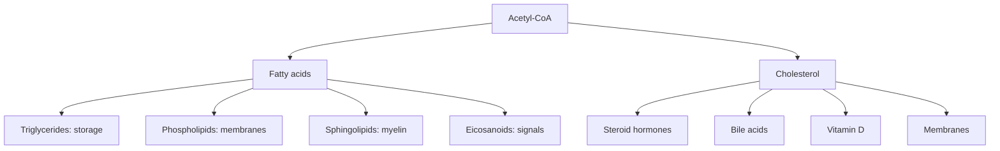

# Lipids overview

## Summary

Lipids are a diverse group of molecules defined by one property: they dissolve poorly in water and well in organic solvents. The main classes in the body are fatty acids, triglycerides (the storage fat), phospholipids (the membrane builders), sterols such as cholesterol, and signaling molecules made from fatty acids. Lipids store most of the body's energy, form every cell membrane, insulate nerves and act as hormones.

## Prerequisites

- [Metabolism](../metabolism.md)

## Core concepts

### Definition

A *lipid* is a biological molecule that is insoluble or poorly soluble in water and soluble in nonpolar solvents. Unlike proteins or carbohydrates, lipids are not defined by a shared building block but by this physical property. Many lipids are *amphipathic*: one end is water-loving (polar) and the other is water-avoiding (nonpolar), which makes them form membranes and droplets in water.

### Analogy

Lipids are like the oil, wax and soap in a household. Oil in the pantry is stored energy (triglycerides). Wax keeps surfaces sealed (the membrane barrier). Soap has one end that likes water and one end that likes grease, so it can carry grease away in water, just as phospholipids and bile salts do. The analogy breaks because some lipids, like steroid hormones and eicosanoids, act as messages, which household oils never do.

### Mechanism

The classes and their roles:

| Class | Structure | Main roles | Example |
| --- | --- | --- | --- |
| Fatty acids | Hydrocarbon chain with a carboxyl group | Fuel, building blocks of other lipids | Palmitic acid, oleic acid |
| Triglycerides (triacylglycerols) | Glycerol + 3 fatty acids | Energy storage, insulation | Fat in adipose tissue, oils |
| Phospholipids | Glycerol + 2 fatty acids + phosphate head | Cell membranes, emulsifiers | Phosphatidylcholine (lecithin) |
| Sphingolipids | Sphingosine + fatty acid + head group | Membranes, myelin, signaling | Sphingomyelin, ceramides |
| Sterols | Four fused rings | Membranes, hormones, bile acids, vitamin D | Cholesterol |
| Eicosanoids | Oxidized 20-carbon fatty acids | Local signals for inflammation, clotting | Prostaglandins, leukotrienes |
| Fat-soluble vitamins | Isoprenoid structures | Vision, bone, antioxidant, clotting | Vitamins A, D, E, K |

Because lipids do not dissolve in water, the body needs special systems to handle them: bile salts emulsify fat in the gut, and lipoproteins carry lipids in the blood (see [Lipoproteins](lipoproteins.md)).

The diagram shows how the classes relate to fatty acids and cholesterol.

### Energy density

Fat provides about 9 kcal (37 kJ) per gram, compared with about 4 kcal per gram for carbohydrate and protein. Fat is also stored nearly without water, while glycogen binds about 3 g of water per gram. A lean 70 kg adult with 15 percent body fat stores about 10 kg of fat, roughly 90,000 kcal, enough energy for over a month of normal life.

## Worked example

Olive oil is almost pure fat, and with a density of about 0.92 g/ml, 100 ml contains about 92 g of fat. One tablespoon (about 14 g of oil) therefore provides about 14 × 9 ≈ 126 kcal. Of this fat, about 73 percent is monounsaturated (mostly oleic acid), 14 percent saturated and 11 percent polyunsaturated, typical values for olive oil.

## Trade offs and when to use it

- "Fat" in nutrition usually means triglycerides. In biochemistry, lipids include many molecules that supply no energy at all.
- Lipids are essential, but some classes (industrial trans fats, LDL-carried cholesterol in excess) are linked to disease. The details are in the specific notes.

## Common mistakes

- **Using "fat" and "lipid" as synonyms.** Cholesterol and phospholipids are lipids but not fats in the dietary sense.
- **Thinking dietary fat goes directly to body fat.** Body fat depends on the total energy balance; excess carbohydrate can also be stored as fat.

## Practice

1. What property defines a lipid?
2. Name three molecules made from cholesterol.
3. Why does the body need lipoproteins?

### Answers

1. Poor solubility in water and good solubility in nonpolar solvents.
2. Steroid hormones, bile acids and vitamin D.
3. Lipids do not dissolve in blood, which is water-based, so they must be packaged with proteins to travel.

## Further reading

- Berg, J. M., Tymoczko, J. L., Stryer, L. (2002). *Biochemistry (5th ed.)*. W. H. Freeman, free on NCBI Bookshelf. [Link](https://www.ncbi.nlm.nih.gov/books/NBK21154/). Chapter 12 on membrane lipids and chapter 22 on fatty acid metabolism.
- Clark, M. A., Douglas, M., Choi, J. (2018). *Biology 2e*. OpenStax, Rice University. [Link](https://openstax.org/details/books/biology-2e). Section 3.3 on lipids.
