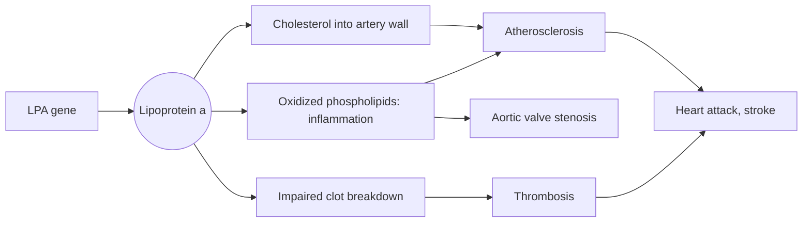

# Lipoprotein(a)

## Summary

Lipoprotein(a), written Lp(a), is an LDL-like particle made in the liver with an extra protein, apolipoprotein(a), attached. Its blood level is set mainly by genes and changes little over life, so measuring it once is enough. High Lp(a) raises the risk of heart attack, stroke and aortic valve stenosis, even when LDL cholesterol is normal. No approved therapy specifically lowers it yet (checked 2026-10; several drugs are in late-stage trials), so a high value is managed by controlling all other risk factors more strictly.

*This note is educational. It is not medical advice and does not replace a doctor, dietitian or pharmacist, especially during pregnancy, illness or when taking medicines.*

## Prerequisites

- [Lipoproteins](lipoproteins.md)

## Core concepts

### Definition

*Lipoprotein(a)* is a lipoprotein particle that consists of an LDL-like particle (with apoB-100) bound to *apolipoprotein(a)*, a protein similar to plasminogen, which takes part in dissolving blood clots. It is *atherogenic*: it promotes atherosclerosis and its complications. It is made in the liver. About 20 percent of people in Europe have levels above 50 mg/dL.

### Analogy

Lp(a) is like an LDL van with a trailer attached. The van alone already risks getting stuck in artery walls. The trailer (apo(a)) carries extra harmful cargo (oxidized phospholipids) and looks like a part of the clot-dissolving machinery, so it can interfere with breaking down clots. The size of the trailer is set by your genes, not by how you drive. The analogy breaks because the trailer size also determines how many particles the liver makes: people with small apo(a) tend to have higher Lp(a).

### Mechanism

1. The *LPA* gene determines apo(a) size and production. More than 90 percent of the variation in Lp(a) levels is genetic.
2. Like LDL, Lp(a) enters the artery wall and deposits cholesterol.
3. It carries most of the oxidized phospholipids in plasma, which drive inflammation in the vessel wall and in the aortic valve.
4. Its similarity to plasminogen may impair the breakdown of clots, which could promote thrombosis.
5. Diet and exercise change Lp(a) very little. Levels may rise somewhat after menopause and in kidney disease.

The diagram shows how Lp(a) adds to cardiovascular risk.

### Consequences of high Lp(a)

Higher levels are associated with:

- coronary heart disease and heart attack
- stroke
- aortic valve stenosis
- peripheral artery disease and reduced blood supply to organs
- blood clots and emboli (association weaker)

High blood pressure was listed in some sources as a consequence. Lp(a) is not an established cause of hypertension, but hypertension adds to the overall risk.

### Reference values

Many laboratories quote about 5 to 29 mg/dL as a usual range, and values above about 50 mg/dL (about 105 to 125 nmol/L) are considered to raise risk meaningfully. The European Atherosclerosis Society consensus (Kronenberg et al., 2022) recommends measuring Lp(a) at least once in every adult, treats levels above 50 mg/dL as risk-enhancing and above 180 mg/dL (about 430 nmol/L) as a risk similar to familial hypercholesterolemia. Results in mg/dL and nmol/L cannot be converted exactly, because particle mass varies with apo(a) size.

### Ways to respond to a high value and their evidence

Each entry states the proposed effect and how strong the human evidence is, using the grades defined in the [Evidence grades](../../../../applied-sciences/medicine-and-health/nutrition/evidence-grades.md) note.

- **Niacin.** Supplementing niacin (vitamin B3) can lower Lp(a), by about 20 to 30 percent at gram doses. But two large trials of niacin in patients on statins (AIM-HIGH 2011, HPS2-THRIVE 2014) found no reduction in cardiovascular events and more side effects, including bleeding, infections and new diabetes. Guidelines do not recommend niacin to lower Lp(a). Evidence: lowers the level; no event benefit and harms.
- **Avoiding oxidized fats.** Lp(a) is described as especially dangerous together with oxidized fats. Reducing them by avoiding fried and highly processed foods, smoking and alcohol is advised. Lp(a) does carry oxidized phospholipids, and avoiding smoking clearly lowers cardiovascular risk, but no trial shows that diet changes Lp(a) itself or its risk. Evidence: general risk reduction plausible; no specific evidence for Lp(a).
- **Reducing low-grade inflammation.** Calming chronic low-grade inflammation with vegetables and with supplements such as resveratrol, glutathione or melatonin has been suggested. Vegetables are part of a heart-healthy diet. There is no evidence that these supplements lower Lp(a) or its risk. Evidence: not supported for the supplements.
- **Managing other risk factors.** With high Lp(a), guidelines recommend lowering LDL cholesterol more intensively, controlling blood pressure, not smoking and treating diabetes. This is the main evidence-based response today. Evidence: strong (guideline consensus).
- **Drugs in development.** Antisense and small interfering RNA drugs (such as pelacarsen and olpasiran) lower Lp(a) by 80 percent or more. Outcome trials were ongoing at the time of writing (checked 2026-10). PCSK9 inhibitors lower Lp(a) by about 20 to 30 percent as a side effect. Evidence: pending.

## Worked example

A 45-year-old has LDL cholesterol of 2.9 mmol/L, which looks acceptable, but Lp(a) of 150 mg/dL. Under the EAS consensus, this level is risk-enhancing and roughly doubles the risk compared with a low level. A doctor would therefore set a lower LDL target than the cholesterol value alone suggests, check blood pressure, and advise testing first-degree relatives, because Lp(a) is inherited. The single Lp(a) test changed the management without any change in the person's lifestyle.

## Trade offs and when to use it

Measuring Lp(a) is cheap and needs to be done only once. The limitation is that no therapy yet specifically lowers it with proven benefit, so the result changes how intensively other risks are treated.

## Common mistakes

- **Re-testing Lp(a) every year to track diet changes.** The level is genetic and stable; one test is enough except in special situations.
- **Taking high-dose niacin to lower Lp(a).** Trials showed no benefit and harm.
- **Concluding that normal LDL means low risk.** High Lp(a) adds risk independently.

## Practice

1. What protein makes Lp(a) different from LDL?
2. How often should Lp(a) be measured?
3. Why was niacin abandoned for Lp(a) lowering?

### Answers

1. Apolipoprotein(a).
2. At least once in adulthood, because it is genetically determined.
3. Trials found no fewer cardiovascular events and more side effects.

## Further reading

- Kronenberg, F., Mora, S., Stroes, E. S. G. et al. (2022). Lipoprotein(a) in atherosclerotic cardiovascular disease and aortic stenosis: a European Atherosclerosis Society consensus statement. European Heart Journal, 43(39), 3925-3946. [DOI](https://doi.org/10.1093/eurheartj/ehac361). European Atherosclerosis Society consensus on lipoprotein(a), including thresholds and the recommendation to measure once.
- AIM-HIGH Investigators (2011). Niacin in patients with low HDL cholesterol levels receiving intensive statin therapy. New England Journal of Medicine, 365(24), 2255-2267. [DOI](https://doi.org/10.1056/NEJMoa1107579). Niacin trial without event reduction.
- HPS2-THRIVE Collaborative Group (2014). Effects of extended-release niacin with laropiprant in high-risk patients. New England Journal of Medicine, 371(3), 203-212. [DOI](https://doi.org/10.1056/NEJMoa1300955). Large niacin trial with no benefit and more adverse events.
- Mach, F., Baigent, C., Catapano, A. L. et al. (2020). 2019 ESC/EAS Guidelines for the management of dyslipidaemias: lipid modification to reduce cardiovascular risk. European Heart Journal, 41(1), 111-188. [DOI](https://doi.org/10.1093/eurheartj/ehz455). ESC/EAS guideline on dyslipidemia.
