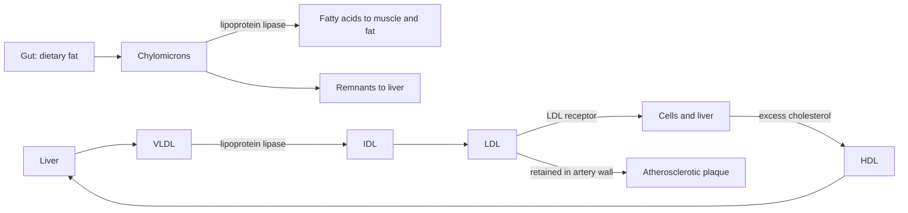

# Lipoproteins

## Summary

Lipoproteins are particles that carry fats and cholesterol through the blood. Each has a core of triglycerides and cholesterol esters and a shell of phospholipids, free cholesterol and proteins called apolipoproteins. Chylomicrons carry dietary fat from the gut, VLDL carries fat made in the liver, LDL delivers cholesterol to tissues, and HDL brings excess cholesterol back to the liver. LDL and other particles containing apolipoprotein B cause atherosclerosis when they are abundant for years. Blood tests of LDL cholesterol, non-HDL cholesterol, apolipoprotein B and lipoprotein(a) are used to estimate cardiovascular risk.

## Prerequisites

- [Cholesterol](cholesterol.md)

## Core concepts

### Definition

A *lipoprotein* is a spherical particle of lipids and proteins that makes fat transport in water-based blood possible. Lipoproteins are classified by density, which rises as the share of protein rises and the share of fat falls: chylomicrons, very low-density (VLDL), intermediate-density (IDL), low-density (LDL) and high-density (HDL) lipoproteins. *Apolipoproteins* in the shell give each class its identity and its "address": apoB-48 marks chylomicrons, apoB-100 marks VLDL, IDL and LDL, and apoA-I marks HDL.

### Analogy

Lipoproteins are like delivery trucks on a highway. Chylomicrons are big trucks from the port (gut) carrying imported goods (dietary fat). VLDL trucks leave the factory (liver) full of fat, unload it at fat and muscle cells, and become smaller LDL vans that mostly carry cholesterol. HDL trucks are the return service that collects surplus cholesterol. Problems start when too many LDL vans crowd the roads: some get stuck in the walls of the arteries and break down there. The analogy breaks because trucks do not change size as they unload, while lipoproteins shrink and change class.

### Mechanism

1. **Exogenous pathway.** After a meal, gut cells pack dietary fat into chylomicrons, which enter the lymph and then the blood. Lipoprotein lipase on capillary walls of muscle and fat tissue releases fatty acids from them. The remnants go to the liver.
2. **Endogenous pathway.** The liver packs triglycerides and cholesterol into VLDL. Lipoprotein lipase strips triglycerides, turning VLDL into IDL and then LDL, which is rich in cholesterol. Cells and the liver take up LDL through LDL receptors.
3. **Reverse cholesterol transport.** HDL collects cholesterol from cells and returns it to the liver directly or by transfer to other particles.
4. **Atherosclerosis.** ApoB-containing particles small enough to enter the artery wall (LDL, remnants, lipoprotein(a)) are retained there. Their lipids oxidize (oxidized LDL), macrophages take them up and become foam cells, and a plaque grows over years. The number of apoB particles and the duration of exposure drive the risk.

The diagram shows the three pathways.

### The particles compared

| Particle | Main cargo | Main apolipoprotein | Atherogenic |
| --- | --- | --- | --- |
| Chylomicrons | Dietary triglycerides | ApoB-48 | Remnants are |
| VLDL | Liver triglycerides | ApoB-100 | Yes (remnants) |
| LDL | Cholesterol | ApoB-100 | Yes, the main one |
| Lipoprotein(a) | Cholesterol, oxidized phospholipids | ApoB-100 + apo(a) | Yes, per particle more than LDL |
| HDL | Cholesterol returned to the liver | ApoA-I | No; low HDL is a risk marker |

Lipoprotein(a) has its own note: [Lipoprotein(a)](lipoprotein-a.md).

### Markers used to assess cardiovascular risk

- **LDL cholesterol:** the standard target of treatment.
- **Non-HDL cholesterol:** total minus HDL cholesterol; includes all atherogenic particles and needs no fasting.
- **Apolipoprotein B:** counts the atherogenic particles directly.
- **Lipoprotein(a):** genetically set, measured once in life.
- **Triglycerides:** a marker of remnant particles.
- **Oxidized LDL (oxLDL):** a research marker of LDL oxidation; not part of standard risk assessment.
- **Homocysteine:** associated with cardiovascular risk, but lowering it with B vitamins did not lower events, so it is not a routine target (see [Methionine](../amino-acids/methionine.md)).

Heart attacks also occur in people with normal cholesterol, because blood pressure, smoking, diabetes, inflammation, lipoprotein(a) and genetics all contribute.

## Worked example

Two people both have LDL cholesterol of 3.4 mmol/L. Person A has apoB of 0.9 g/L and person B has apoB of 1.3 g/L. Person B's LDL particles are smaller and more numerous, each carrying less cholesterol. Because risk follows the number of particles that can enter the artery wall, person B has the higher risk despite identical LDL cholesterol. This situation, called discordance, is common in people with high triglycerides, obesity or diabetes, which is why guidelines suggest measuring apoB in them.

## Trade offs and when to use it

- LDL cholesterol is cheap and well validated. ApoB is more precise for risk but less widely used.
- Raising HDL with drugs (niacin, CETP inhibitors) did not reduce events, so a low HDL is treated as a marker, not a target.

## Common mistakes

- **"Good" and "bad" cholesterol.** The cholesterol molecule is the same; the particles differ.
- **Trying to raise HDL to cancel high LDL.** Lowering LDL is what reduces risk in trials.
- **Ignoring triglycerides.** High triglycerides indicate remnant particles, which are also atherogenic.

## Practice

1. Which apolipoprotein marks LDL?
2. What does non-HDL cholesterol include?
3. Why is apoB sometimes a better risk marker than LDL cholesterol?

### Answers

1. ApoB-100.
2. The cholesterol in all apoB-containing particles: VLDL, IDL, LDL, remnants and lipoprotein(a).
3. It counts particles, and risk follows the number of particles that can enter the artery wall.

## Further reading

- Mach, F., Baigent, C., Catapano, A. L. et al. (2020). 2019 ESC/EAS Guidelines for the management of dyslipidaemias: lipid modification to reduce cardiovascular risk. European Heart Journal, 41(1), 111-188. [DOI](https://doi.org/10.1093/eurheartj/ehz455). ESC/EAS guideline on lipid markers and targets.
- Berg, J. M., Tymoczko, J. L., Stryer, L. (2002). *Biochemistry (5th ed.)*. W. H. Freeman, free on NCBI Bookshelf. [Link](https://www.ncbi.nlm.nih.gov/books/NBK21154/). Lipoprotein metabolism.
- AIM-HIGH Investigators (2011). Niacin in patients with low HDL cholesterol levels receiving intensive statin therapy. New England Journal of Medicine, 365(24), 2255-2267. [DOI](https://doi.org/10.1056/NEJMoa1107579). Trial showing that raising HDL with niacin did not reduce events.
