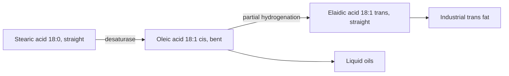

# Oleic acid

## Summary

Oleic acid (18:1 n-9) is the most common monounsaturated fatty acid in food and in the human body. It makes up most of the fat in olive oil and a large share in avocados, nuts, rapeseed oil and lard. Its single cis double bond keeps fats liquid. It is the main member of the omega-9 family, and its health effects are described there.

## Prerequisites

- [Omega-9 fatty acids](omega-9-fatty-acids.md)

## Core concepts

### Definition

*Oleic acid* is an 18-carbon fatty acid with one cis double bond between carbons 9 and 10 (counting from either end). Its name comes from Latin *oleum*, oil. Humans make it from stearic acid with the enzyme stearoyl-CoA desaturase.

### Analogy

Oleic acid is like a hinge in a door: one bend at the middle lets the chain fold, so fats rich in it stay liquid and flexible. The analogy breaks because the bend is fixed, not movable like a hinge.

### Mechanism

- In membranes, oleic acid increases fluidity.
- In fat tissue, it is the most common fatty acid of stored triglycerides.
- In the diet, it replaces saturated fat and lowers LDL cholesterol (see [Omega-9 fatty acids](omega-9-fatty-acids.md)).
- *Elaidic acid* is its trans isomer, the main industrial trans fat.

The diagram compares oleic acid with its saturated and trans relatives.

## Worked example

Oleic acid melts at about 13 to 14 °C, stearic acid at about 69 °C and elaidic acid at about 45 °C. This is why olive oil is liquid at room temperature but turns cloudy in the fridge, while fats rich in stearic or elaidic acid are solid.

## Trade offs and when to use it

Oleic acid is safe and widely used. High-oleic oils were bred to replace partially hydrogenated oils in frying because they are stable without trans fat.

## Common mistakes

- **Confusing oleic acid with linoleic acid.** Oleic acid has one double bond (omega-9); linoleic acid has two (omega-6).

## Practice

1. What is the trans isomer of oleic acid called?
2. Why does olive oil turn cloudy in the fridge?

### Answers

1. Elaidic acid.
2. Oleic acid and other fats start to crystallize near 13 °C and below.

## Further reading

- Berg, J. M., Tymoczko, J. L., Stryer, L. (2002). *Biochemistry (5th ed.)*. W. H. Freeman, free on NCBI Bookshelf. [Link](https://www.ncbi.nlm.nih.gov/books/NBK21154/). Structure of fatty acids and desaturation.
