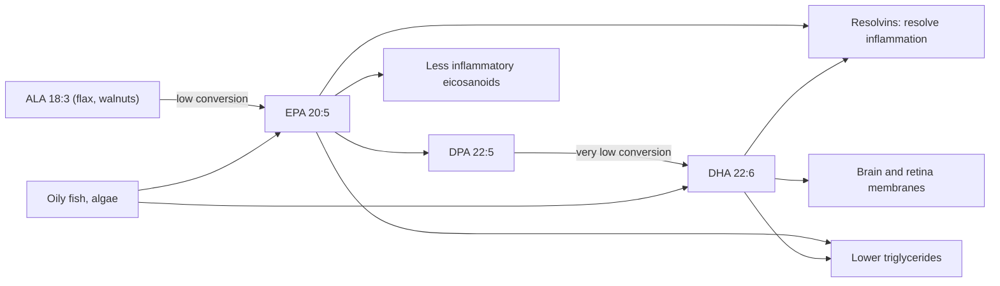

# Omega-3 fatty acids

## Summary

Omega-3 fatty acids are polyunsaturated fatty acids with the first double bond three carbons from the methyl end. The body cannot make the parent omega-3, alpha-linolenic acid (ALA), and converts only a few percent of it into the long-chain forms EPA and DHA, so these come mainly from oily fish or algae. Omega-3 fatty acids build membranes (DHA is concentrated in the brain and retina), lower triglycerides and give rise to less inflammatory signals. Evidence is strong for lowering triglycerides and for DHA in infant development; results for preventing heart disease with supplements are mixed.

*This note is educational. It is not medical advice and does not replace a doctor, dietitian or pharmacist, especially during pregnancy, illness or when taking medicines.*

## Prerequisites

- [Fatty acids](fatty-acids.md)

## Core concepts

### Definition

The *omega-3 family* (n-3) includes [Alpha-linolenic acid](alpha-linolenic-acid.md) (ALA, 18:3 n-3), stearidonic acid, [Eicosapentaenoic acid (EPA)](epa.md) (eicosapentaenoic acid, 20:5 n-3), docosapentaenoic acid (DPA, 22:5 n-3) and [Docosahexaenoic acid (DHA)](dha.md) (docosahexaenoic acid, 22:6 n-3). ALA is essential. Food sources: oily fish such as salmon, mackerel, herring and sardines (EPA and DHA), algae (DHA and some EPA), flaxseed, chia, walnuts and rapeseed oil (ALA). Supplements contain fish oil, krill oil or algal oil.

### Analogy

The omega-3 and omega-6 families are like two teams sharing one set of tools (desaturase and elongase enzymes) and the same workbenches (COX and LOX enzymes). Omega-6 products tend to be louder alarms; omega-3 products make quieter alarms and also produce the "all clear" signals (resolvins). More omega-3 on the bench means more quiet signals. The analogy breaks because the teams are not opponents: both are needed, and the body controls the tools tightly.

### Mechanism

1. ALA is converted to EPA and then DHA through the same enzymes as omega-6 (delta-6 desaturase, elongase, delta-5 desaturase). Conversion is low: estimates are roughly 5 to 10 percent to EPA and under 1 to 5 percent to DHA, higher in women of reproductive age.
2. EPA and DHA are built into membrane phospholipids. DHA makes up a large share of the polyunsaturated fat in the brain gray matter and in the photoreceptors of the retina.
3. EPA competes with arachidonic acid and forms eicosanoids with weaker inflammatory and clotting effects.
4. EPA and DHA form *specialized pro-resolving mediators* (resolvins, protectins, maresins) that help end inflammation.
5. In the liver, EPA and DHA reduce the production of VLDL, which lowers blood triglycerides by about 20 to 30 percent at 2 to 4 g per day.

The diagram shows the omega-3 pathway and its effects.

### Intake recommendations

| Body | Recommendation |
| --- | --- |
| EFSA (2010) | 250 mg EPA + DHA per day for adults; plus 100 to 200 mg DHA in pregnancy and lactation; ALA 0.5 percent of energy |
| US Institute of Medicine (2005) | ALA adequate intake 1.6 g (men) and 1.1 g (women) per day |
| Many heart associations | One to two servings of oily fish per week |

A 100 g portion of farmed salmon supplies about 1.5 to 2.5 g of EPA + DHA, mackerel 1.5 to 2.5 g, canned tuna only about 0.2 to 0.3 g.

### Proposed effects and evidence

Each entry states the proposed effect and how strong the human evidence is, using the grades defined in the [Evidence grades](../../../../applied-sciences/medicine-and-health/nutrition/evidence-grades.md) note.

- **Heart health.** Omega-3 fatty acids may reduce cardiovascular risk by lowering triglycerides, regulating blood pressure, reducing inflammation and improving vessel function. EPA and DHA may affect heart rhythm and reduce the risk of arrhythmia. Large trials give mixed results: VITAL (Manson et al., 2019) with 1 g per day found no reduction in major cardiovascular events overall, while REDUCE-IT (Bhatt et al., 2019) with 4 g per day of purified EPA (icosapent ethyl) found about 25 percent fewer events in high-risk patients with high triglycerides. High doses slightly increase the risk of atrial fibrillation, the opposite of the antiarrhythmic claim. Evidence: moderate, depends on dose and population.
- **Anti-inflammatory action.** Omega-3 fatty acids, especially EPA, have anti-inflammatory properties and help reduce inflammation linked to chronic diseases such as heart disease, type 2 diabetes, rheumatoid arthritis and other autoimmune diseases. In rheumatoid arthritis, doses of about 3 g or more reduce joint tenderness and the need for painkillers in trials. Evidence: moderate for rheumatoid arthritis.
- **Brain and cognition.** DHA is important for the brain and eyes. It supports brain development in infants and helps maintain cognitive function in older age. It may help protect against neurodegenerative diseases such as Alzheimer disease. Trials of supplements in older adults without deficiency have generally not shown slower cognitive decline. Evidence: strong for infant development, not supported for preventing decline.
- **Mood and mental health.** Omega-3 fatty acids may help improve mood and reduce symptoms of depression and anxiety. DHA and EPA supplements are studied as support in depression, especially in people with low intake. Meta-analyses suggest a small benefit of EPA-rich preparations (at least 60 percent EPA) as an add-on in major depression. Evidence: limited to moderate.
- **Skin health.** Omega-3 fatty acids may improve skin condition, hydration and elasticity and reduce inflammatory skin conditions such as acne, atopic dermatitis and psoriasis. They may help protect skin from ultraviolet damage. Trials are small. Evidence: limited.
- **Eye health.** DHA is important for the retina. Supplements may help reduce the risk of age-related macular degeneration and dry eyes. The AREDS2 trial found no added benefit of omega-3 for macular degeneration, and a large dry eye trial (DREAM, 2018) found no benefit over olive oil placebo. Evidence: not supported for supplements.
- **Pregnancy and child development.** Omega-3, especially DHA, is important for the development of the fetal brain and nervous system. Supplementation in pregnancy may support cognitive development and reduce the risk of preterm birth. A Cochrane review (Middleton et al., 2018) found fewer preterm births before 37 and 34 weeks. Evidence: moderate for preterm birth.
- **Bones and joints.** Omega-3 fatty acids may support bone health by increasing calcium absorption and improving bone mineral density, and may ease arthritis symptoms such as pain and stiffness. Evidence: limited.
- **Immune system.** Omega-3 fatty acids may support a normal immune response, reducing excessive inflammatory reactions while helping protect against infection. Evidence: limited.
- **Cholesterol and triglycerides.** Omega-3 fatty acids may help raise "good" HDL cholesterol and lower triglycerides, which supports heart health. Lowering triglycerides is well established; effects on HDL are small, and DHA can slightly raise LDL. Evidence: strong for triglycerides.

## Worked example

A capsule labeled "1,000 mg fish oil" usually contains about 180 mg EPA and 120 mg DHA, 300 mg of omega-3 in total. To reach the EFSA intake of 250 mg EPA + DHA a day, one capsule is enough. To reach the 4 g per day of EPA used in REDUCE-IT, a person would need over 20 such capsules, which is why that trial used a prescription concentrate. Two portions of salmon a week (2 × 2 g) give about 570 mg a day on average, more than double the EFSA value.

## Trade offs and when to use it

- **Safety.** Fish oil up to about 3 g EPA + DHA a day is considered safe by the US FDA and up to 5 g by EFSA. Side effects include fishy burps and gut upset. High doses may increase bleeding time slightly and the risk of atrial fibrillation.
- **Quality.** Fish oil oxidizes; a rancid smell indicates oxidation. Reputable products are tested for mercury and PCBs, which are removed during refining.
- **Vegetarians** can use algal oil, which provides DHA and some EPA.

## Common mistakes

- **Counting ALA from flax as equal to fish omega-3.** Conversion to EPA and especially DHA is low.
- **Expecting fish oil capsules to prevent heart attacks in everyone.** Large trials show mixed results; the clearest benefit is lowering triglycerides.
- **Reading "1,000 mg fish oil" as 1,000 mg omega-3.** Check the EPA and DHA content.

## Practice

1. Name the three main omega-3 fatty acids and their sources.
2. By roughly how much do 2 to 4 g of EPA + DHA lower triglycerides?
3. Why can vegetarians use algal oil?

### Answers

1. ALA (flax, walnuts, rapeseed oil), EPA and DHA (oily fish, algae).
2. About 20 to 30 percent.
3. Fish get EPA and DHA from algae, so algal oil supplies them directly.

## Further reading

- NIH Office of Dietary Supplements. Omega-3 Fatty Acids: Fact Sheet for Health Professionals. [Link](https://ods.od.nih.gov/factsheets/Omega3FattyAcids-HealthProfessional/). Fact sheet with intakes, food sources and a summary of trials.
- Manson, J. E., Cook, N. R., Lee, I. M. et al. (2019). Marine n-3 fatty acids and prevention of cardiovascular disease and cancer. New England Journal of Medicine, 380(1), 23-32. [DOI](https://doi.org/10.1056/NEJMoa1811403). VITAL trial of 1 g per day omega-3.
- Bhatt, D. L., Steg, P. G., Miller, M. et al. (2019). Cardiovascular risk reduction with icosapent ethyl for hypertriglyceridemia. New England Journal of Medicine, 380(1), 11-22. [DOI](https://doi.org/10.1056/NEJMoa1812792). REDUCE-IT trial of 4 g per day icosapent ethyl.
- Middleton, P., Gomersall, J. C., Gould, J. F. et al. (2018). Omega-3 fatty acid addition during pregnancy. Cochrane Database of Systematic Reviews, CD003402. [DOI](https://doi.org/10.1002/14651858.CD003402.pub3). Cochrane review of omega-3 in pregnancy.
- EFSA Panel on Dietetic Products, Nutrition, and Allergies (2010). Scientific Opinion on Dietary Reference Values for fats, including saturated fatty acids, polyunsaturated fatty acids, monounsaturated fatty acids, trans fatty acids, and cholesterol. EFSA Journal, 8(3), 1461. [DOI](https://doi.org/10.2903/j.efsa.2010.1461). European reference intake of 250 mg EPA + DHA.
