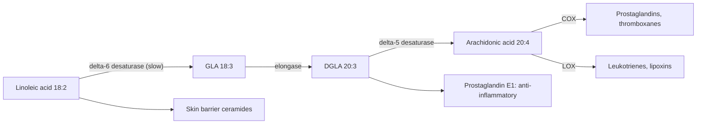

# Omega-6 fatty acids

## Summary

Omega-6 fatty acids are polyunsaturated fatty acids whose first double bond sits six carbons from the methyl end. Like omega-3, they are essential: the body cannot make the parent fatty acid, linoleic acid (LA), so it must come from food. LA is converted into gamma-linolenic acid (GLA) and arachidonic acid (AA). They build membranes and are precursors of eicosanoids involved in inflammation, immunity and blood clotting. The popular idea that omega-6 fats are "inflammatory" is not supported for normal dietary LA intake, which is associated with lower heart risk.

*This note is educational. It is not medical advice and does not replace a doctor, dietitian or pharmacist, especially during pregnancy, illness or when taking medicines.*

## Prerequisites

- [Fatty acids](fatty-acids.md)

## Core concepts

### Definition

The *omega-6 family* (n-6) includes [Linoleic acid](linoleic-acid.md) (LA, 18:2 n-6), [Gamma-linolenic acid](gamma-linolenic-acid.md) (GLA, 18:3 n-6), dihomo-gamma-linolenic acid (DGLA, 20:3 n-6) and [Arachidonic acid](arachidonic-acid.md) (AA, 20:4 n-6). They occur mainly in vegetable oils such as sunflower, corn and soybean oil, and in nuts and seeds. AA is found in meat, eggs and fish.

### Analogy

The omega-6 pathway is like a fire brigade with both a siren and a hose. The products of arachidonic acid sound the alarm and bring blood and immune cells to an injury (inflammation, clotting), which is necessary for healing. Other products, from DGLA and from AA itself, help switch the alarm off. A system with only alarms would be dangerous; one with no alarms could not respond to injury. The analogy breaks because dietary LA does not simply "fill the siren": the conversion of LA to AA is tightly regulated, so eating more LA barely changes tissue AA.

### Mechanism

1. Delta-6 desaturase converts LA to GLA. This is the slow, controlled step, shared with the omega-3 pathway.
2. Elongase converts GLA to DGLA, and delta-5 desaturase converts DGLA to AA.
3. AA is stored in membrane phospholipids. When a cell is activated, phospholipase A2 releases it, and cyclooxygenase (COX) and lipoxygenase (LOX) enzymes turn it into [Eicosanoids](eicosanoids.md): prostaglandins, thromboxanes and leukotrienes. Some promote inflammation and clotting; others, such as lipoxins, help resolve inflammation.
4. DGLA produces prostaglandin E1, which is anti-inflammatory and widens vessels. This is the basis of interest in GLA supplements.
5. LA itself is part of the skin's ceramides, which form the water barrier. Deficiency causes scaly skin.

The diagram shows the omega-6 pathway and its products.

### Intake

EFSA set an adequate intake for LA of 4 percent of energy (about 9 g a day on 2,000 kcal). Typical Western diets provide 5 to 8 percent. The ratio of omega-6 to omega-3 rose sharply in the 20th century with the spread of seed oils, often quoted as 10 to 20 to 1. Current evidence suggests that the absolute intake of EPA and DHA matters more than the ratio.

### Proposed effects and evidence

Each entry states the proposed effect and how strong the human evidence is, using the grades defined in the [Evidence grades](../../../../applied-sciences/medicine-and-health/nutrition/evidence-grades.md) note.

- **Cell membranes.** Omega-6 fatty acids are an essential component of cell membranes, supporting their structure, flexibility and permeability, which matters for normal cell function. Evidence: established physiology.
- **Regulation of inflammation.** Arachidonic acid is a precursor of eicosanoids, compounds that regulate inflammation. Omega-6 fatty acids can promote inflammation, which matters for wound healing and protection against infection, but an excess in the diet is often said to lead to chronic inflammation. Controlled feeding trials found that raising dietary LA does not raise inflammatory markers in healthy people. Evidence: established physiology; "excess LA causes inflammation" not supported.
- **Immune system.** Through prostaglandins and leukotrienes, omega-6 fatty acids play a role in the immune response, supporting the fight against infection and repair processes. Evidence: established physiology.
- **Skin health.** GLA, a form of omega-6, may improve skin hydration and elasticity and reduce inflammatory skin symptoms such as eczema and atopic dermatitis. A Cochrane review (Bamford et al., 2013) found that evening primrose and borage oil did not improve eczema. Evidence: not supported for eczema.
- **Blood clotting.** Omega-6 fatty acids play an important role in blood clotting through thromboxanes from arachidonic acid, which helps prevent excessive bleeding and supports wound healing. Evidence: established physiology.
- **Cardiovascular health.** In the right proportions, omega-6 fatty acids may support heart health by helping regulate cholesterol and blood pressure. Some sources say an excess relative to omega-3 raises cardiovascular risk through inflammation. Meta-analyses of cohort studies associate higher LA intake and blood levels with lower cardiovascular risk, and LA lowers LDL cholesterol when it replaces saturated fat. Evidence: moderate for benefit of LA replacing saturated fat.
- **Mental health.** Studies suggest that adequate omega-6 intake, especially GLA, may support mental health, improving mood and easing depression and anxiety. Evidence is weak. Evidence: very limited.
- **Arthritis.** Omega-6 fatty acids, especially GLA, may ease arthritis symptoms such as pain and stiffness thanks to anti-inflammatory properties. Small trials of GLA in rheumatoid arthritis reported some benefit. Evidence: limited.
- **Hair health.** Omega-6 fatty acids may support hair, preventing hair loss and improving its condition through effects on the structure and hydration of the scalp. Severe LA deficiency causes hair loss; benefit of extra intake is not shown. Evidence: very limited.

## Worked example

A person eats 2,000 kcal a day. One tablespoon (14 g) of sunflower oil contains about 9 g of LA, about 81 kcal or 4 percent of energy, which on its own meets the EFSA adequate intake. A handful of walnuts (30 g) adds about 11 g of LA and 2.7 g of ALA. Most people in Europe reach the LA target without trying, while EPA and DHA from fish are often too low.

## Trade offs and when to use it

Omega-6 oils lower LDL cholesterol when they replace saturated fat. They are less stable when heated than monounsaturated oils. The concern about omega-6 and inflammation is popular but not well supported by trials.

## Common mistakes

- **Avoiding all seed oils because of "inflammation".** Trials do not show that dietary LA raises inflammation, and LA is linked to lower heart risk.
- **Focusing only on the omega-6 to omega-3 ratio.** Raising EPA and DHA intake is the more useful target.

## Practice

1. Which omega-6 fatty acid is essential?
2. Which enzyme step is slow and shared with the omega-3 pathway?
3. Which prostaglandin from DGLA is anti-inflammatory?

### Answers

1. Linoleic acid.
2. Delta-6 desaturase.
3. Prostaglandin E1.

## Further reading

- EFSA Panel on Dietetic Products, Nutrition, and Allergies (2010). Scientific Opinion on Dietary Reference Values for fats, including saturated fatty acids, polyunsaturated fatty acids, monounsaturated fatty acids, trans fatty acids, and cholesterol. EFSA Journal, 8(3), 1461. [DOI](https://doi.org/10.2903/j.efsa.2010.1461). Adequate intake for linoleic acid.
- Bamford, J. T., Ray, S., Musekiwa, A. et al. (2013). Oral evening primrose oil and borage oil for eczema. Cochrane Database of Systematic Reviews, CD004416. [DOI](https://doi.org/10.1002/14651858.CD004416.pub2). Cochrane review of GLA oils for eczema.
- Berg, J. M., Tymoczko, J. L., Stryer, L. (2002). *Biochemistry (5th ed.)*. W. H. Freeman, free on NCBI Bookshelf. [Link](https://www.ncbi.nlm.nih.gov/books/NBK21154/). Eicosanoid synthesis from arachidonic acid.
