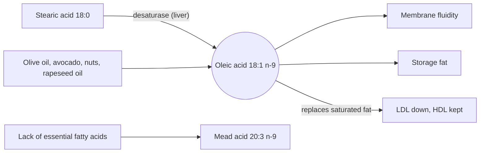

# Omega-9 fatty acids

## Summary

Omega-9 fatty acids are monounsaturated fatty acids whose double bond sits nine carbons from the methyl end. Unlike omega-3 and omega-6, they are not essential, because the body can make them. The best known is oleic acid, abundant in olive oil, avocados, nuts and seeds. Replacing saturated fat with them lowers LDL cholesterol, and olive oil-rich diets are linked to lower cardiovascular risk.

*This note is educational. It is not medical advice and does not replace a doctor, dietitian or pharmacist, especially during pregnancy, illness or when taking medicines.*

## Prerequisites

- [Fatty acids](fatty-acids.md)

## Core concepts

### Definition

*Omega-9 fatty acids* are monounsaturated fatty acids (or in rare cases polyunsaturated) with the first double bond at the ninth carbon from the methyl end. The main member is [Oleic acid](oleic-acid.md) (18:1 n-9). Others include erucic acid (22:1 n-9) in some rapeseed varieties and mustard oil, and mead acid (20:3 n-9), which the body makes when essential fatty acids are lacking. Enzymes in the liver make oleic acid from stearic acid (stearoyl-CoA desaturase).

### Analogy

Omega-9 fatty acids are like the house brand of fats: the body can make its own, so they are not essential, but buying them in (from olive oil) still pays off when they replace less healthy fats. The analogy breaks because, unlike most house brands, these are of high quality, and the main benefit comes from what they replace.

### Mechanism

- Oleic acid is the most common monounsaturated fatty acid in the body and in adipose tissue.
- When it replaces saturated fat, LDL cholesterol falls and HDL is maintained.
- Oleic acid contributes to membrane fluidity and can be converted to oleoylethanolamide, a satiety signal studied in animals.
- Olive oil also contains polyphenols (such as hydroxytyrosol and oleocanthal) that may contribute to its effects, so not every benefit of olive oil is due to omega-9.

The diagram shows where omega-9 fatty acids come from and what they do.

### Proposed effects and evidence

Each entry states the proposed effect and how strong the human evidence is, using the grades defined in the [Evidence grades](../../../../applied-sciences/medicine-and-health/nutrition/evidence-grades.md) note.

- **Heart health.** Oleic acid, the main omega-9 fatty acid, may help reduce cardiovascular risk. It helps lower "bad" LDL cholesterol and maintain or raise "good" HDL cholesterol, which may reduce the risk of atherosclerosis and heart attack. The PREDIMED trial (Estruch et al., 2018) found about 30 percent fewer major cardiovascular events with a Mediterranean diet supplemented with extra virgin olive oil or nuts compared with a low-fat control diet. Evidence: moderate (for olive oil-rich diets).
- **Anti-inflammatory action.** Omega-9 fatty acids may reduce inflammation, which matters for preventing chronic diseases such as heart disease, type 2 diabetes and some cancers. Part of this effect in olive oil is attributed to its polyphenols. Evidence: limited.
- **Metabolic health.** Omega-9 fatty acids may support metabolic health by helping regulate insulin and blood glucose. Studies suggest benefit for people with insulin resistance and type 2 diabetes, when they replace saturated fat or refined carbohydrate. Evidence: limited to moderate.
- **Brain function.** Omega-9 fatty acids may support memory and cognition. Their neuroprotective action is studied for preventing Alzheimer disease. Evidence comes mainly from observational studies of Mediterranean diets. Evidence: limited.
- **Healthy weight.** A diet rich in monounsaturated fats may help maintain a healthy weight by increasing satiety and supporting fat metabolism. Trials show no clear weight advantage when energy intake is equal. Evidence: limited.
- **Skin health.** Omega-9 fatty acids, especially oleic acid, may improve skin condition, hydration and elasticity, and may soothe inflammatory skin conditions such as eczema. Applied to skin, oleic acid can also increase penetration and may disturb the skin barrier in eczema. Evidence: very limited.
- **Immune system.** Omega-9 fatty acids may help balance inflammatory reactions and protection against infection. Evidence: very limited.
- **Blood pressure.** Oleic acid may help regulate blood pressure by supporting vessel health and elasticity. Small trials of olive oil show modest reductions. Evidence: limited.

## Worked example

Extra virgin olive oil is about 55 to 83 percent oleic acid, avocados about 70 percent of their fat, rapeseed oil about 60 percent, and "high oleic" sunflower oil over 80 percent. Two tablespoons of olive oil (28 g) supply about 20 g of oleic acid. The PREDIMED group used about 50 ml (4 tablespoons) of extra virgin olive oil per day.

## Trade offs and when to use it

Omega-9 fats are stable for cooking (more than polyunsaturated oils) and safe. They supply about 9 kcal per gram like any fat. Supplements of "omega-9" have no advantage over olive oil or nuts.

## Common mistakes

- **Buying omega-3-6-9 capsules for the omega-9 part.** The body makes oleic acid, and food supplies plenty.
- **Crediting all olive oil benefits to oleic acid.** Polyphenols and the replaced foods also matter.

## Practice

1. Why are omega-9 fatty acids not essential?
2. Which large trial supports olive oil-rich diets for heart health?

### Answers

1. The body can make oleic acid from stearic acid.
2. PREDIMED.

## Further reading

- Estruch, R., Ros, E., Salas-Salvadó, J. et al. (2018). Primary prevention of cardiovascular disease with a Mediterranean diet supplemented with extra-virgin olive oil or nuts. New England Journal of Medicine, 378(25), e34. [DOI](https://doi.org/10.1056/NEJMoa1800389). PREDIMED trial of a Mediterranean diet with olive oil or nuts.
- EFSA Panel on Dietetic Products, Nutrition, and Allergies (2010). Scientific Opinion on Dietary Reference Values for fats, including saturated fatty acids, polyunsaturated fatty acids, monounsaturated fatty acids, trans fatty acids, and cholesterol. EFSA Journal, 8(3), 1461. [DOI](https://doi.org/10.2903/j.efsa.2010.1461). Reference values for fats.
