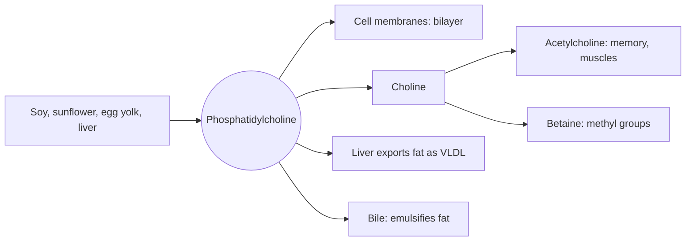

# Phospholipids and lecithin

## Summary

Phospholipids are the lipids that form cell membranes. Each has a water-loving head with a phosphate group and two water-avoiding fatty acid tails, so in water they arrange themselves into bilayers. Lecithin is a commercial mixture of phospholipids, mainly phosphatidylcholine, extracted from soy, sunflower or egg yolk. It is used as a food emulsifier (E322) and as a supplement, mainly as a source of choline. Its claimed effects on memory, cholesterol and liver health rest on limited evidence.

*This note is educational. It is not medical advice and does not replace a doctor, dietitian or pharmacist, especially during pregnancy, illness or when taking medicines.*

## Prerequisites

- [Fatty acids](fatty-acids.md)

## Core concepts

### Definition

A *phospholipid* is a lipid made of glycerol (or sphingosine) bound to two fatty acids and a phosphate group, which carries a head group such as choline, ethanolamine, serine or inositol. *Phosphatidylcholine* (PC) is the most common phospholipid in human membranes. *Lecithin* originally meant phosphatidylcholine (from Greek *lekithos*, egg yolk), but commercial lecithin is a mixture of phospholipids, typically containing 20 to 90 percent PC depending on purification. Food sources: soybeans, rapeseed, sunflower seeds, whole grains, egg yolks and liver. Lecithin is also sold as a supplement.

### Analogy

Phospholipids are like people in a crowd at the beach who want to keep their feet dry but their faces in the sea breeze. The only stable arrangement is two rows standing back to back, feet facing each other in the middle (the fatty acid tails) and faces looking out (the heads in water). This is the lipid bilayer of every cell membrane. The analogy breaks because real phospholipids move constantly within their row, making the membrane fluid.

### Mechanism

- **Membranes.** Phospholipids form the bilayer, with proteins and cholesterol embedded. The fatty acids in them set membrane fluidity.
- **Choline supply.** Phosphatidylcholine releases choline, which the body uses for acetylcholine (a neurotransmitter of memory and muscle control), for methyl groups (via betaine) and for new phospholipids. Lecithin is about 13 percent choline by weight when it is pure phosphatidylcholine, less in commercial mixtures.
- **Emulsification.** Phospholipids in bile help emulsify dietary fat, and lecithin in food keeps oil and water mixed.
- **Lipoproteins and liver export.** The liver needs phosphatidylcholine to package fat into VLDL. Choline deficiency causes fatty liver for this reason.
- **Signaling.** Phosphatidylinositol and other phospholipids release second messengers inside cells.

The diagram shows the structure and roles.

### Sources of lecithin

- **Plant:** soybeans, rapeseed, sunflower seeds, whole grains.
- **Animal:** egg yolks, liver.

Soy lecithin is the most common industrial source; sunflower lecithin is used in products labeled soy-free.

### Proposed effects and evidence

Each entry states the proposed effect and how strong the human evidence is, using the grades defined in the [Evidence grades](../../../../applied-sciences/medicine-and-health/nutrition/evidence-grades.md) note.

- **Cognitive function.** Thanks to its choline, lecithin may support memory and concentration. Studies suggest it may help prevent cognitive decline in older people and ease dementia symptoms, though results are inconsistent. A Cochrane review (2003) found no benefit of lecithin in dementia. Evidence: not supported for dementia.
- **Cardiovascular health.** Lecithin may help regulate cholesterol, especially by lowering LDL and raising HDL, which could help protect against atherosclerosis. Evidence is from small, short studies, some in animals. Evidence: very limited.
- **Liver health.** Lecithin supports fat metabolism in the liver, which may help prevent fatty liver, especially in people with obesity or high cholesterol, and may protect the liver from some toxins. Choline deficiency clearly causes fatty liver; whether lecithin helps people who are not deficient is not established. Purified phosphatidylcholine ("essential phospholipids") is used in some countries for liver disease with limited evidence. Evidence: established for choline deficiency, limited otherwise.
- **Nervous system.** As part of neuronal membranes and a precursor of acetylcholine, lecithin may support the nervous system. Lecithin supplements are studied in Alzheimer and Parkinson disease without clear benefit. Evidence: not supported.
- **ADHD.** As a choline source, lecithin may support brain health in people with ADHD, and in some cases it is used as an add-on to therapy for concentration. Effectiveness needs further study. Evidence: very limited.
- **Digestion.** Lecithin acts as an emulsifier and may help digest fats, supporting the absorption of fats and fat-soluble vitamins (A, D, E, K). This is relevant mainly when bile is lacking. Evidence: limited.
- **Skin health.** Lecithin may be used on or taken for skin. It has moisturizing and regenerating properties and is common in cosmetics, where it is used as an emollient and to form liposomes. Evidence for oral use is lacking. Evidence: very limited for oral use.
- **Immune system.** Preliminary studies suggest lecithin may support the immune system, but evidence is limited. Evidence: very limited.

## Worked example

A person takes 1,200 mg of soy lecithin capsules a day for choline. Commercial soy lecithin contains roughly 20 to 25 percent phosphatidylcholine, so the dose provides about 250 to 300 mg of PC, which yields about 35 to 40 mg of choline. The adequate intake of choline is 400 mg per day in the EU (EFSA) and 550 mg for men in the US. One large egg supplies about 150 mg of choline, about four times as much as the capsules.

## Trade offs and when to use it

Lecithin is safe in food amounts. Large doses can cause diarrhea and a fishy body odor from trimethylamine. People with soy allergy usually tolerate soy lecithin because it contains little protein, but sensitive individuals should check with a doctor.

## Common mistakes

- **Taking lecithin capsules for choline without checking the amount.** Commercial lecithin contains much less choline than its weight suggests.
- **Expecting lecithin to treat dementia.** Reviews found no benefit.

## Practice

1. Which phospholipid is the main component of lecithin?
2. Why does choline deficiency cause fatty liver?
3. What is the E number of lecithin?

### Answers

1. Phosphatidylcholine.
2. The liver needs phosphatidylcholine to export fat as VLDL.
3. E322.

## Further reading

- NIH Office of Dietary Supplements. Choline: Fact Sheet for Health Professionals. [Link](https://ods.od.nih.gov/factsheets/Choline-HealthProfessional/). Choline intake, food sources and the role of phosphatidylcholine.
- Berg, J. M., Tymoczko, J. L., Stryer, L. (2002). *Biochemistry (5th ed.)*. W. H. Freeman, free on NCBI Bookshelf. [Link](https://www.ncbi.nlm.nih.gov/books/NBK21154/). Membrane lipids and the lipid bilayer.
- Alberts, B., Johnson, A., Lewis, J. et al. (2002). *Molecular Biology of the Cell (4th ed.)*. Garland Science, free on NCBI Bookshelf. [Link](https://www.ncbi.nlm.nih.gov/books/NBK21054/). Chapter 10 on membrane structure.
