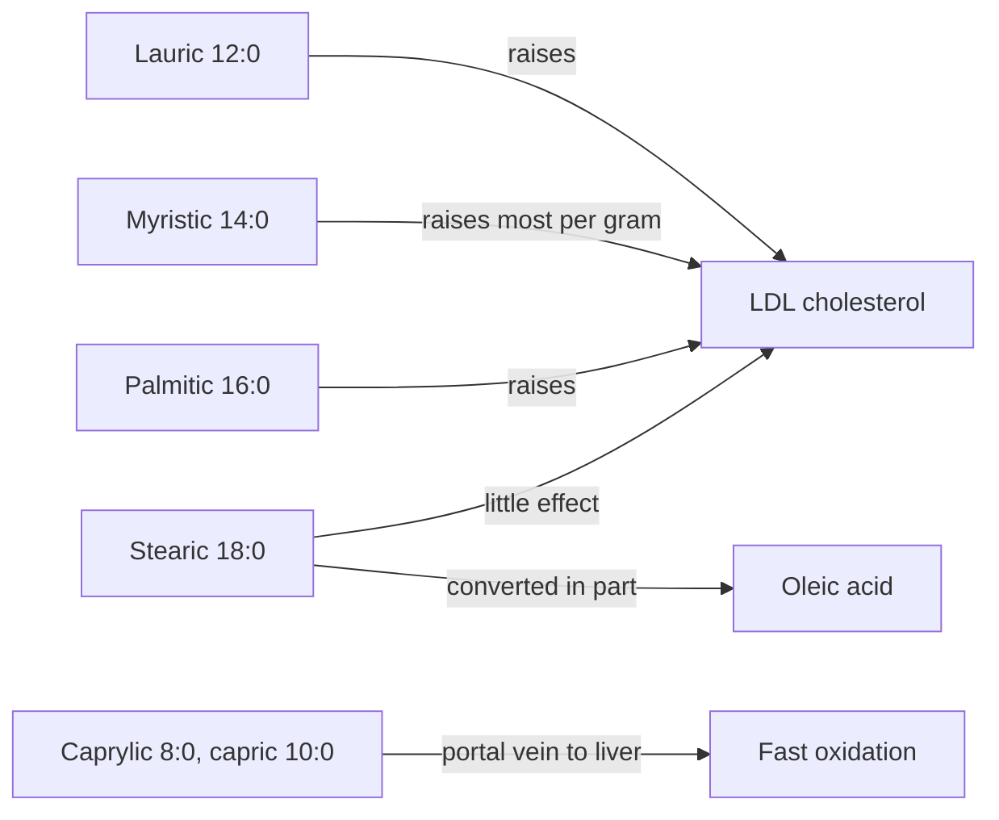

# Saturated fatty acids

## Summary

Saturated fatty acids have no double bonds, so their chains are straight and pack tightly, which makes fats rich in them solid at room temperature. Common examples are palmitic acid (the most abundant in food and in the body), stearic acid, myristic acid, and the medium-chain lauric and caprylic acids of coconut oil. Replacing saturated fat with unsaturated fat lowers LDL cholesterol and, in trials and cohort studies, cardiovascular risk. The individual saturated fatty acids differ in their effects.

## Prerequisites

- [Fatty acids](fatty-acids.md)

## Core concepts

### Definition

A *saturated fatty acid* (SFA) contains only single bonds between its carbon atoms, so each carbon carries the maximum number of hydrogen atoms ("saturated" with hydrogen). The body makes palmitic acid from acetyl-CoA, and it can lengthen it to stearic acid.

### Analogy

Saturated chains are like straight logs on a timber truck: they stack densely and the load is stiff. Fats made of them are firm, which is useful for baking and frying stability. The analogy breaks because logs are inert, while saturated fatty acids act on cells, for example by changing how the liver handles LDL receptors.

### Mechanism

- **LDL cholesterol.** Lauric (12:0), myristic (14:0) and palmitic (16:0) acids raise LDL cholesterol, probably by lowering the activity of LDL receptors in the liver. Stearic acid (18:0) has little effect on LDL, partly because the body converts much of it to oleic acid.
- **Medium-chain fatty acids** (caprylic 8:0, capric 10:0, and partly lauric 12:0) are absorbed directly into the portal vein and burned quickly in the liver. This is the basis of MCT (medium-chain triglyceride) oils.
- **Antimicrobial action.** Lauric and caprylic acids and their monoglycerides damage the membranes of some bacteria and fungi in laboratory tests, which is the basis of claims for coconut oil against yeast (see [Coconut oil](../../../../applied-sciences/medicine-and-health/complementary-medicine/coconut-oil.md)).

The diagram compares the effects of the main saturated fatty acids on LDL cholesterol.

### Sources

| Fatty acid | Rich sources |
| --- | --- |
| Caprylic, capric | Coconut oil, palm kernel oil, goat milk |
| Lauric | Coconut oil (about 45 to 50 percent of its fat), palm kernel oil |
| Myristic | Butter, coconut oil, nutmeg |
| Palmitic | Palm oil (about 44 percent), meat, butter, lard |
| Stearic | Cocoa butter, beef and lamb fat, shea butter |

### Proposed effects and evidence

Each entry states the proposed effect and how strong the human evidence is, using the grades defined in the [Evidence grades](../../../../applied-sciences/medicine-and-health/nutrition/evidence-grades.md) note.

- **Heart health.** Replacing saturated fat with polyunsaturated fat lowers LDL cholesterol and was associated with fewer cardiovascular events in a Cochrane review (2020). WHO (2023) recommends keeping saturated fat below 10 percent of energy intake. Evidence: strong for LDL, moderate for events.
- **Food matrix.** The effect of saturated fat depends on the food: cheese and yogurt raise LDL less than butter with the same saturated fat, and processed meat is associated with more harm than dairy. Evidence: moderate.

## Worked example

A person eats 2,000 kcal a day. The WHO limit of 10 percent of energy is 200 kcal, which is 200 ÷ 9 ≈ 22 g of saturated fat. One tablespoon of coconut oil (14 g) contains about 12 g of saturated fat, 30 g of butter about 15 g, and 100 g of salami about 15 g. One portion of any of these uses half or more of the daily limit.

## Trade offs and when to use it

Saturated fats are stable for frying and baking and give texture. The health cost comes mainly from LDL cholesterol. The replacement matters: swapping saturated fat for refined carbohydrate does not lower risk, while swapping it for unsaturated fat or whole grains does.

## Common mistakes

- **Treating coconut oil as heart-healthy because it is a plant oil.** It raises LDL cholesterol more than unsaturated oils.
- **Treating all saturated fatty acids alike.** Stearic acid has little effect on LDL, myristic acid a large one.

## Practice

1. Which saturated fatty acid barely raises LDL cholesterol?
2. How many grams of saturated fat correspond to 10 percent of a 2,500 kcal diet?

### Answers

1. Stearic acid.
2. About 28 g.

## Further reading

- World Health Organization (2023). *Saturated fatty acid and trans-fatty acid intake for adults and children: WHO guideline*. WHO. Recommendation to limit saturated fat to less than 10 percent of energy.
- Hooper, L., Martin, N., Jimoh, O. F. et al. (2020). Reduction in saturated fat intake for cardiovascular disease. Cochrane Database of Systematic Reviews, CD011737. Cochrane review of reducing saturated fat.
- Mach, F., Baigent, C., Catapano, A. L. et al. (2020). 2019 ESC/EAS Guidelines for the management of dyslipidaemias: lipid modification to reduce cardiovascular risk. European Heart Journal, 41(1), 111-188. [DOI](https://doi.org/10.1093/eurheartj/ehz455). Effects of dietary fats on LDL cholesterol in the ESC/EAS guideline.
