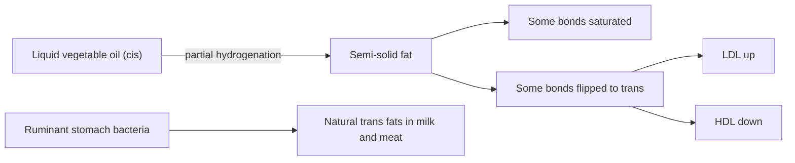

# Trans fatty acids

## Summary

Trans fatty acids are unsaturated fatty acids with at least one double bond in the trans configuration. Industrial trans fats were created by partially hydrogenating vegetable oils and raise LDL cholesterol while lowering HDL, more harmful per gram than saturated fat. The EU limits industrial trans fat to 2 g per 100 g of fat (since 2021), and the WHO aims to eliminate it. Small amounts of natural trans fats occur in milk and meat of ruminants.

## Prerequisites

- [Fatty acids](fatty-acids.md)

## Core concepts

### Definition

A *trans fatty acid* has hydrogen atoms on opposite sides of a double bond, so the chain stays nearly straight. *Industrially produced trans fats* form during partial hydrogenation of oils, which was used to make margarines and shortenings solid and shelf-stable. *Ruminant trans fats* (such as vaccenic acid) are made by bacteria in the stomachs of cows and sheep.

### Analogy

A trans fatty acid is like an unsaturated fatty acid in disguise: chemically it has a double bond like oleic acid, but physically it lies straight like a saturated chain. The body's enzymes and membranes treat it as an odd hybrid. The analogy breaks because the harm is not about appearance: trans fats change the activity of lipid transfer proteins in the blood.

### Mechanism

- Partial hydrogenation adds hydrogen to some double bonds and flips others from cis to trans.
- Industrial trans fats raise LDL cholesterol, lower HDL cholesterol, raise lipoprotein(a) and promote inflammation.
- Each 2 percent of energy from trans fat was associated with about 23 percent higher coronary heart disease risk in pooled cohort studies (Mozaffarian and colleagues, 2006).

The diagram shows how partial hydrogenation forms trans fats.

### Proposed effects and evidence

Each entry states the proposed effect and how strong the human evidence is, using the grades defined in the [Evidence grades](../../../../applied-sciences/medicine-and-health/nutrition/evidence-grades.md) note.

- **Cardiovascular disease.** Industrial trans fats raise LDL, lower HDL and are associated with higher coronary heart disease risk, more strongly than saturated fat per gram. Evidence: strong.
- **Ruminant trans fats.** At normal intakes, natural trans fats from dairy and meat do not show the same association, but intakes are small and studies limited. Evidence: limited.

## Worked example

Commission Regulation (EU) 2019/649 limits industrial trans fat in food sold to consumers to 2 g per 100 g of fat, in force since April 2021. A biscuit with 20 g of fat per 100 g can therefore contain at most 0.4 g of industrial trans fat per 100 g. Before such limits, some fast foods contained more than 10 g of trans fat per portion.

## Trade offs and when to use it

There is no known benefit of industrial trans fat for health. The food industry replaced it mostly with palm oil and fully hydrogenated or interesterified fats.

## Common mistakes

- **Assuming "hydrogenated" means trans fat.** Fully hydrogenated fat contains almost no trans fat; partial hydrogenation creates it.

## Practice

1. What process creates industrial trans fats?
2. What is the EU limit for industrial trans fat?

### Answers

1. Partial hydrogenation of vegetable oils.
2. 2 g per 100 g of fat.

## Further reading

- World Health Organization (2023). *Saturated fatty acid and trans-fatty acid intake for adults and children: WHO guideline*. WHO. WHO guideline on trans fat intake.
- Mozaffarian, D., Katan, M. B., Ascherio, A. et al. (2006). Trans fatty acids and cardiovascular disease. New England Journal of Medicine, 354(15), 1601-1613. [DOI](https://doi.org/10.1056/NEJMra054035). Review with the pooled cohort estimate of risk per 2 percent of energy.
- EFSA Panel on Dietetic Products, Nutrition, and Allergies (2010). Scientific Opinion on Dietary Reference Values for fats, including saturated fatty acids, polyunsaturated fatty acids, monounsaturated fatty acids, trans fatty acids, and cholesterol. EFSA Journal, 8(3), 1461. [DOI](https://doi.org/10.2903/j.efsa.2010.1461). EFSA advice to keep trans fat intake as low as possible.
