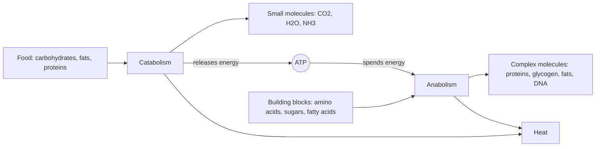
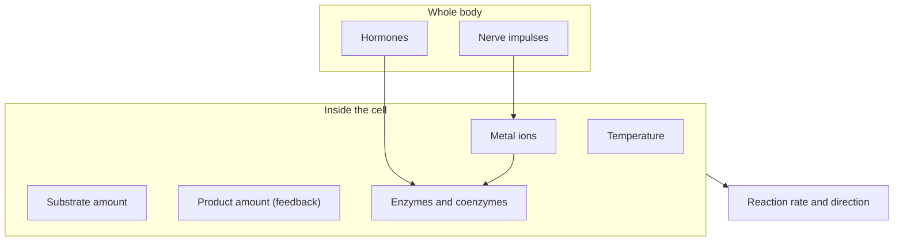

# Metabolism

## Summary

Metabolism is the sum of all chemical reactions in a living organism, together with the energy changes that go with them. It has two halves: anabolism builds complex molecules and consumes energy, and catabolism breaks molecules down and releases energy. ATP links the two. Metabolism needs a supply of food and oxygen, transport inside the body and removal of waste, and it is controlled by enzymes, hormones, nerves, temperature and the amounts of substrates and products.

## Prerequisites

No prior notes are needed. Basic chemistry helps: a reaction turns substrates into products, and chemical bonds store energy.

## Core concepts

### Definition

*Metabolism* is the complete set of biochemical reactions and energy conversions that take place in the cells of an organism and keep it alive, growing and working. The energy it releases pays for every form of biological work: building body components (synthesis), moving substances across cell membranes (transport), contracting muscles (mechanical work) and conducting nerve impulses (electrical work). Part of the energy always ends up as heat, which is how mammals keep their body temperature above that of their surroundings (thermoregulation).

### Analogy

A city economy is a useful picture. Factories build products from raw materials and spend money doing so (anabolism). Recycling plants break old products into parts and sell them, which brings money in (catabolism). Money circulates as cash (ATP), and every transaction loses a little to fees (heat). The analogy breaks in one place: a city can borrow, while a cell cannot run a deficit. If catabolism does not supply enough ATP, anabolism stops within seconds.

### Mechanism

Metabolic reactions are organized into *pathways*: chains of steps in which the product of one enzyme is the substrate of the next. Pathways that break molecules down converge on a few shared intermediates (pyruvate and acetyl-CoA), and pathways that build molecules start from the same intermediates. This shared hub lets the body convert one fuel into another.

The diagram shows the two halves of metabolism and how ATP carries energy between them.

### What metabolism requires

Every metabolic process depends on four supporting functions of the whole body:

| Requirement | What it supplies or removes | Main organ systems |
| --- | --- | --- |
| Nutrition | Energy sources and building materials taken from the environment | Digestive system |
| Respiration | Oxygen for oxidation inside cells, and removal of excess carbon dioxide | Respiratory system |
| Circulation | Transport of fuels, building materials, oxygen, carbon dioxide and waste between cells and organs | Cardiovascular and lymphatic systems |
| Excretion | Removal of metabolic waste from the internal environment | Kidneys, lungs, liver, skin |

The respiratory side is explained in [Respiratory system](../../../applied-sciences/medicine-and-health/physiology/respiration/respiratory-system.md), and the cell level oxidation in [Oxidative phosphorylation](oxidative-phosphorylation.md).

### Anabolism and catabolism compared

| Feature | Anabolism | Catabolism |
| --- | --- | --- |
| Reaction type | Synthesis: A + B → C | Breakdown: C → A + B |
| Energy | Must be supplied (endergonic) | Is released (exergonic) |
| Energy level of products | Higher than the substrates | Lower than the substrates |
| Function | Builds structural, functional and storage compounds | Supplies energy for synthesis and for work |
| Examples | Protein synthesis, glycogenesis, fatty acid synthesis, gluconeogenesis | Glycolysis, Krebs cycle, beta-oxidation, protein breakdown |

The details are in [Anabolism](anabolism.md) and [Catabolism](catabolism.md).

### How metabolism is controlled

Several factors set the speed and direction of metabolic reactions:

- **Temperature.** A rise speeds up chemical reactions and a fall slows them. In the body the range is narrow, because enzymes lose their shape (denature) at high temperatures.
- **Amount of substrate.** More substrate usually means a faster reaction, until the enzyme is saturated.
- **Amount of product.** Products that accumulate slow their own production, either by pushing the equilibrium back or by inhibiting an earlier enzyme (feedback inhibition).
- **Catalysts.** Substances that speed up a reaction without being used up.
- **Enzymes.** The biological catalysts. Almost all are proteins made by the cell, and each is specific for one reaction or a small group of reactions. See [Enzymes and coenzymes](enzymes-and-coenzymes.md).
- **Coenzymes.** Small organic helper molecules. Many are made from vitamins, for example NAD+ from niacin (vitamin B3) and coenzyme A from pantothenic acid (vitamin B5). Not every coenzyme comes from a vitamin: coenzyme Q10 and lipoic acid are made in the body.
- **Metal ions.** Calcium, magnesium, sodium and potassium change enzyme activity. Because nerve impulses change the ion composition around cells, the nervous system can control metabolism this way, for example when calcium released in a muscle fiber activates both contraction and glycogen breakdown.
- **Hormones.** Signals carried in the blood, such as insulin, glucagon, adrenaline, cortisol and thyroid hormones, switch whole pathways on or off.

The diagram groups the controls by the level at which they act.

## Worked example

A rough energy budget shows why metabolism and heat are linked. An adult who eats 2,500 kcal a day and stays at a stable weight releases about the same amount of energy, which equals about 10.5 MJ per day or about 120 W on average (10.5 × 10^6 J ÷ 86,400 s). When a muscle turns food energy into mechanical work, only about 20 to 25 percent becomes work and the rest becomes heat. During a 30 minute run at 600 W of metabolic power, about 450 to 480 W is heat, which is why body temperature rises and sweating starts.

## Trade offs and when to use it

- The two-part model (anabolism versus catabolism) is a teaching simplification. In every cell both run at the same time, and what changes is the balance between them.
- A body "in an anabolic state" is one in which synthesis exceeds breakdown in a given tissue, not one in which catabolism has stopped.
- The everyday phrase "fast metabolism" usually means a high energy expenditure. Most of the difference between people of the same sex and age comes from body size and fat-free mass, so the phrase explains little on its own (see [Metabolic age](../../../applied-sciences/medicine-and-health/physiology/metabolic-age.md)).

## Common mistakes

- **Calling anabolism "energy producing".** Anabolism stores energy in chemical bonds, but it consumes ATP to do so. Catabolism is the energy releasing half.
- **Saying that coenzymes are vitamins.** Many coenzymes are made from vitamins, but they are different molecules, and some coenzymes have no vitamin precursor.
- **Treating metabolism as a single rate.** It is thousands of reactions with separate controls. A hormone can speed up fat breakdown while slowing protein synthesis.

## Practice

1. Name the four body functions that every metabolic process depends on.
2. Why does feedback inhibition save energy for the cell?
3. A muscle uses 400 W of metabolic power with 22 percent efficiency. How much heat does it produce?

### Answers

1. Nutrition, respiration, circulation and excretion.
2. When the product accumulates, it slows its own pathway, so the cell stops spending substrates and ATP on something it already has enough of.
3. About 312 W (78 percent of 400 W).

## Further reading

- Berg, J. M., Tymoczko, J. L., Stryer, L. (2002). *Biochemistry (5th ed.)*. W. H. Freeman, free on NCBI Bookshelf. [Link](https://www.ncbi.nlm.nih.gov/books/NBK21154/). The standard textbook account of metabolic pathways and their regulation.
- Clark, M. A., Douglas, M., Choi, J. (2018). *Biology 2e*. OpenStax, Rice University. [Link](https://openstax.org/details/books/biology-2e). Chapters 6 and 7 introduce metabolism and energy in plain language.
- Betts, J. G., Young, K. A., Wise, J. A. et al. (2022). *Anatomy and Physiology 2e*. OpenStax, Rice University. [Link](https://openstax.org/details/books/anatomy-and-physiology-2e). Chapter 24 covers metabolism and nutrition at the level of the whole body.
