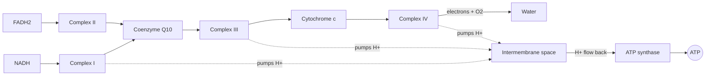

# Oxidative phosphorylation

## Summary

Oxidative phosphorylation is the process in the inner mitochondrial membrane that makes most of the body's ATP. The electron transport chain passes electrons from NADH and FADH2 to oxygen, forming water, and uses the released energy to pump protons out of the matrix. The protons flow back through ATP synthase, a rotating molecular motor that makes ATP. This is where the oxygen we breathe is used.

## Prerequisites

- [Krebs cycle](krebs-cycle.md)
- [Mitochondria](../../biology/cell-biology/mitochondria.md)

## Core concepts

### Definition

*Oxidative phosphorylation* is the synthesis of ATP driven by the transfer of electrons from NADH and FADH2 to oxygen through the *electron transport chain* (also called the respiratory chain). The two parts are coupled by a proton gradient, a mechanism Peter Mitchell proposed in 1961 as the *chemiosmotic theory*, for which he received the Nobel Prize in 1978.

### Analogy

The process works like a hydroelectric pumped-storage plant. Electrons falling from NADH to oxygen are like the electricity that pumps water uphill into a reservoir (protons pumped into the space between the two mitochondrial membranes). The water then flows back down through a turbine (ATP synthase), which generates power (ATP). The analogy holds well, including the leak: some protons flow back without passing the turbine, and that energy becomes heat, which brown fat uses on purpose.

### Mechanism

1. **Electron entry.** NADH gives two electrons to complex I. FADH2 gives its electrons to complex II, which bypasses complex I, so FADH2 yields less ATP.
2. **Transfer.** Coenzyme Q10 (ubiquinone) carries electrons to complex III, and cytochrome c carries them to complex IV.
3. **Reduction of oxygen.** Complex IV (cytochrome c oxidase) passes the electrons to oxygen, which picks up protons and becomes water.
4. **Proton pumping.** Complexes I, III and IV pump protons from the matrix into the intermembrane space. This builds a gradient of charge and pH.
5. **ATP synthesis.** Protons return through ATP synthase. Their flow rotates part of the enzyme, and each full turn makes three ATP from ADP and phosphate.

The diagram shows the path of electrons and protons through the inner membrane.

### Yield

About 10 protons are pumped per NADH and 6 per FADH2, and about 4 protons are needed per ATP made and exported to the cytoplasm. This gives roughly 2.5 ATP per NADH and 1.5 ATP per FADH2. Older textbooks give 3 and 2, which leads to the older figure of 36 to 38 ATP per glucose. Current values give about 30 to 32.

### What stops it

- **Lack of oxygen** (hypoxia). Electrons back up and the chain stops.
- **Poisons.** Cyanide and carbon monoxide block complex IV, which is why they are fatal within minutes.
- **Uncouplers.** Substances that let protons leak back without ATP synthase release the energy as heat. Brown fat does this on purpose with uncoupling protein 1 (UCP1). The drug 2,4-dinitrophenol was once sold for weight loss and caused deaths from overheating.

## Worked example

Oxygen use tells us how fast ATP is being made. A trained runner with a VO2 max of 4 L/min uses about 4 ÷ 22.4 ≈ 0.18 mol of O2 per minute. With roughly 5 to 6 ATP made per O2 molecule (about 2.5 ATP per pair of electrons, and each O2 accepts 4 electrons), this is about 0.9 to 1.1 mol of ATP per minute at maximal aerobic effort, which is about 500 g of ATP every minute.

## Trade offs and when to use it

- Oxidative phosphorylation gives about 15 times more ATP per glucose than glycolysis alone and can use fat, but it is slower and depends on oxygen delivery and the number of mitochondria. Endurance training increases mitochondrial content, which raises this capacity.
- The chain leaks a small fraction of electrons to oxygen early, forming superoxide. This is a main source of reactive oxygen species, discussed in [Oxidative stress](oxidative-stress.md).

## Common mistakes

- **"Oxygen is burned to make energy."** Oxygen is the final electron acceptor. The energy comes from the electrons of the food.
- **"Coenzyme Q10 supplements boost ATP in healthy people."** The body makes its own CoQ10. Supplements help in a genetic deficiency and possibly in some conditions, but there is no good evidence that they raise ATP production in healthy people. See [Coenzyme Q10](../../../applied-sciences/medicine-and-health/nutrition/supplements/coenzyme-q10.md).
- **Using 36 or 38 ATP per glucose as a fixed number.** It is an older estimate. The actual yield depends on proton leak and on how NADH from the cytoplasm enters the mitochondria.

## Practice

1. Which molecule is the final electron acceptor?
2. Why does FADH2 yield less ATP than NADH?
3. How does cyanide kill?

### Answers

1. Oxygen, which becomes water.
2. Its electrons enter at complex II, which pumps no protons, so fewer protons are pumped per pair of electrons.
3. It blocks complex IV, so electrons cannot reach oxygen and ATP synthesis stops in all cells.

## Further reading

- Mitchell, P. (1961). Coupling of phosphorylation to electron and hydrogen transfer by a chemi-osmotic type of mechanism. Nature, 191, 144-148. [DOI](https://doi.org/10.1038/191144a0). The original proposal of the chemiosmotic mechanism.
- Berg, J. M., Tymoczko, J. L., Stryer, L. (2002). *Biochemistry (5th ed.)*. W. H. Freeman, free on NCBI Bookshelf. [Link](https://www.ncbi.nlm.nih.gov/books/NBK21154/). Chapter 18 on oxidative phosphorylation, including proton stoichiometry.
- Nelson, D. L., Cox, M. M. (2021). *Lehninger Principles of Biochemistry (8th ed.)*. Macmillan Learning. Current values for protons per ATP.
