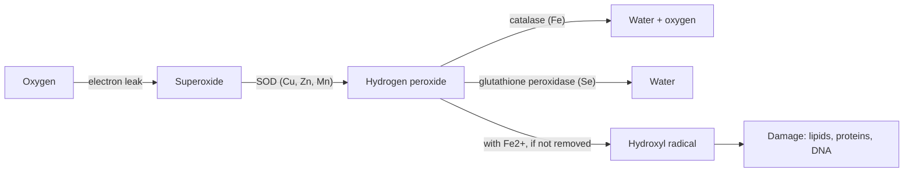

# Oxidative stress

## Summary

Oxidative stress is an imbalance in which reactive oxygen species (ROS), often called free radicals, outpace the body's antioxidant defenses and damage lipids, proteins and DNA. ROS are not only harmful: at low levels they are signals that trigger adaptation to exercise. The body's own enzymes (superoxide dismutase, catalase, glutathione peroxidase) and glutathione do most of the defense. Many supplements are sold as antioxidants, but large trials of high-dose antioxidant pills have mostly not shown benefits for disease prevention.

## Prerequisites

- [Oxidative phosphorylation](oxidative-phosphorylation.md)

## Core concepts

### Definition

A *free radical* is an atom or molecule with an unpaired electron, which makes it highly reactive. *Reactive oxygen species* include free radicals such as superoxide (O2•-) and the hydroxyl radical (•OH) and non-radicals such as hydrogen peroxide (H2O2). An *antioxidant* is a substance that prevents or delays the oxidation of a target molecule, for example by donating an electron to a radical or by converting ROS into water. *Oxidative stress* is the state in which ROS production exceeds the capacity of these defenses.

### Analogy

ROS are like sparks from a fireplace. A few sparks are normal and even useful (they show the fire is burning, much as ROS signal that a muscle is working hard). A fire screen and a person with a bucket (antioxidant enzymes and molecules) keep sparks from burning the carpet. Oxidative stress is the moment when sparks land faster than they can be put out. The analogy breaks because removing all sparks would stop useful signals: antioxidant supplements at high doses can blunt training adaptation.

### Mechanism

**Sources of ROS.**

- The electron transport chain leaks a small share of electrons to oxygen, forming superoxide (see [Oxidative phosphorylation](oxidative-phosphorylation.md)).
- Immune cells make ROS on purpose to kill bacteria.
- Enzymes such as NADPH oxidase and xanthine oxidase.
- External sources: smoking, ultraviolet light, air pollution, some drugs and toxins.

**Damage.** ROS attack the double bonds of polyunsaturated fatty acids in membranes (lipid peroxidation), oxidize proteins and break or modify DNA bases.

**Defenses.**

| Defense | Type | What it does |
| --- | --- | --- |
| Superoxide dismutase (SOD) | Enzyme, needs copper, zinc or manganese | Turns superoxide into hydrogen peroxide |
| Catalase | Enzyme, contains iron | Turns hydrogen peroxide into water and oxygen |
| Glutathione peroxidase | Enzyme, contains selenium | Uses glutathione to reduce peroxides to water |
| Glutathione | Tripeptide made in cells | Main water-soluble antioxidant inside cells |
| Vitamin E | Fat-soluble vitamin | Stops lipid peroxidation chains in membranes |
| Vitamin C | Water-soluble vitamin | Donates electrons and regenerates vitamin E |
| Carotenoids, polyphenols | Plant compounds | Act directly or by switching on the cell's own defenses (the Nrf2 pathway) |

The diagram shows the main detoxification chain for superoxide.

### Hormesis and exercise

Exercise raises ROS production, and this rise is one of the signals that triggers adaptations such as more mitochondria and stronger antioxidant enzymes. This principle, that a small dose of a stressor makes a system stronger, is called *hormesis*. Several studies found that high doses of vitamin C (1 g per day) and vitamin E (400 IU per day) reduced some training adaptations, although results are not uniform.

### Why many antioxidant claims need care

Supplement notes in this library often mention "protection against free radicals". The evidence for this has three layers: (1) the substance neutralizes ROS in a test tube, which is common and says little; (2) it changes markers of oxidative stress in humans, which is less common; (3) it reduces disease or improves function in humans, which is rare. Large trials of beta-carotene even found more lung cancer in smokers. Each note grades its claim with [Evidence grades](../../../applied-sciences/medicine-and-health/nutrition/evidence-grades.md).

## Worked example

A test tube assay ranks blueberry extract above vitamin C in "antioxidant capacity" (for example ORAC units). This does not mean eating blueberries protects cells more than vitamin C does. Most polyphenols are poorly absorbed, are changed by the gut and liver, and reach blood levels far below those used in the test tube. The US Department of Agriculture withdrew its ORAC database in 2012 for this reason. Fruit and vegetables are still linked to better health, but probably through many mechanisms, not simple radical scavenging.

## Trade offs and when to use it

- Getting antioxidants from food (fruit, vegetables, nuts, whole grains) is supported by observational evidence and carries little risk.
- High-dose antioxidant supplements have not reduced cardiovascular disease or cancer in large trials and may blunt training effects.
- Correcting a real deficiency (for example selenium or vitamin C) restores defenses and is worthwhile.

## Common mistakes

- **"More antioxidants are always better."** ROS are needed as signals and for immune defense.
- **Reading test tube antioxidant capacity as a health effect.**
- **Ignoring the enzymes.** The body's own enzymes, which depend on minerals such as selenium, zinc, copper and manganese, are the main defense.

## Practice

1. Which minerals are needed for the main antioxidant enzymes?
2. What is hormesis?
3. Why can a high antioxidant capacity in a test tube be misleading?

### Answers

1. Copper, zinc and manganese for superoxide dismutase, iron for catalase and selenium for glutathione peroxidase.
2. A favorable adaptive response to a small dose of a stressor that would be harmful at a high dose.
3. The substance may be poorly absorbed or changed in the body, and blood levels may be far below those tested.

## Further reading

- Berg, J. M., Tymoczko, J. L., Stryer, L. (2002). *Biochemistry (5th ed.)*. W. H. Freeman, free on NCBI Bookshelf. [Link](https://www.ncbi.nlm.nih.gov/books/NBK21154/). Chapter 18 on reactive oxygen species formed by the respiratory chain.
- NIH Office of Dietary Supplements. Vitamin E: Fact Sheet for Health Professionals. [Link](https://ods.od.nih.gov/factsheets/VitaminE-HealthProfessional/). Summarizes trials of vitamin E supplements for disease prevention.
- NIH Office of Dietary Supplements. Vitamin C: Fact Sheet for Health Professionals. [Link](https://ods.od.nih.gov/factsheets/VitaminC-HealthProfessional/). Summarizes the evidence on vitamin C and disease.
