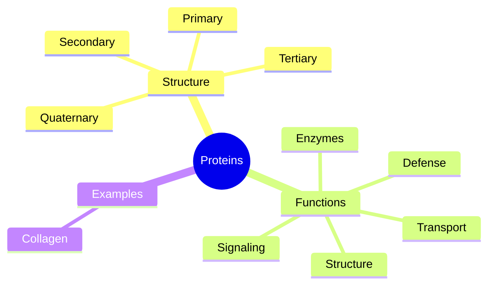

# Proteins

Proteins are chains of amino acids folded into precise shapes. They build tissues, catalyze reactions, carry oxygen, signal between cells and defend the body. This subfield explains protein structure and has a note on collagen, the most abundant protein in the body. Peptide supplements and drugs are covered in [Peptides](../../../../applied-sciences/medicine-and-health/peptides/README.md).

## Map of the subfield

## Reading order

1. [Proteins](proteins.md): structure, folding, functions and protein in the diet.
2. [Collagen](collagen.md): the structural protein of connective tissue and the evidence on collagen supplements.
