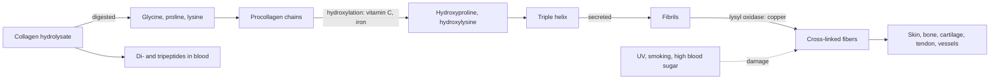

# Collagen

## Summary

Collagen is the main structural protein of connective tissue and the most abundant protein in the human body, making up about a quarter to a third of all protein. It forms skin, bones, cartilage, tendons, ligaments and blood vessel walls. The body's production falls with age. Collagen supplements, often marine (fish) collagen hydrolysate, are digested into amino acids and small peptides. Meta-analyses show modest improvements in skin hydration and elasticity and some reduction in joint pain, but many trials are industry-funded and small.

*This note is educational. It is not medical advice and does not replace a doctor, dietitian or pharmacist, especially during pregnancy, illness or when taking medicines.*

## Prerequisites

- [Proteins](proteins.md)

## Core concepts

### Definition

*Collagen* is a family of at least 28 proteins whose chains wind into a triple helix with the repeating sequence glycine-X-Y (often proline and hydroxyproline). Type I collagen is in skin, bone, tendons and ligaments; type II in cartilage; type III in skin, vessels and organs alongside type I. *Hydrolyzed collagen* (collagen peptides) is collagen broken into short peptides by enzymes. *Gelatin* is partly hydrolyzed collagen that still forms gels. Marine collagen from fish skin and scales is mostly type I and is promoted for high bioavailability, meaning it is well absorbed. Dietary sources include bone broth, skin, cartilage and gelatin.

### Analogy

Collagen is like the steel rebar in reinforced concrete. Minerals (calcium phosphate in bone) or water-binding molecules (in cartilage and skin) are the concrete, and collagen fibers are the rebar that gives tensile strength and keeps the structure from cracking. Weak rebar gives brittle bones (osteogenesis imperfecta) or fragile skin and vessels. The analogy breaks because rebar is installed once, while collagen is constantly broken down and rebuilt, more slowly with age.

### Mechanism

1. **Synthesis.** Fibroblasts (and bone and cartilage cells) make procollagen chains. Proline and lysine residues are hydroxylated by enzymes that need vitamin C and iron. The chains form a triple helix.
2. **Secretion and assembly.** Outside the cell, the ends are cut off, and the molecules line up into fibrils. Lysyl oxidase, a copper enzyme, forms cross-links that give strength.
3. **Turnover.** Enzymes called matrix metalloproteinases break collagen down. Ultraviolet light, smoking and high blood sugar (glycation) speed up damage.
4. **Supplements.** Collagen hydrolysate is digested into amino acids and some di- and tripeptides, such as prolyl-hydroxyproline, which are absorbed into the blood. In laboratory studies these peptides stimulate fibroblasts. Whether this explains the results of human trials is not established.

Nutrients needed for collagen production are vitamin C, copper, iron, zinc and amino acids (glycine, proline, lysine). Silicon is also often listed; its role in humans is not well established.

The diagram shows collagen synthesis and what it depends on.

### Types and locations

| Type | Main locations |
| --- | --- |
| I | Skin, bone, tendons, ligaments, cornea; about 90 percent of body collagen |
| II | Cartilage, vitreous of the eye |
| III | Skin, blood vessels, organs, early wound tissue |
| IV | Basement membranes |
| V | With type I in many tissues, placenta |

### Proposed effects and evidence

Each entry states the proposed effect and how strong the human evidence is, using the grades defined in the [Evidence grades](../../../../applied-sciences/medicine-and-health/nutrition/evidence-grades.md) note.

- **Skin health.** Marine collagen supplements may improve skin elasticity, firmness and hydration. Studies show regular use may reduce visible wrinkles and speed skin regeneration. A meta-analysis of 19 trials (de Miranda et al., 2021) found improved hydration and elasticity after about 90 days, with doses of about 2.5 to 10 g per day. Many trials were funded by manufacturers. Evidence: moderate, with risk of bias.
- **Joints and bones.** Collagen helps maintain joint flexibility and strength. Supplements may reduce joint pain, especially in degenerative disease such as osteoarthritis. Collagen also supports bone mineralization, which may counteract osteoporosis. Trials in osteoarthritis show small reductions in pain; one trial in postmenopausal women found improved bone density with 5 g per day. Evidence: limited to moderate.
- **Hair and nails.** Marine collagen may support hair growth and condition and strengthen nails, preventing brittleness and splitting. One small open-label study reported fewer broken nails. Evidence: very limited.
- **Muscle recovery.** Collagen matters for muscle health and may support recovery of muscle tissue after exercise and its growth and endurance. Collagen is a low-quality protein for muscle building (it lacks tryptophan and is low in leucine), but some trials in older men found added fat-free mass when combined with training. Gelatin with vitamin C before exercise increased a marker of collagen synthesis in tendons (Shaw et al., 2017). Evidence: limited.
- **Digestive health.** Collagen may support regeneration of the gut mucosa, which could benefit people with irritable bowel syndrome (IBS) or "leaky gut syndrome". Human evidence is lacking, and "leaky gut syndrome" is not a defined diagnosis. Evidence: very limited.
- **Cardiovascular health.** Collagen is important for vessel elasticity, and supplements may support vessel health, circulation and lower cardiovascular risk. One small uncontrolled study reported reduced arterial stiffness. Evidence: very limited.
- **Gums and teeth.** Collagen is important for the gums and the structures (periodontal ligament) that hold teeth in place. Evidence: established physiology, no supplement evidence.
- **Wound healing.** Collagen takes part in wound healing and tissue regeneration. Collagen-based dressings are used in wound care; oral supplements with arginine and zinc have small trials in pressure ulcers. Evidence: limited.

## Worked example

A person takes 10 g of marine collagen peptides daily. Collagen is roughly a third glycine, so this gives about 3.3 g of glycine, plus proline and hydroxyproline. As a protein source, 10 g of collagen counts towards daily protein but is incomplete (no tryptophan). Pairing it with vitamin C-rich food covers the cofactor for hydroxylation; Shaw and colleagues used 15 g of gelatin with 48 mg of vitamin C taken about an hour before exercise.

## Trade offs and when to use it

- **Safety.** Collagen supplements are generally safe. People with fish allergy should avoid marine collagen. Products should be tested for heavy metals.
- **Cost and alternatives.** Collagen is expensive per gram of protein. Gelatin is cheaper and similar in composition. Not smoking, sun protection and adequate vitamin C and protein are well-supported ways to protect collagen.

## Common mistakes

- **Believing swallowed collagen goes straight to the skin.** It is digested into amino acids and small peptides first.
- **Counting collagen as complete protein for muscle building.** It lacks tryptophan and is low in leucine.
- **Ignoring vitamin C.** Collagen synthesis needs vitamin C for hydroxylation.

## Practice

1. Which collagen type is most abundant?
2. Which two cofactors are needed to hydroxylate proline?
3. Why is collagen a poor protein for building muscle?

### Answers

1. Type I, about 90 percent of body collagen.
2. Vitamin C and iron.
3. It lacks tryptophan and is low in leucine.

## Further reading

- de Miranda, R. B., Weimer, P., Rossi, R. C. (2021). Effects of hydrolyzed collagen supplementation on skin aging: a systematic review and meta-analysis. International Journal of Dermatology, 60(12), 1449-1461. [DOI](https://doi.org/10.1111/ijd.15518). Meta-analysis of collagen supplements for skin.
- Shaw, G., Lee-Barthel, A., Ross, M. L. et al. (2017). Vitamin C-enriched gelatin supplementation before intermittent activity augments collagen synthesis. American Journal of Clinical Nutrition, 105(1), 136-143. [DOI](https://doi.org/10.3945/ajcn.116.138594). Gelatin with vitamin C and collagen synthesis.
- Berg, J. M., Tymoczko, J. L., Stryer, L. (2002). *Biochemistry (5th ed.)*. W. H. Freeman, free on NCBI Bookshelf. [Link](https://www.ncbi.nlm.nih.gov/books/NBK21154/). Collagen structure and synthesis.
