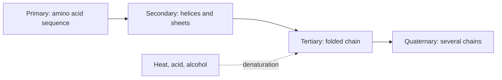

# Proteins

## Summary

Proteins are the basic building materials of cells and tissues. They are polymers of amino acids joined by peptide bonds, and each folds into a three-dimensional shape that determines its function. Proteins build muscle, form enzymes and hormones, carry substances in the blood, and are needed for growth and repair. The best food sources are animal products (meat, fish, eggs, dairy) and plant foods such as legumes, nuts, seeds, tofu and quinoa.

## Prerequisites

- [Amino acids overview](../amino-acids/amino-acids-overview.md)

## Core concepts

### Definition

A *protein* is a polymer of one or more chains of amino acids (polypeptides), usually more than about 50 amino acids long, that folds into a specific three-dimensional structure. The sequence of amino acids is encoded in a gene. A *peptide* is a shorter chain.

### Analogy

A protein is like a long necklace of differently shaped beads that folds itself into a tool. The order of the beads (sequence) decides how the necklace bends, which parts stick together and what final shape it takes, and the shape decides whether the tool is a pair of scissors (an enzyme cutting another molecule), a rope (collagen) or a delivery truck (hemoglobin). The analogy breaks because many proteins need help (chaperone proteins) to fold correctly, and some change shape as part of their work.

### Mechanism

Protein structure has four levels:

| Level | What it is | Held by |
| --- | --- | --- |
| Primary | The sequence of amino acids | Peptide bonds |
| Secondary | Local folds: alpha helices and beta sheets | Hydrogen bonds in the backbone |
| Tertiary | The overall 3D shape of one chain | Side chain interactions: hydrophobic core, ionic bonds, hydrogen bonds, disulfide bonds |
| Quaternary | Several chains assembled together | Same forces between chains |

Folding happens spontaneously as the water-avoiding side chains move into the core, often assisted by chaperones. Heat, acid, alcohol or heavy metals can unfold a protein (*denaturation*), which destroys its function. Cooking an egg denatures its proteins, and stomach acid denatures food proteins so that enzymes can digest them.

The diagram shows the four levels of structure.

### Functions

| Function | Example |
| --- | --- |
| Catalysis | Enzymes such as amylase and ATP synthase |
| Structure | Collagen, keratin, elastin |
| Movement | Actin and myosin in muscle |
| Transport | Hemoglobin (oxygen), albumin (fatty acids), lipoproteins |
| Signaling | Insulin, growth hormone, receptors |
| Defense | Antibodies, clotting factors |
| Storage | Ferritin (iron) |

### Protein in the diet

Dietary protein is digested into amino acids and small peptides, absorbed, and used to build the body's own proteins. Adults turn over about 250 to 300 g of body protein per day, most of it recycled. The population reference intake for adults is 0.83 g per kg body weight per day (EFSA) and the US RDA 0.8 g/kg. Higher intakes, about 1.2 to 2.0 g/kg, are recommended for people doing regular resistance or endurance training (ISSN), and older adults may benefit from about 1.0 to 1.2 g/kg. See [Muscle protein balance](../../../../applied-sciences/medicine-and-health/physiology/muscle/muscle-protein-balance.md).

Best sources:

- **Animal:** meat, fish, eggs, dairy. All essential amino acids in good proportions and well digested.
- **Plant:** legumes (beans, lentils), nuts, seeds, tofu, quinoa. Usually lower in one essential amino acid (see [Amino acids overview](../amino-acids/amino-acids-overview.md#protein-quality)).

## Worked example

A 70 kg adult who lifts weights four times a week aims for 1.6 g/kg, which is 112 g of protein a day. Spread over four meals, that is 28 g per meal. One example day: 3 eggs (19 g), 200 g of Greek yogurt (20 g), 150 g of chicken breast (46 g), 200 g of cooked lentils (18 g) and 30 g of almonds (6 g), which totals 109 g, close to the target without supplements.

## Trade offs and when to use it

- Protein is satiating and supports muscle, but animal sources can come with saturated fat or processed meat, which carry their own risks. Fish, dairy, legumes and poultry are lower-risk choices.
- Intakes up to about 2 g/kg appear safe for people with healthy kidneys.

## Common mistakes

- **Equating "protein" with meat.** Dairy, eggs, fish and legumes are major sources.
- **Thinking more protein always builds more muscle.** Gains level off at about 1.6 g/kg in meta-analyses.
- **Assuming denatured protein is worthless.** Cooking denatures proteins but does not destroy their amino acids; it often improves digestibility.

## Practice

1. What holds the secondary structure of a protein together?
2. What happens to a protein when it is denatured?
3. Calculate the daily protein target for a 60 kg person at 1.4 g/kg.

### Answers

1. Hydrogen bonds between the atoms of the backbone.
2. It unfolds and loses its function, but its amino acid sequence remains.
3. 84 g per day.

## Further reading

- Berg, J. M., Tymoczko, J. L., Stryer, L. (2002). *Biochemistry (5th ed.)*. W. H. Freeman, free on NCBI Bookshelf. [Link](https://www.ncbi.nlm.nih.gov/books/NBK21154/). Chapters 2 and 3 on protein structure.
- Jäger, R., Kerksick, C. M., Campbell, B. I. et al. (2017). International Society of Sports Nutrition position stand: protein and exercise. Journal of the International Society of Sports Nutrition, 14, 20. [DOI](https://doi.org/10.1186/s12970-017-0177-8). ISSN position stand on protein intake for exercise.
- Morton, R. W., Murphy, K. T., McKellar, S. R. et al. (2018). A systematic review, meta-analysis and meta-regression of the effect of protein supplementation on resistance training-induced gains in muscle mass and strength in healthy adults. British Journal of Sports Medicine, 52(6), 376-384. [DOI](https://doi.org/10.1136/bjsports-2017-097608). Meta-analysis on protein intake and muscle gains.
