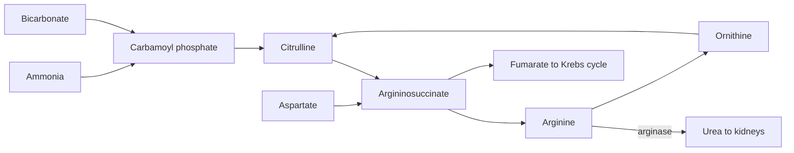

# Urea cycle

## Summary

The urea cycle is the pathway in the liver that turns toxic ammonia, released when amino acids are broken down, into urea, which the kidneys excrete. It links two amino acids that appear as supplements: citrulline and arginine are intermediates of the cycle. An adult excretes roughly 20 to 35 g of urea a day, more on a high protein diet.

## Prerequisites

- [Amino acids](amino-acids/README.md)
- [Krebs cycle](krebs-cycle.md)

## Core concepts

### Definition

The *urea cycle* (also called the ornithine cycle) is a cycle of five reactions, partly in the mitochondria and partly in the cytoplasm of liver cells, that combines two nitrogen atoms (one from ammonia, one from aspartate) with carbon dioxide to form urea. Hans Krebs and Kurt Henseleit described it in 1932, five years before the Krebs cycle.

### Analogy

The cycle is like a waste-packing machine. Loose, hazardous material (ammonia) is packed into sealed, harmless parcels (urea) that the mail service (kidneys and urine) can carry away. The machine's frame, ornithine, is reused for every parcel. The analogy breaks because packing costs fuel: 3 ATP (4 high-energy bonds) per urea.

### Mechanism

1. When amino acids are broken down, their amino groups are transferred (transamination, needs vitamin B6) and released as ammonia (NH3, as NH4+ in the body).
2. In the mitochondria, ammonia and bicarbonate form carbamoyl phosphate (2 ATP).
3. Carbamoyl phosphate joins ornithine to form **citrulline**.
4. Citrulline moves to the cytoplasm and combines with aspartate (1 ATP) to form argininosuccinate.
5. Argininosuccinate splits into **arginine** and fumarate. Fumarate links the cycle to the Krebs cycle.
6. Arginase splits arginine into urea and ornithine, which returns to the mitochondria.

The diagram shows the cycle and where citrulline and arginine sit.

### Arginine, citrulline and nitric oxide

Outside the liver, arginine is also the substrate of nitric oxide synthase, which produces nitric oxide (NO) and citrulline. Nitric oxide relaxes blood vessels. In the kidneys, citrulline is turned back into arginine. This explains why oral citrulline raises blood arginine more than oral arginine does: arginine taken by mouth is largely broken down by arginase in the gut and liver, while citrulline passes the liver and is converted into arginine in the kidney. See [Arginine](amino-acids/arginine.md) and [Citrulline](amino-acids/citrulline.md).

## Worked example

A person eats 120 g of protein a day and is in nitrogen balance. Protein is about 16 percent nitrogen, so 120 g contains about 19 g of nitrogen. Urea is about 46.7 percent nitrogen. If roughly 85 percent of the nitrogen leaves as urea, the urea output is about 0.85 × 19 ÷ 0.467 ≈ 35 g per day. On 60 g of protein, it would be about half.

## Trade offs and when to use it

- The cycle allows a high protein diet without ammonia poisoning, at an energy cost of about 3 ATP per urea.
- Liver failure or rare genetic defects of the cycle let ammonia rise, which damages the brain (hepatic encephalopathy, hyperammonemia).

## Common mistakes

- **"High protein diets damage healthy kidneys because of urea."** In healthy people, current evidence does not show kidney damage from protein intakes common in sports nutrition. People with existing kidney disease are a different case and follow medical advice.
- **"Citrulline is useless because it is not in proteins."** It is a non-protein amino acid with a real role in the urea cycle and in arginine supply.

## Practice

1. Which two amino acids of the urea cycle are sold as supplements?
2. Why does oral citrulline raise blood arginine more than oral arginine?
3. Where in the cell does the urea cycle take place?

### Answers

1. Arginine and citrulline (ornithine is also sold).
2. Oral arginine is broken down by arginase in the gut and liver, while citrulline bypasses this and is converted to arginine in the kidneys.
3. The first two steps in the mitochondria of liver cells, the rest in the cytoplasm.

## Further reading

- Berg, J. M., Tymoczko, J. L., Stryer, L. (2002). *Biochemistry (5th ed.)*. W. H. Freeman, free on NCBI Bookshelf. [Link](https://www.ncbi.nlm.nih.gov/books/NBK21154/). Chapter 23 on amino acid degradation and the urea cycle.
