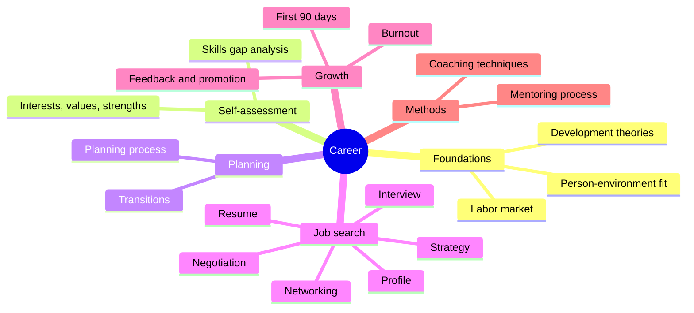

# Career

This field covers how people choose, find, build and change their work. It rests on research from vocational psychology, personnel selection, organizational behavior and the evidence on coaching and mentoring. The aim is to give a reader a model for each decision, not a list of tips.

## Map of the field

The diagram shows the six subfields around the field and the notes in each. The reading order below follows the order of a career, and methods support every step.

## Scope and evidence

- The theory notes explain why people choose and develop in certain ways. The practical notes (job search, interviews, negotiation) use research on what works and mark advice that has no research behind it.
- Coaching and mentoring appear as techniques, processes and approaches used in career work (see [methods](methods/README.md)). They are not covered as professions.
- Bibliographic details of cited papers were checked against Crossref in 2026-10. Findings were summarized from abstracts and secondary sources unless a note says otherwise. Full texts were not read, so numbers should be checked in the source before they are reused.
- The notes are written in a US and EU research context. Labor law, hiring customs and salary norms differ by country, and a note says so where it matters.

## Reading order

1. [Foundations](foundations/README.md): the theories of career development, person-environment fit and the labor market.
2. [Self-assessment](self-assessment/README.md): interests, values, strengths and a skills inventory.
3. [Planning](planning/README.md): the planning process and career transitions.
4. [Job search](job-search/README.md): strategy, resume, professional profile, networking, interviews and negotiation.
5. [Growth](growth/README.md): the first 90 days, feedback and promotion, and burnout.
6. [Methods](methods/README.md): coaching techniques and the mentoring process, which support every step above.

## Related

- [Skills](../skills/README.md): the abilities that the career notes refer to.
- [Personal growth](../personal-growth/README.md): goals, habits and motivation.
- [Psychology](../../social-sciences/psychology/README.md): the field behind most of the theories.
