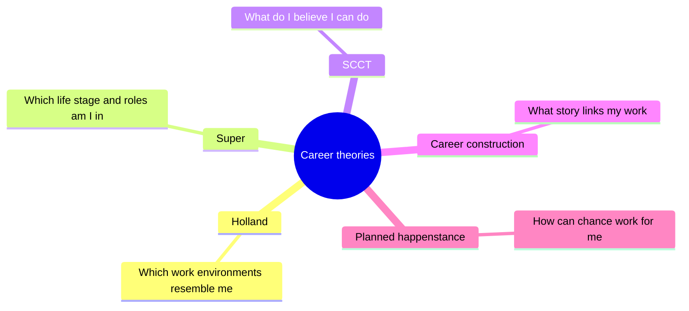
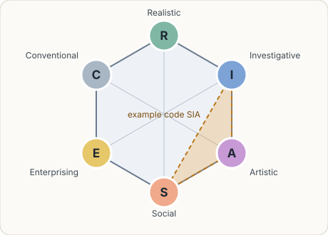

# Career development theories

## Summary

A career theory is a model of how people choose work and how their working lives change. This note covers five influential views: matching interests to work (Holland), development over a lifetime (Super), beliefs about oneself (social cognitive career theory), building a career story (Savickas) and using chance (Krumboltz). No single theory is complete. Each one asks a different question, and a good decision usually needs two or three of them.

## Prerequisites

None. A general idea of what personality and motivation mean helps. See [psychology](../../../social-sciences/psychology/README.md).

## Core concepts

### Why theories matter

Career advice without a model is a list of opinions. A theory names the factors that matter and says how they relate, so you can ask better questions and notice what you have not considered. The cost is simplification: every theory leaves something out.

Each theory answers a different question about the same person. The map below lists the five covered here and the question each one asks.

### Holland: matching interests to work environments

*Definition.* John Holland proposed in 1959 that vocational choice expresses personality, and that people do better in work environments that resemble them. Interests are grouped into six types, known as RIASEC: Realistic, Investigative, Artistic, Social, Enterprising and Conventional. The U.S. Department of Labor's O*NET Interest Profiler uses the same six areas.

*Analogy.* Picture a hexagon with the six types at its corners. Neighbors on the hexagon (for example Investigative and Artistic, or Artistic and Social) are similar, and opposite corners (Social and Realistic) are far apart. The map works like a map of a city district: nearby places share traits. It breaks where the analogy suggests fixed places, because a person is a blend, not a single corner.

The figure shows the hexagon. Neighbors such as Investigative and Artistic are similar, Social and Realistic sit at opposite corners, and the dashed triangle marks the example code SIA.

*Mechanism.* A person is described by a short code made of their top types, such as SIA (Social, Investigative, Artistic). Occupations have codes too. The closer the two codes, the better the *congruence*. The theory predicts that higher congruence goes with more satisfaction and persistence.

*Example.* Someone who enjoys teaching, analyzing data and designing materials may score highest on Social, Investigative and Artistic. Occupations with similar codes, such as instructional designer or education researcher, are worth exploring.

*Boundaries.* Types describe interests, not ability. A meta-analysis of 60 studies found that interests relate to performance and persistence (Nye et al., 2012). The same authors revisited the congruence results in 2017, so treat the size of the congruence effect as contested.

### Super: life span and life space

*Definition.* Donald Super described a career as development over a whole life (*life span*) in several roles at once (*life space*). Roles include student, worker, citizen, leisure participant and homemaker. His 1980 paper is the source of the "life-career rainbow" idea, where the importance of each role changes with age.

*Mechanism.* The classic life stages are growth, exploration, establishment, maintenance and disengagement. Later authors describe small cycles inside the large one, so a person can return to exploration at 40.

*Boundaries.* Ages attached to the stages are rough, and many careers no longer follow them.

### Social cognitive career theory (SCCT)

*Definition.* Lent, Brown and Hackett (1994) applied Bandura's social cognitive theory to careers. Three personal factors drive interest, choice and performance: *self-efficacy* (belief that you can do the task), *outcome expectations* (belief about what will result) and *goals*. Context can support or block them.

*Example.* A capable student who doubts their ability in mathematics may rule out engineering before ever testing it. The model predicts that raising self-efficacy, for example through small successes, changes interest and choice.

*Boundaries.* Beliefs matter, but they do not replace ability or opportunity.

### Career construction

*Definition.* Mark Savickas proposed that people build a career by giving meaning to their experiences and telling a story about them. The theory names *career adaptability*, the readiness to cope with changes in work, with four dimensions: concern, control, curiosity and confidence. The Career Adapt-Abilities Scale measures them (Savickas and Porfeli, 2012).

*Example.* Asking "which three stories from my work do I tell most often, and what do they have in common?" is a construction exercise.

### Planned happenstance

*Definition.* Mitchell, Levin and Krumboltz (1999) argued that unplanned events are normal in careers and can be used. They name five skills that make chance useful: curiosity, persistence, flexibility, optimism and risk taking.

*Boundaries.* The authors describe it as a counseling approach. It adds to other theories and does not replace them.

## Worked example

Ana, 28, is a data analyst who feels stuck. This table shows how each view turns a vague worry into a concrete question. The person and the answers are invented for illustration.

| View | Question it asks | Possible finding for Ana |
| --- | --- | --- |
| Holland | Which interest types do I score highest on? | Investigative and Social, so analysis with people contact |
| Super | Which stage and roles am I in? | Establishment in the worker role, with a caring role at home taking more time |
| SCCT | What do I believe I can do, and what do I expect to follow? | High self-efficacy in analysis, low in presenting to executives |
| Career construction | What story links my jobs? | "I turn messy data into decisions for others" |
| Planned happenstance | What small experiments could create chances? | Offer one internal talk, shadow a product manager for a week |

Next step: pick the two most useful questions, then continue with [self-assessment](../self-assessment/README.md).

## Trade offs and when to use it

- Holland is quick and easy to test with an inventory, but it says little about change over time.
- Super and Savickas fit long-term reflection, but they give few concrete predictions.
- SCCT points to what can be changed (beliefs, supports) but needs honest feedback to work.
- Most of this research was developed in the United States and Europe. How well the models travel to other labor markets is a common criticism.

## Common mistakes

- Treating a test result as a verdict. Use it to generate options.
- Using one theory for everything. Pair a matching view with a developmental or constructionist one.
- Reading "follow your passion" into Holland. The theory is about fit between a person and an environment, not about a single passion.

## Practice

1. Which of the RIASEC types are neighbors of Artistic on the hexagon, and why does the distance matter?
2. A friend says "I will never be good at presenting, so I avoid it." Which theory explains the pattern, and what would it suggest?
3. Name the five skills of planned happenstance and give one action for each.

Hints: the usual order around the hexagon is Realistic, Investigative, Artistic, Social, Enterprising, Conventional, so the neighbors of Artistic are Investigative and Social. For question 2 the answer is SCCT: self-efficacy and small successes.

## Further reading

- Holland, J. L. (1959). A theory of vocational choice. *Journal of Counseling Psychology*, 6(1), 35-45. [doi:10.1037/h0040767](https://doi.org/10.1037/h0040767). The original statement of the matching idea.
- Super, D. E. (1980). A life-span, life-space approach to career development. *Journal of Vocational Behavior*, 16(3), 282-298. [doi:10.1016/0001-8791(80)90056-1](https://doi.org/10.1016/0001-8791(80)90056-1). The life-career rainbow.
- Lent, R. W., Brown, S. D., & Hackett, G. (1994). Toward a unifying social cognitive theory of career and academic interest, choice, and performance. *Journal of Vocational Behavior*, 45(1), 79-122. [doi:10.1006/jvbe.1994.1027](https://doi.org/10.1006/jvbe.1994.1027). The foundation of SCCT.
- Savickas, M. L., & Porfeli, E. J. (2012). Career Adapt-Abilities Scale: Construction, reliability, and measurement equivalence across 13 countries. *Journal of Vocational Behavior*, 80(3), 661-673. [doi:10.1016/j.jvb.2012.01.011](https://doi.org/10.1016/j.jvb.2012.01.011). Defines and measures adaptability.
- Mitchell, K. E., Levin, A. S., & Krumboltz, J. D. (1999). Planned happenstance: Constructing unexpected career opportunities. *Journal of Counseling & Development*, 77(2), 115-124. [doi:10.1002/j.1556-6676.1999.tb02431.x](https://doi.org/10.1002/j.1556-6676.1999.tb02431.x). The five skills.
- Nye, C. D., Su, R., Rounds, J., & Drasgow, F. (2012). Vocational interests and performance: A quantitative summary of over 60 years of research. *Perspectives on Psychological Science*, 7(4), 384-403. [doi:10.1177/1745691612449021](https://doi.org/10.1177/1745691612449021). Evidence that interests relate to performance.
- U.S. Department of Labor. O*NET Interest Profiler. [onetcenter.org/IP.html](https://www.onetcenter.org/IP.html). A free RIASEC inventory (checked 2026-10).

TODO: Check the stage names and the claim about small cycles against a primary Super text. Check the order of types around the hexagon against a Holland primary source. The adaptability dimensions come from the 2012 scale paper, and the full text was not read.
