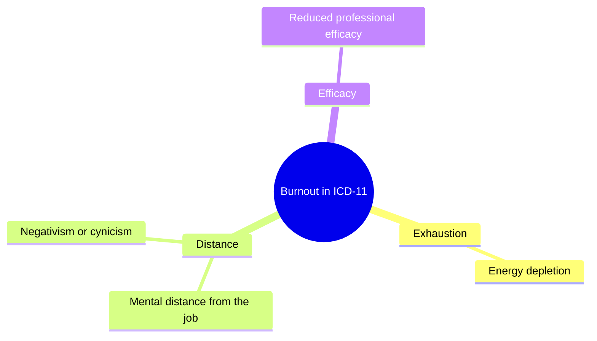
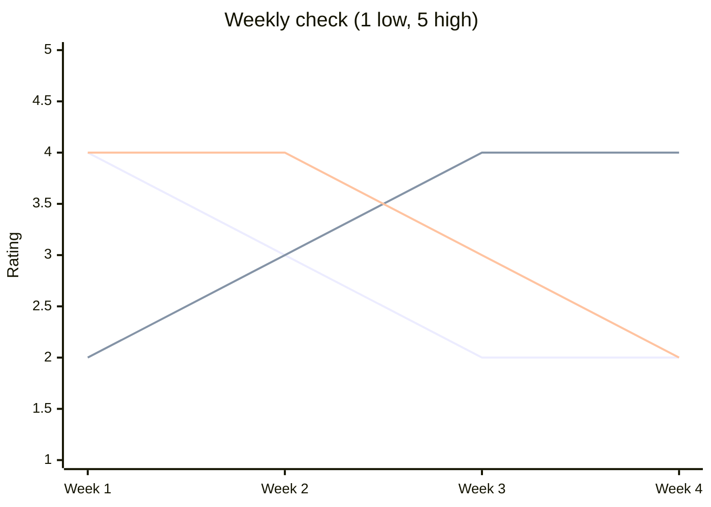

# Career resilience and burnout

## Summary

Burnout is an occupational phenomenon that the World Health Organization describes in ICD-11 as a syndrome resulting from chronic workplace stress that has not been successfully managed. It has three dimensions: exhaustion, mental distance or cynicism toward the job, and reduced professional efficacy. It is not classed as a medical condition. This note explains the definition and the main research model, and gives a way to notice early signs. It is educational and is not medical advice.

## Prerequisites

[Feedback and promotion](feedback-and-promotion.md) is useful but not required.

## Core concepts

### Definition

The WHO states that burn-out in ICD-11 "is a syndrome conceptualized as resulting from chronic workplace stress that has not been successfully managed." The three dimensions listed are feelings of energy depletion or exhaustion, increased mental distance from one's job or negativism or cynicism related to one's job, and reduced professional efficacy. The WHO describes it as an occupational phenomenon, not a medical condition, and says the term should not be applied to experiences in other areas of life (checked 2026-10).

### What the research adds

Maslach and Leiter (2016) review decades of research. Measures and theoretical models exist, most work has been done in human service occupations and especially health care, and there are debates about the link between burnout and mental illness and about attempts to redefine burnout as simply exhaustion. TODO: read the paper for the six areas of work life that Maslach and Leiter describe (workload, control, reward, community, fairness, values). They are mentioned here from general knowledge and should be checked.

*Analogy.* Burnout is like a battery that is drained faster than it is charged, for a long time. The analogy fails in one way: a battery has no sense of meaning, and burnout is strongly tied to cynicism and feelings of ineffectiveness, not only to low energy.

### Resilience

*Resilience* in a career is the ability to recover from setbacks and adapt. It combines personal resources (see adaptability in [career development theories](../foundations/career-development-theories.md)) and the work environment. It is not a reason to ignore a harmful workload.

*Opinion.* Advice that tells individuals to "be more resilient" while the job design stays the same puts the whole burden on the person. This is an interpretation, not a research finding.

## Worked example

A weekly check for three signals, rated 1 (low) to 5 (high). The ratings are invented.

| Week | Energy at the end of day | Distance from the work | Sense of effectiveness |
| --- | --- | --- | --- |
| 1 | 4 | 2 | 4 |
| 2 | 3 | 3 | 4 |
| 3 | 2 | 4 | 3 |
| 4 | 2 | 4 | 2 |

The chart plots the table. Energy and effectiveness fall while distance rises, which is the pattern to act on.

The lines are energy, distance and effectiveness, in the order of the table columns.

A downward trend in energy and effectiveness with rising distance over four weeks is a prompt to act. This is not a diagnosis. Actions: talk with your manager about workload and control, use leave if you have it and, if the feelings persist or you feel unwell, speak with a doctor or another qualified professional.

## Trade offs and when to use it

- Self-monitoring helps you notice trends early but can add worry. Keep it short.
- Changing the job (workload, control, support) usually addresses causes. Changing yourself alone addresses symptoms.
- Leaving a job can be a reasonable choice. See [career transitions](../planning/career-transitions.md).

## Common mistakes

- Calling every bad week burnout. The definition requires chronic stress that has not been managed.
- Waiting for a crisis. Fix: act on early trends.
- Treating burnout as a personal flaw. The WHO definition places it in the work context.

## Practice

1. List the three dimensions in the ICD-11 description.
2. Why is it not accurate to apply the term to a stressful period in family life?
3. Keep the weekly check for four weeks and write what you notice.

Hints: question 2 relates to the sentence about other areas of life.

## Further reading

- World Health Organization (2019). Burn-out an "occupational phenomenon": International Classification of Diseases. [who.int](https://www.who.int/news/item/28-05-2019-burn-out-an-occupational-phenomenon-international-classification-of-diseases). The definition (checked 2026-10).
- Maslach, C., & Leiter, M. P. (2016). Understanding the burnout experience: Recent research and its implications for psychiatry. *World Psychiatry*, 15(2), 103-111. [doi:10.1002/wps.20311](https://doi.org/10.1002/wps.20311). A review of the research.

TODO: Add evidence on interventions that reduce burnout. The six areas of work life need a source check.
