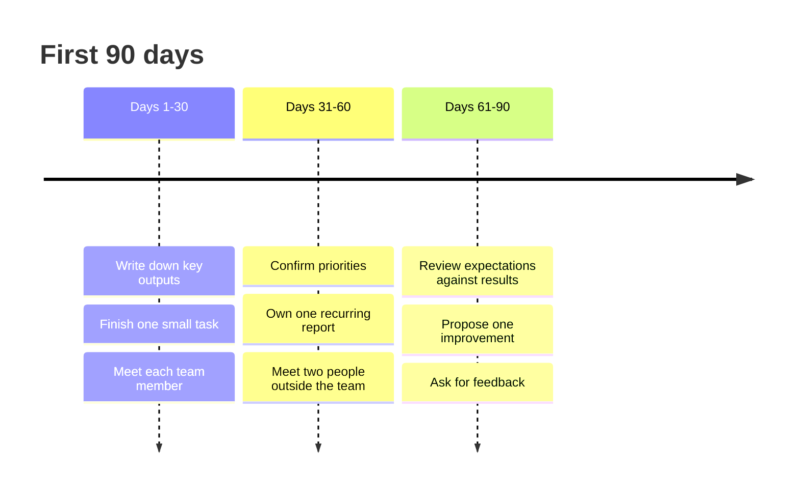

# First 90 days

## Summary

The first months in a new role decide whether you become productive, accepted and likely to stay. A meta-analysis of 70 samples of newcomers found that three kinds of adjustment - clarity about the role, self-efficacy and social acceptance - connected the way the organization onboarded people and the way newcomers sought information to outcomes such as satisfaction, commitment, performance and intention to stay. In practice this means a newcomer should clarify the role, ask for information on purpose and build relationships early.

## Prerequisites

[Job interview](../job-search/job-interview.md), especially the questions about expectations.

## Core concepts

### Newcomer adjustment

*Definition.* *Newcomer adjustment* is the process by which a new employee learns the role and the organization and becomes accepted. Bauer, Bodner, Erdogan and Truxillo (2007) tested a model with three adjustment indicators:

- **Role clarity:** you know what is expected.
- **Self-efficacy:** you believe you can do the job.
- **Social acceptance:** you feel part of the group.

*Mechanism.* In the tested model, organizational socialization tactics (how the employer structures onboarding) and the newcomer's information seeking improved adjustment, and adjustment in turn related to job satisfaction, organizational commitment, job performance, intentions to remain and turnover. The results generally supported the model. Effects differed with how the studies were designed, and with whether newcomers came from school or from another job.

*Analogy.* Starting a job is like arriving in a new city: you need a map (role clarity), confidence to move around (self-efficacy) and a few friendly faces (acceptance). The analogy breaks because a city does not evaluate you.

*Boundaries.* The review is correlational and averages across many settings. It does not tell you the right sequence of actions in your company.

### Your part

Information seeking is something you control. Ask questions, observe, and request feedback.

## Worked example

A synthetic 30-60-90 plan for a new analyst. Use it as a template, and agree it with your manager.

| Period | Role clarity | Self-efficacy | Social acceptance |
| --- | --- | --- | --- |
| Days 1-30 | Write down the three most important outputs and how success is judged | Complete one small task end to end | Meet each team member for 20 minutes |
| Days 31-60 | Confirm priorities with the manager | Own one recurring report | Meet two people outside the team |
| Days 61-90 | Review the written expectations against results | Propose one improvement | Ask two colleagues for feedback |

The timeline shows the same plan in three steps.

Use the question from the [interview note](../job-search/job-interview.md): "What would I have needed to accomplish in six months to exceed expectations?" Write the answer down and bring it to the first one-to-one meeting.

## Trade offs and when to use it

- Asking too many questions at once can overload colleagues. Collect them and ask in batches.
- Quick wins build confidence, but do not skip learning how decisions are made.
- Some employers have a formal onboarding program. Use it, and fill the gaps with your own plan.

## Common mistakes

- Waiting to be told what to do. Fix: propose a plan and ask for corrections.
- Judging the culture within two weeks. Fix: note observations and test them with people you trust.
- Working alone to prove yourself. Fix: schedule regular contact.

## Practice

1. Name the three adjustment indicators and give a question you could ask to improve each.
2. Why might the results differ for someone coming from school versus from another job?
3. Draft the 30-day column of your own plan for a real or imagined role.

Hints: question 2 relates to what the newcomer already knows about work in general.

## Further reading

- Bauer, T. N., Bodner, T., Erdogan, B., Truxillo, D. M., & Tucker, J. S. (2007). Newcomer adjustment during organizational socialization: A meta-analytic review of antecedents, outcomes, and methods. *Journal of Applied Psychology*, 92(3), 707-721. [doi:10.1037/0021-9010.92.3.707](https://doi.org/10.1037/0021-9010.92.3.707). The model and the 70 samples.

TODO: Read the paper in full for effect sizes. The 30-60-90 table is a template of this repository and not a published method.
