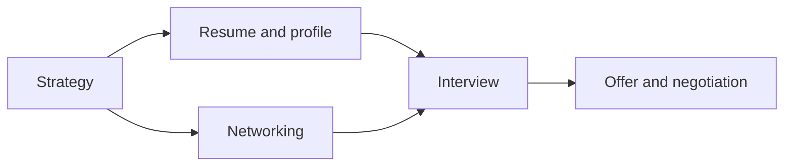

# Job search

The steps from a decision to an offer: strategy, documents, networks, interviews and negotiation.

## How the notes fit together

The diagram shows the path from strategy to an offer. Documents and networks feed the search, and the interview leads to negotiation.

## Notes in reading order

1. [Job search strategy](job-search-strategy.md): what the research says about search behavior and interventions.
2. [Resume and cover letter](resume-and-cover-letter.md): what screeners look at and how to present evidence.
3. [Professional profile](professional-profile.md): a public profile such as LinkedIn.
4. [Networking](networking.md): weak ties and what networking behavior predicts.
5. [Job interview](job-interview.md): structured interviews, answering and the questions you ask.
6. [Salary and offer negotiation](salary-and-offer-negotiation.md): anchoring, interests and alternatives.

## Navigation

- Back to [Career](../README.md).
