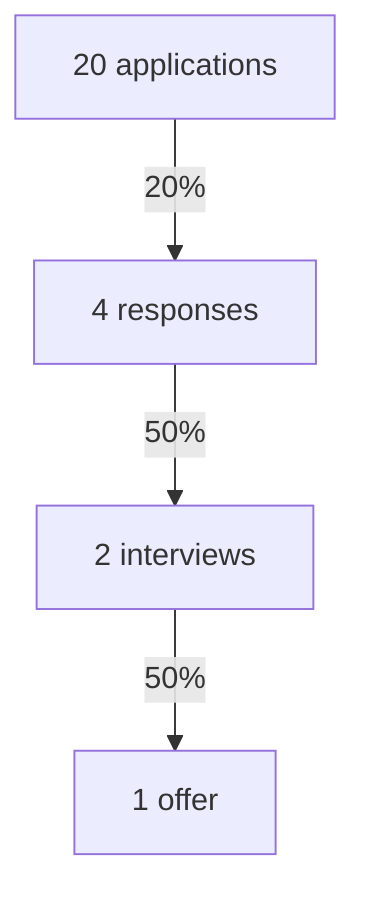

# Job search strategy

## Summary

Job searching is a project with a target, channels, a weekly routine and a way to measure progress. Research supports the basics: more purposeful job-search behavior goes with a higher chance of finding work, and structured programs that build both skills and motivation raise the odds of employment. A pipeline with conversion rates shows where a search is failing, so you fix the right step.

## Prerequisites

[Career planning process](../planning/career-planning-process.md) for the target, and [skills inventory](../self-assessment/skills-inventory-and-gap-analysis.md) for what you offer.

## Core concepts

### Search behavior and outcomes

A meta-analysis of job search and employment found that job-search behavior was significantly and positively related to finding employment. Several personality and motivation variables related to search behavior, with population correlations from -.15 to .46, and their relation to employment success was smaller than that of search behavior itself (Kanfer, Wanberg and Kantrowitz, 2001). In plain terms: what you do matters more than traits you cannot change.

### Interventions that work

A meta-analytic review of 47 experimental or quasi-experimental job-search interventions found that the odds of obtaining employment were 2.67 times higher for participants than for control groups (Liu, Huang and Wang, 2014). Components such as teaching job-search skills, improving self-presentation, boosting self-efficacy, encouraging proactivity, promoting goal setting and enlisting social support were linked to better results. Interventions promoted employment only when both skill development and motivation enhancement were included.

*Use.* A good routine therefore trains skills (documents, interviews) and keeps motivation (small goals, support from others).

### Channels

- **Posted jobs:** visible, competitive, require a tailored application.
- **Referrals and contacts:** depend on [networking](networking.md).
- **Direct applications:** to employers without an open posting.
- **Recruiters and agencies:** useful where they specialize.

### The pipeline

*Definition.* A pipeline counts how many opportunities move through each stage: application, response, interview, offer.

*Analogy.* It is like a water filter system with several stages. A low yield at one stage points to the problem there. The analogy breaks because each "drop" is a person with their own reasons.

## Worked example

Over six weeks you send 20 applications and record the results (invented numbers).

| Stage | Count | Rate from previous stage |
| --- | --- | --- |
| Applications | 20 | - |
| Responses | 4 | 20% |
| Interviews | 2 | 50% |
| Offers | 1 | 50% |

Diagnosis: the response rate is the weakest step. The likely causes are targeting (roles that do not match your profile) or the [resume](resume-and-cover-letter.md). Action: apply to 10 roles that match at least 70% of the requirements, with a tailored resume, and compare the response rate. The interview-to-offer rate of 50% is fine, so keep your current interview preparation. With so few data points, the rates are rough; wait for 30 or more applications before drawing firm conclusions.

The funnel shows the example counts and the rate at each step. The weakest step is the first one.

## Trade offs and when to use it

- Tracking takes effort but removes guesswork. A simple spreadsheet is enough.
- Tailoring each application lowers volume and usually raises quality. Balance it against your time.
- Search intensity is limited by energy. Plan rest, since job search stress is real.

## Common mistakes

- Sending the same resume everywhere. Fix: change the top third to match the posting.
- Quoting a popular "most jobs are never advertised" statistic. TODO: find a primary source before using any such figure. Meanwhile treat referral channels as important without a number.
- Waiting to network until the search starts. Fix: keep contacts warm.

## Practice

1. Which stage of your own pipeline do you think is weakest, and what data would show it?
2. Why can a program that only teaches resume writing fail to raise employment?
3. Set up the table above for your search and fill in the first week.

Hints: question 2 relates to the finding about skill development and motivation.

## Further reading

- Kanfer, R., Wanberg, C. R., & Kantrowitz, T. M. (2001). Job search and employment: A personality-motivational analysis and meta-analytic review. *Journal of Applied Psychology*, 86(5), 837-855. [doi:10.1037/0021-9010.86.5.837](https://doi.org/10.1037/0021-9010.86.5.837). Search behavior and employment.
- Liu, S., Huang, J. L., & Wang, M. (2014). Effectiveness of job search interventions: A meta-analytic review. *Psychological Bulletin*, 140(4), 1009-1041. [doi:10.1037/a0035923](https://doi.org/10.1037/a0035923). What makes interventions work.

TODO: The statistics come from the abstracts. Read the full texts for the effect-size details and the age findings.
