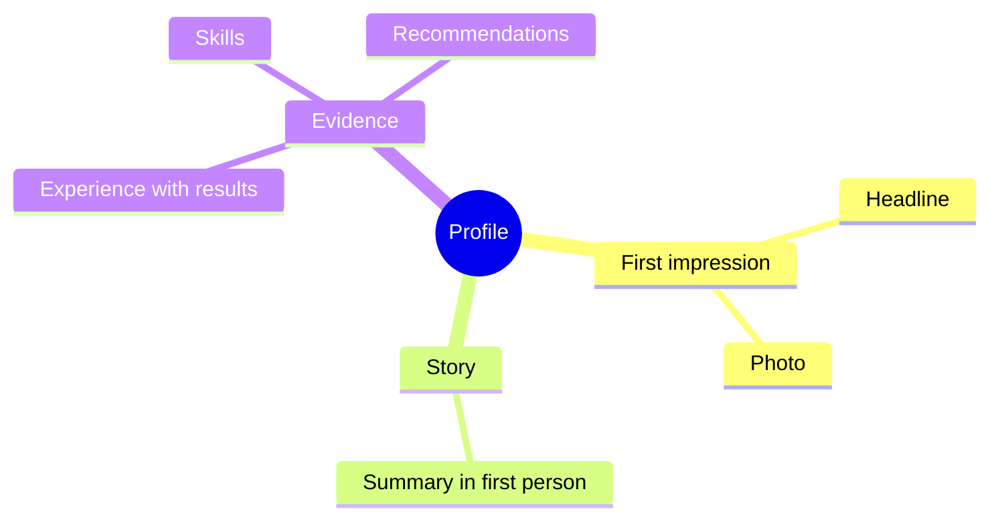

# Professional profile

## Summary

A professional profile is your public page on a platform such as LinkedIn, where recruiters, colleagues and clients can find and judge you. It works when it is written in your own voice, shows evidence and invites the right contacts. Research has begun to study such profiles as a way recruiters assess candidates, so the profile is part of the selection process even if you never apply.

## Prerequisites

[Resume and cover letter](resume-and-cover-letter.md) for the evidence-based writing method.

## Core concepts

### Why a profile matters

A profile is searchable and always on. People who do not know you can see your headline, your photo and your summary before they decide to reply. A study examined LinkedIn profiles as a selection method and their psychometric properties (Roulin and Levashina, 2019). The fact that researchers test profiles as an assessment tool shows that judgments are made from them. TODO: read the findings.

### Parts of a profile

- **Headline.** One line saying what you do and for whom.
- **Photo.** A clear, recent, professional-looking image.
- **Summary.** A short text in the first person.
- **Experience.** Roles with results, as in the [resume](resume-and-cover-letter.md).
- **Skills and recommendations.** Evidence from other people carries more weight than your own claims.

The map shows how the parts of a profile work together. The headline and photo are seen first, and the experience and recommendations give the evidence.

### Common profile mistakes

These errors are practitioner advice and have no research source here. TODO: verify with a primary or platform source.

- Not writing your own summary. Write as yourself, in the first person. The third person creates distance.
- A poor photo or none. Use a good, authentic one.
- Sending generic connection invitations. Add a reason in one sentence.

## Worked example

A synthetic profile for a data analyst.

Headline: "Data analyst | I turn sales data into weekly decisions | SQL, Python".

Summary: "I build reports that people read. At my current employer I replaced a 3-day monthly reporting process with a weekly dashboard used by 4 regional managers. I like working with finance and product teams. I am looking to join a team where analysis changes decisions."

Check against the list: the headline says what and for whom, the summary is in first person, it has one piece of evidence and it says what you want. A connection message might read: "Hello, I read your post on churn analysis. I work on a similar problem and would value a short exchange of ideas."

## Trade offs and when to use it

- A visible profile attracts contacts, including unwanted ones. Review your privacy settings.
- Over-polishing can sound generic. Use concrete details.
- Keep the profile consistent with the resume. Differences look careless.
- A profile is public data. Do not publish personal data you do not want a stranger to have, and do not post confidential employer information.

## Common mistakes

- Using only a job title as the headline. Fix: say what you do for whom.
- Letting the profile go stale. Fix: update it after each project.
- Asking for a favor in the first message. Fix: start with a specific interest or an offer.

## Practice

1. Rewrite your own headline in one line using what you do and for whom.
2. Why might recommendations from colleagues be more persuasive than your own skill list?
3. Write a two-sentence connection request that gives a reason.

Hints: question 2 relates to evidence from a source other than yourself.

## Further reading

- Roulin, N., & Levashina, J. (2019). LinkedIn as a new selection method: Psychometric properties and assessment approach. *Personnel Psychology*, 72(2), 187-211. [doi:10.1111/peps.12296](https://doi.org/10.1111/peps.12296). Profiles studied as an assessment tool (findings not read here).

TODO: Add a platform or research source for profile elements. The advice on the summary, photo and invitations is practitioner advice.
