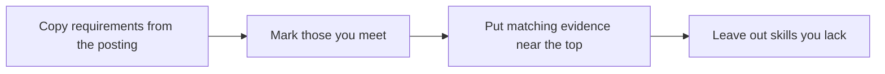

# Resume and cover letter

## Summary

A resume (also called a CV) is a short document that lets a reader decide in a few minutes whether to talk to you. It works when each claim is specific and backed by evidence, and when its content matches the posting. A cover letter explains why you want this role and what you would bring. Research on how recruiters use resume information exists, but most layout rules in circulation are convention or practitioner advice, and this note marks them as such.

## Prerequisites

[Skills inventory and gap analysis](../self-assessment/skills-inventory-and-gap-analysis.md) supplies the evidence you will cite.

## Core concepts

### Purpose

*Definition.* A resume is a selection document. It is read quickly and compared with other resumes, so its job is to get an interview, not to tell your whole story.

*Analogy.* A resume works like a product label: a reader scanning a shelf needs the key facts at once. The limit is that you are not a product, and the label should not hide how you work with others.

### Evidence over adjectives

A claim such as "excellent communication skills" can be written by anyone. A claim with an action, a scope and a result can be checked.

| Weak | Stronger |
| --- | --- |
| Responsible for monthly reports | Built the monthly sales report for 4 regions, cutting preparation time from 3 days to 1 |
| Good team player | Coordinated 5 colleagues to finish a migration two days early |

The numbers in the second column are examples. Use only figures you can defend.

### Matching the posting

Copy the key requirements from the posting, mark those you meet and place the matching evidence near the top. Do not claim skills you lack. A study of recruiters' use of resume information for recent graduates (Cole, Rubin, Feild and Giles, 2007) examined what recruiters take from a resume. TODO: read the findings and add them here.

### Cover letter

Three short parts: why this employer, what you offer with one piece of evidence, and what you ask for. Keep it to one page.

### Practitioner conventions

Length, photo, personal data and section order differ by country and industry. Check local norms. The advice "one page for early career, two for experienced" is a common rule of thumb and is not a research finding. TODO: add a verified source for the norms of your country.

## Worked example

Posting excerpt: "Reports weekly to management; basic SQL; works with finance team."

Original bullet: "Worked on reports."

Rewrite in three steps:
1. Action and object: "Produced weekly sales reports".
2. Scope: "for 4 regions".
3. Evidence from the posting terms: "using SQL queries, shared with the finance team".

Result: "Produced weekly sales reports for 4 regions with SQL queries and shared them with the finance team." The reader can see three of the requirements in one line. Check each part is true before you use it.

## Trade offs and when to use it

- Tailoring raises relevance and costs time. Keep a master document with all evidence and copy from it.
- A creative layout can stand out but may break software that parses resumes. It is wise to keep a plain version. TODO: verify how common parsing problems are.
- A cover letter is useful when the posting asks for it or when your path needs explaining. Otherwise a short message to a named person may be better.

## Common mistakes

- Listing duties instead of results. Fix: use the action-scope-result pattern.
- Typos and inconsistent dates. Fix: read it aloud and ask someone else to read it.
- Including personal data that is not needed. Fix: leave out what the posting and your local norms do not require.

## Practice

1. Rewrite "Helped customers" into an evidence-based bullet using invented but plausible numbers.
2. What three parts does a short cover letter need?
3. Take one real posting and mark which requirements your current resume proves.

Hints: question 1 needs an action, a scope and a result.

## Further reading

- Cole, M. S., Rubin, R. S., Feild, H. S., & Giles, W. F. (2007). Recruiters' perceptions and use of applicant resume information: Screening the recent graduate. *Applied Psychology*, 56(2), 319-343. [doi:10.1111/j.1464-0597.2007.00288.x](https://doi.org/10.1111/j.1464-0597.2007.00288.x). How recruiters read resumes (findings not read in this note).

TODO: The structure of this note follows general practice. Add research on cover letters.
