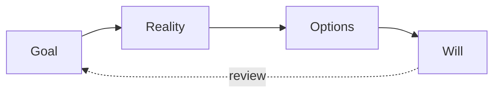

# Coaching techniques for career

## Summary

Coaching is a set of conversation techniques that help a person clarify goals and find their own next steps. In career work, the useful parts are a simple structure for a conversation (GROW), questions that open thinking, and habits that keep the coach from giving advice too early. A meta-analysis of 18 studies found positive effects of coaching in organizations on performance and skills, well-being, coping, work attitudes and goal-directed self-regulation. This note treats these as tools you can use on yourself or with a peer. It is not about becoming a coach.

## Prerequisites

[Career planning process](../planning/career-planning-process.md) for goals and decisions.

## Core concepts

### Why the techniques exist

Advice often fails because it answers the adviser's problem, not yours. Coaching techniques keep the focus on the person's own goals, reasoning and commitments.

### GROW

*Definition.* GROW is a four-step structure for a coaching conversation: Goal, Reality, Options and Will (also called Way forward). It is usually credited to John Whitmore's book *Coaching for Performance*. The bibliographic details come from memory and were not checked.

*Mechanism.* Each step has typical questions:

| Step | Purpose | Example question |
| --- | --- | --- |
| Goal | State what you want | "What would a good outcome of this conversation be?" |
| Reality | Describe where you are | "What have you tried, and what happened?" |
| Options | Generate choices | "What else could you do? What would you advise a friend?" |
| Will | Commit to action | "What will you do by when? How will you know?" |

*Analogy.* GROW is like a route plan: destination, current position, possible routes, chosen route. It fails if the destination changes during the trip, which is normal. Go back to Goal when it does.

The diagram shows the four steps and the return to Goal when it changes.

### Powerful questions

A powerful question is open (not answerable by yes or no), non-leading and directs attention to the person's own thinking. "What matters most to you in this decision?" is stronger than "Don't you think you should take the job?"

### Other approaches

- **Solution-focused questions:** attention to what works and to a desired future, for example scaling questions ("On a scale of 1 to 10, where are you now, and what would make it one point higher?"). TODO: add a primary source.
- **Motivational interviewing basics:** open questions, affirmations, reflective listening and summaries, used to explore ambivalence without pushing. TODO: add Miller and Rollnick as a primary source.

### Evidence

Theeboom, Beersma and van Vianen (2014) meta-analyzed coaching in organizational settings. Effects were positive and significant on five outcomes, with effect sizes (Hedges' g) from 0.43 for coping to 0.74 for goal-directed self-regulation, based on 18 studies. Grant, Curtayne and Burton (2009) report a randomized controlled study of executive coaching on goal attainment, resilience and workplace well-being. TODO: read both papers for the details.

*Boundaries.* The studies are about coaching in organizations, with trained coaches. A self-guided or peer version may work differently. Coaching is not therapy and does not replace medical or legal help.

## Worked example

A self-coaching session on a decision: stay in the current job or move to a smaller company. Write answers to each prompt in about 10 minutes. The notes are an illustration.

- **Goal:** "In one year I want more responsibility and a clear path to leading a project."
- **Reality:** "I lead no projects now. I asked once and was told to wait. I feel underused."
- **Options:** "Ask for a pilot project. Move to a smaller company. Take a project in another team. Do nothing."
- **Will:** "I will ask my manager for a pilot project in this week's one-to-one and decide in six weeks. I will count it a success if I get a scoped project with a date."

Review after six weeks. If the answer was no, go back to Options and test the next one. Use the [decision matrix](../planning/career-planning-process.md) for the final choice.

## Trade offs and when to use it

- Questions work best when you have some answers and need structure. If you lack basic information, ask someone with experience (see [mentoring](mentoring-process-and-relationships.md)).
- Self-coaching can be too comfortable. A peer who asks "what exactly will you do?" helps.
- Quality varies between coaches and approaches, and the field includes weak claims. Ask what evidence supports a method.

## Common mistakes

- Giving advice in the Options step before the person has generated their own. Fix: ask "what else?" at least twice.
- Setting vague actions in Will. Fix: write who, what and when.
- Skipping Reality. Fix: describe facts before judgments.

## Practice

1. Write the four steps of GROW with one question for each.
2. Turn "You should apply for the promotion, right?" into a powerful question.
3. Run the self-coaching session above on a real decision and check the follow-up date.

Hints: question 2 should be open and not suggest the answer.

## Further reading

- Theeboom, T., Beersma, B., & van Vianen, A. E. M. (2014). Does coaching work? A meta-analysis on the effects of coaching on individual level outcomes in an organizational context. *The Journal of Positive Psychology*, 9(1), 1-18. [doi:10.1080/17439760.2013.837499](https://doi.org/10.1080/17439760.2013.837499). The meta-analysis.
- Grant, A. M., Curtayne, L., & Burton, G. (2009). Executive coaching enhances goal attainment, resilience and workplace well-being: A randomised controlled study. *The Journal of Positive Psychology*, 4(5), 396-407. [doi:10.1080/17439760902992456](https://doi.org/10.1080/17439760902992456). A randomized study.
- Whitmore, J. *Coaching for Performance*. The GROW model. Edition and year not checked.

TODO: Verify the GROW attribution and add sources for solution-focused and motivational interviewing methods.
