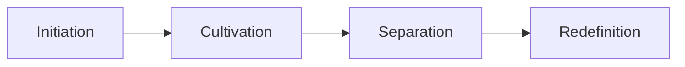

# Mentoring process and relationships

## Summary

A mentoring relationship is a developmental relationship in which a more experienced person supports a less experienced one. Kram's research describes four phases: initiation, cultivation, separation and redefinition. Meta-analyses find that mentored people report favorable career and other outcomes, but the effects are generally small, and smaller still for objective outcomes such as pay. The useful lesson for career work is a process: choose a mentor on purpose, agree on expectations, use the relationship for specific goals and plan its end.

## Prerequisites

[Coaching techniques for career](coaching-techniques-for-career.md) for the question styles, and [networking](../job-search/networking.md) for finding people.

## Core concepts

### Definition

*Mentoring* is a relationship between a mentor and a protégé (also called mentee) aimed at the protégé's development. It differs from coaching in being tied to the mentor's own experience in a field, while a coach may know nothing about your field and still help you think.

### Functions

Kram's work distinguishes career functions (such as sponsorship, exposure and challenging assignments) from psychosocial functions (such as role modeling, acceptance and counseling). TODO: confirm the list of functions in Kram (1985) because the 1983 paper is about phases.

### Phases

*Mechanism.* Kram (1983) described four phases:

- **Initiation:** the relationship starts and each person forms expectations.
- **Cultivation:** the functions are delivered and the relationship deepens.
- **Separation:** change in roles or location alters the relationship.
- **Redefinition:** the relationship ends or becomes a different one, such as a peer friendship.

*Analogy.* A mentoring relationship is like a season: it starts, grows, changes and ends, and the end is part of the cycle. The analogy fails because the phases do not need fixed lengths and people may skip some.

### Evidence

A meta-analysis of the career benefits for protégés found generally supportive results, but effect sizes for objective outcomes such as compensation were small; there were also signs that outcomes differed by type of mentoring, career or psychosocial (Allen, Eby, Poteet and Lentz, 2004). A later meta-analysis of youth, academic and workplace mentoring found favorable behavioral, attitudinal, health-related, relational, motivational and career outcomes, with effect sizes generally small, and larger effects for academic and workplace than for youth mentoring (Eby, Allen, Evans and Ng, 2008).

*Boundaries.* Correlations are averages. They do not show that a particular mentor will raise your pay, and they say little about the quality of the relationship.

## Worked example

Goal: find and start a mentoring relationship in six months. All names are placeholders.

1. **Clarify the need.** "I want to learn how to lead projects." Use your [skills gap list](../self-assessment/skills-inventory-and-gap-analysis.md).
2. **Choose.** List three people who do what you want to do. Prefer someone who has time and is a step or two ahead.
3. **Ask small.** "Could we meet for 30 minutes to talk about how you moved into project leadership?" Do not ask them to be your mentor at once.
4. **Agree.** After two or three meetings, state expectations: how often, how long, what is confidential, how either side can pause.
5. **Use it.** Bring a concrete topic and a question to every meeting, and report what you did with the last advice.
6. **Plan the end.** Set a review date at six months. Decide to continue, change the form or close with thanks.

Expected result: a relationship with a purpose, a rhythm and an ending that does not feel like a failure.

## Trade offs and when to use it

- Formal programs give structure and access. Informal relationships may be closer but depend on chance and similarity. Similarity can leave some people without mentors.
- One mentor rarely covers everything. Several people for different needs may work better.
- A mentor's advice reflects their path. Test it against your situation.

## Common mistakes

- Asking for a mentor in the first message. Fix: start with a specific, small question.
- Arriving without a topic. Fix: send an agenda in advance.
- Letting a relationship fade unclearly. Fix: agree on a review date.

## Practice

1. Name Kram's four phases and say what typically happens in each.
2. Why should you not expect mentoring to raise pay on its own?
3. Write the first message to a possible mentor in three sentences.

Hints: question 2 relates to the small effect sizes for objective outcomes.

## Further reading

- Kram, K. E. (1983). Phases of the mentor relationship. *Academy of Management Journal*, 26(4), 608-625. [doi:10.2307/255910](https://doi.org/10.2307/255910). The four phases.
- Allen, T. D., Eby, L. T., Poteet, M. L., Lentz, E., & Lima, L. (2004). Career benefits associated with mentoring for proteges: A meta-analysis. *Journal of Applied Psychology*, 89(1), 127-136. [doi:10.1037/0021-9010.89.1.127](https://doi.org/10.1037/0021-9010.89.1.127). Career outcomes.
- Eby, L. T., Allen, T. D., Evans, S. C., Ng, T., & DuBois, D. L. (2008). Does mentoring matter? A multidisciplinary meta-analysis comparing mentored and non-mentored individuals. *Journal of Vocational Behavior*, 72(2), 254-267. [doi:10.1016/j.jvb.2007.04.005](https://doi.org/10.1016/j.jvb.2007.04.005). Mentoring across settings.

TODO: The phase names and descriptions come from general knowledge of Kram (1983), and the abstract was not retrieved. Check them. Add research on formal versus informal mentoring.
