# Career planning process

## Summary

Career planning is a loop, not a one-time choice: assess yourself, explore options, decide, act and review. Research on goals shows that specific, challenging goals with feedback work better than vague ones, and that simple if-then plans help people follow through. A weighted decision matrix makes the choice explicit, but when options score close together the result is a prompt to gather more information, not an answer.

## Prerequisites

[Career development theories](../foundations/career-development-theories.md) and [interests, values and strengths](../self-assessment/interests-values-and-strengths.md).

## Core concepts

### The loop

The diagram shows the five steps and the arrow back from review. Each pass uses what the last one taught you.

- **Assess:** interests, values, strengths, skills.
- **Explore:** talk to people, try small tasks, read postings. This stage uses ideas from planned happenstance.
- **Decide:** compare options against your criteria.
- **Act:** apply, learn, change roles or projects.
- **Review:** compare results with what you expected and adjust.

### Goal setting

*Definition.* Goal-setting theory, summarized by Locke and Latham (2002), says that specific and difficult goals lead to higher performance than easy goals or "do your best", provided you are committed, you get feedback and the task is not too complex.

*Mechanism.* A goal directs attention, raises effort, increases persistence and prompts the search for strategies.

*Example.* "Improve my SQL" is vague. "Finish three SQL exercises per week for six weeks and have a colleague review the last one" is specific, measurable and has feedback.

*Boundaries.* For a new, complex task, a goal about learning ("try four approaches and record what each taught") works better than a goal about the result.

### Implementation intentions

*Definition.* An *implementation intention* is an if-then plan: "If situation X occurs, I will do Y." Gollwitzer (1999) reviewed research showing that such plans help people carry out goals.

*Example.* "If it is Tuesday 19:00, I open my SQL exercise file."

### Decision matrix

*Definition.* A weighted decision matrix scores each option on each criterion and multiplies by the weight of the criterion.

## Worked example

Choose between three roles. Criteria and weights (they sum to 1.0): growth 0.4, pay 0.3, location 0.2, stability 0.1. Scores run from 1 to 5.

| Option | Growth | Pay | Location | Stability | Total |
| --- | --- | --- | --- | --- | --- |
| A | 5 | 3 | 2 | 3 | 3.6 |
| B | 3 | 5 | 4 | 4 | 3.9 |
| C | 4 | 4 | 3 | 2 | 3.6 |

Total for A: 5 x 0.4 + 3 x 0.3 + 2 x 0.2 + 3 x 0.1 = 2.0 + 0.9 + 0.4 + 0.3 = 3.6. B wins by a small margin.

The chart compares the totals under the original weights and under the sensitivity weights described below. The ranking changes, so the decision is close.

```mermaid
xychart-beta
  title "Weighted totals for options A, B and C"
  x-axis ["A", "B", "C"]
  y-axis "Total" 3 --> 4
  bar [3.6, 3.9, 3.6]
  bar [3.8, 3.7, 3.6]
```

The first bar of each pair uses the original weights and the second uses the weights growth 0.5, pay 0.2, location 0.2, stability 0.1.

Sensitivity check: change the weights to growth 0.5, pay 0.2, location 0.2, stability 0.1. Now A = 3.8, B = 3.7 and C = 3.6. The ranking flips, so the decision is close. The right move is to find out more about the options (for example, how fast people in A actually grow), not to trust the first total.

## Trade offs and when to use it

- A matrix makes your criteria visible and discussable. It cannot find a criterion you forgot.
- A challenging goal motivates, but a goal set too high can discourage. Check commitment and resources.
- Plans age quickly. Schedule a review every few months.

## Common mistakes

- Planning for ten years in detail. Plan the next experiment and review.
- Choosing weights after seeing the scores. Fix the weights first.
- Treating the review step as optional. Without it the loop does not learn.

## Practice

1. Rewrite "get better at presenting" as a specific goal with feedback.
2. Compute option C's total with the second set of weights.
3. Why does a close result in the matrix tell you to explore more?

Hints: C with weights 0.5, 0.2, 0.2, 0.1 = 2.0 + 0.8 + 0.6 + 0.2 = 3.6.

## Further reading

- Locke, E. A., & Latham, G. P. (2002). Building a practically useful theory of goal setting and task motivation: A 35-year odyssey. *American Psychologist*, 57(9), 705-717. [doi:10.1037/0003-066X.57.9.705](https://doi.org/10.1037/0003-066X.57.9.705). Summary of goal-setting theory.
- Gollwitzer, P. M. (1999). Implementation intentions: Strong effects of simple plans. *American Psychologist*, 54(7), 493-503. [doi:10.1037/0003-066X.54.7.493](https://doi.org/10.1037/0003-066X.54.7.493). The if-then plan.
- Mitchell, K. E., Levin, A. S., & Krumboltz, J. D. (1999). Planned happenstance: Constructing unexpected career opportunities. *Journal of Counseling & Development*, 77(2), 115-124. [doi:10.1002/j.1556-6676.1999.tb02431.x](https://doi.org/10.1002/j.1556-6676.1999.tb02431.x). Exploration as a planned activity.

TODO: The abstracts of Locke and Latham (2002) and Gollwitzer (1999) were not retrieved, so the descriptions come from general knowledge of the papers. Check them against the full texts.
