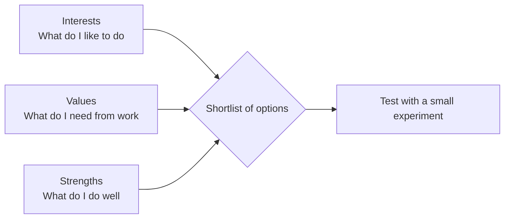

# Interests, values and strengths

## Summary

Three questions shape a good career decision: what do I find interesting, what do I care about, and what am I good at? Interests have the strongest research base, with free inventories such as the O*NET Interest Profiler. Values and strengths are usually explored with structured reflection, where the evidence for specific tests is thinner. Each result is a starting point for exploring options, not a verdict.

## Prerequisites

[Career development theories](../foundations/career-development-theories.md) for the RIASEC types, and [person-environment fit](../foundations/person-environment-fit.md).

## Core concepts

### Interests

*Definition.* A vocational interest is a stable preference for certain activities and settings. In Holland's model there are six types: Realistic, Investigative, Artistic, Social, Enterprising and Conventional.

*Mechanism.* An inventory asks whether you would like or dislike many activities and sums the answers into six scores. The top three letters form your code, which is matched to occupations with similar codes. The O*NET Interest Profiler has a 30-item mini version and a 60-item short form, and links the result to more than 900 occupations on O*NET OnLine (checked 2026-10).

*Evidence.* A meta-analysis of 60 studies found that interests relate to performance and persistence at work and in education (Nye et al., 2012).

*Boundaries.* An interest score does not measure ability, and it does not tell you what the labor market pays for.

### Values

*Definition.* Work values are the outcomes you want from work: autonomy, security, income, helping others, status, variety and so on. They are your needs in the needs-and-supplies view of [fit](../foundations/person-environment-fit.md).

*Method.* A forced ranking works better than a rating, because rating makes everything "important". List 10 values and compare pairs until a ranking appears.

### Strengths

*Definition.* A strength is something you do well and that gives you energy. Strength-based approaches ask people to identify and use these.

*Boundaries.* The research base for specific strength tests is smaller than for interests. Treat the results as prompts for a conversation, and look for external evidence such as feedback you received. TODO: add a verified source on the evidence for strengths tools.

The three lenses answer different questions, and an option is worth exploring when it holds up under all of them.

### Analogy

Interests are a compass, values are the destination criteria, and strengths are the vehicle. The analogy fails because a compass has one reading while a person has several interests that can conflict.

## Worked example

Step 1: take the O*NET Interest Profiler short form (60 items). Suppose the result is Investigative 28, Social 24, Artistic 16, Enterprising 12, Conventional 9, Realistic 6. The top code is ISA. (The scores are invented.)

Step 2: list 8 to 10 occupations with a similar code from O*NET OnLine.

Step 3: rank your values by pairwise comparison. Suppose the top three are autonomy, learning and helping others.

Step 4: for each occupation, write one sentence on how it supplies the top three values. Remove any that clearly do not.

Step 5: for the remaining three, find a person in the role and ask what a normal week looks like (see [networking](../job-search/networking.md)).

Expected result: a shortlist of two or three occupations with a reason for each, and a list of questions to test them.

## Trade offs and when to use it

- Inventories are fast and cheap, but self-report can be shaped by what you think is desirable.
- Values work needs honesty about trade-offs, such as income versus autonomy.
- Use these methods early and repeat them after a major life change. Interests are fairly stable, but values often shift.

## Common mistakes

- Reading a code as "the only jobs I can do". Treat it as a search seed.
- Choosing an interest without checking the day-to-day work. A topic you like and a task you like are different.
- Listing only values that sound good. Include uncomfortable ones, such as status or money.

## Practice

1. Explain why a forced ranking of values is more informative than a rating of each.
2. A person scores high on Artistic and low on Conventional. What kinds of work environments should they test first?
3. Take the Interest Profiler and write your code. Find two occupations that you did not expect.

Hints: question 2 is about Holland's matching idea, in which a code is linked to similar work settings.

## Further reading

- Nye, C. D., Su, R., Rounds, J., & Drasgow, F. (2012). Vocational interests and performance: A quantitative summary of over 60 years of research. *Perspectives on Psychological Science*, 7(4), 384-403. [doi:10.1177/1745691612449021](https://doi.org/10.1177/1745691612449021). The evidence for interests.
- U.S. Department of Labor. O*NET Interest Profiler. [onetcenter.org/IP.html](https://www.onetcenter.org/IP.html). A free inventory (checked 2026-10).

TODO: Add a primary source on work values (for example Dawis and Lofquist). Add the evidence for strengths tools.
