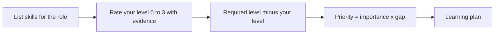
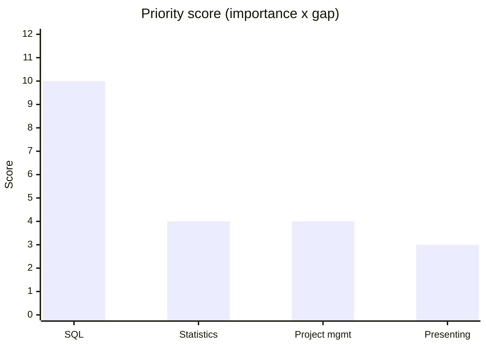

# Skills inventory and gap analysis

## Summary

A skills inventory is a list of what you can do, each item backed by evidence and a level. A gap analysis compares that list with what a target role needs and ranks the differences so you know what to learn first. The method turns the vague thought "I need more skills" into a short, ordered list with a reason for each item.

## Prerequisites

[Labor market and work trends](../foundations/labor-market-and-work-trends.md) for where to find the list of required skills. The meaning of skill categories is in [skills](../../skills/README.md), with [soft skills](../../skills/soft-skills/README.md) and [hard skills](../../skills/hard-skills/README.md).

## Core concepts

### Inventory

*Definition.* A skills inventory records each skill, your level on a fixed scale and the evidence for that level.

*Scale.* A simple four-step scale keeps ratings comparable:

| Level | Meaning | Evidence you can show |
| --- | --- | --- |
| 0 | None | - |
| 1 | Aware: can explain it | A course or a book |
| 2 | Working: can do it with help | A project with review |
| 3 | Independent: can do it and teach it | A finished result others used |

*Boundaries.* People often rate themselves with little outside check. A skill without evidence stays at level 1 until you have some.

### Gap analysis

*Definition.* The gap for a skill is the required level minus your level. A negative result is no gap.

*Mechanism.* Priority combines the gap with how much the skill matters for the role. A simple priority score is importance (1 to 5) multiplied by the gap. The score only orders the list, and cost to learn still has to be considered.

*Analogy.* The method is like a pre-trip check of a car: list each part, rate its state, compare it to what the route needs and fix the most critical first. The analogy fails because skills improve with use, while a worn part does not.

The diagram shows the order of the method, from listing skills to a learning plan.

## Worked example

Target role: junior data analyst. The importance and levels below are invented.

| Skill | Importance (1-5) | Required | Current | Gap | Priority |
| --- | --- | --- | --- | --- | --- |
| SQL | 5 | 3 | 1 | 2 | 10 |
| Statistics | 4 | 2 | 1 | 1 | 4 |
| Project management | 2 | 2 | 0 | 2 | 4 |
| Presenting results | 3 | 3 | 2 | 1 | 3 |

The chart shows the priority score of each skill. SQL stands out, so it comes first.

Priority = importance x gap. The ranked list is: SQL (10), statistics (4), project management (4), presenting results (3). Statistics and project management tie, so break the tie by importance (4 versus 2): statistics comes first.

Plan: one SQL project with a reviewer within six weeks. This action creates the evidence needed to move from level 1 to level 2.

## Trade offs and when to use it

- The method is useful before a job change, a promotion discussion or a learning plan.
- It works poorly when the target role is unclear. Do [self-assessment](interests-values-and-strengths.md) first.
- A high gap does not always mean "learn it". If the cost is high and the importance is moderate, consider a role that needs less of it.

## Common mistakes

- Rating without evidence. Fix: attach one concrete example to every rating of 2 or more.
- Treating all gaps as equal. Fix: use the priority score or a similar weighting.
- Planning ten skills at once. Fix: start with the top two.

## Practice

1. Compute the priority for a skill with importance 4, required level 3 and current level 1.
2. Why is a certificate often weaker evidence than a finished project?
3. Build your own table for one target role with at least five skills.

Hints: question 1 gives a gap of 2 and a priority of 8.

## Further reading

- European Commission. ESCO. [esco.ec.europa.eu](https://esco.ec.europa.eu/en/about-esco/what-esco). A source of skill lists per occupation (checked 2026-10).
- Bandura, A. (1977). Self-efficacy: Toward a unifying theory of behavioral change. *Psychological Review*, 84(2), 191-215. [doi:10.1037/0033-295X.84.2.191](https://doi.org/10.1037/0033-295X.84.2.191). Why mastery experiences, such as finished projects, raise confidence.

TODO: Add a source on the accuracy of self-rated skills. The four-level scale is a working tool of this repository, not a published standard.
