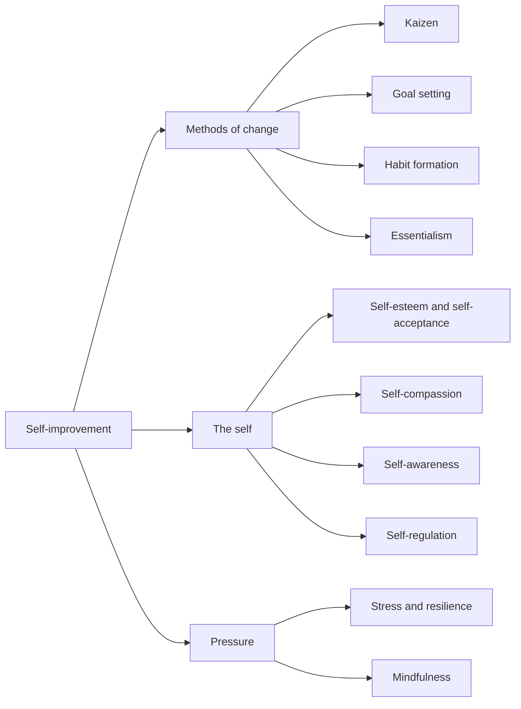

# Personal growth

Understanding and changing how you think, feel and act. This field belongs to [Personal development](../README.md). It covers the overall idea of self-improvement, methods of change (kaizen, goals, habits, essentialism), the self (esteem, compassion, awareness, regulation) and coping with pressure (stress, resilience, mindfulness). Notes rely on research where it exists and say so where a popular idea has no support. Skills that are practiced with others or at work are in [soft skills](../skills/soft-skills/README.md).

## Map of the field

## Notes in reading order

1. [Self-improvement](self-improvement.md): what it is, whether people can change and what works.
2. [Goal setting](goal-setting.md): specific goals, feedback and the limits of goals.
3. [Habit formation](habit-formation.md): cues, small steps, implementation intentions and how long it takes.
4. [Kaizen](kaizen.md): continuous improvement in small steps and the arithmetic of "1% a day".
5. [Essentialism and focusing on the vital few](essentialism.md): doing less but better, and the Pareto principle.
6. [Self-awareness](self-awareness.md): objective self-awareness and tools for reflection.
7. [Self-esteem and self-acceptance](self-esteem-and-self-acceptance.md): development, effects and a stable basis.
8. [Self-compassion](self-compassion.md): the three components and the difference from self-esteem.
9. [Self-regulation, self-control and self-discipline](self-regulation.md): ego depletion, situational strategies and planning.
10. [Stress and resilience](stress-and-resilience.md): appraisal, coping and common resilience.
11. [Mindfulness](mindfulness.md): attention to the present and what trials show.

## Planned topics

- Confidence
