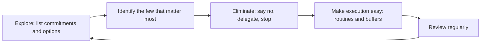

# Essentialism and focusing on the vital few

## Summary

Essentialism is a way of working and living that puts "less but better" first: find the few things that matter most, say no to the rest and protect time for them. Greg McKeown (2014) popularized it, and its roots go back to Stoic and minimalist ideas. The practical core is prioritization, supported by the Pareto principle, the observation that a small share of causes tends to produce a large share of results. The idea is a method and a mindset, and it is not a scientific theory.

*This note is educational.*

## Prerequisites

No prior notes are needed.

## Core concepts

### Definition

*Essentialism* is the disciplined pursuit of less: deciding what is essential, removing what is not and making execution easy (McKeown, 2014). It is the opposite of the *non-essentialist* default of saying yes to every request and trying to do it all. A related popular idea, *focus on the 10%*, claims that about a tenth of activities produce most of the value. The number is a rule of thumb, and the exact share varies.

### The Pareto principle

Vilfredo Pareto observed in the 1890s that about 80% of the land in Italy belonged to about 20% of the people. Later authors, notably Juran, generalized it to the "vital few and the trivial many". It is an empirical regularity in many data sets, not a law: the split is sometimes 80/20 and often different.

### Analogy

An essentialist is a gardener who prunes: cutting back many branches lets the plant put energy into a few. The limit of the analogy is that people choose what to prune using values, and a plant does not.

### Method



| Step | Question |
| --- | --- |
| Explore | What am I doing, and why? |
| Identify | If I could do only one thing, which would make the others easier or unnecessary? |
| Eliminate | What happens if I stop doing this? |
| Make easy | How can the essential thing happen without effort of will? |

## Worked example

A person has 12 recurring tasks per week. They estimate the weekly value of each for their main goal on a scale of 1 to 10.

```python
# Python 3.12. How concentrated is value? Illustrative scores for 12 weekly tasks.
scores = [10, 9, 6, 3, 2, 2, 1, 1, 1, 1, 1, 1]
total = sum(scores)
top = sum(sorted(scores, reverse=True)[:3])
print(total, top, round(top / total * 100))
```

Output:

```text
38 25 66
```

The top 3 tasks (25% of the tasks) give 66% of the value in this illustrative list. The plan: protect time for the top 3, review the next 3, and drop or delegate the 6 tasks that score 1. The scores are the person's own estimates, and the result is a guide for choice and not a measurement.

## Trade offs and when to use it

Essentialism helps with overload, over-commitment and unclear priorities. Limits: the method does not suit jobs in which the tasks are assigned, so "no" has social and professional costs, and "non-essential" tasks such as maintenance and relationships are sometimes essential in the long run. The claim that one can ignore 90% of activities overstates the case.

## Common mistakes

- **Saying no to everything uncomfortable.** The aim is alignment with priorities.
- **Equating essential with urgent.** Important tasks are often not urgent.
- **Treating 80/20 or 10% as exact.** They are rough patterns.

## Practice

1. What is the core idea of essentialism?
2. What does the Pareto principle say?
3. Why should the "10%" be re-evaluated?

### Answers

1. Do less but better: decide what is essential, remove the rest and make the essential easy.
2. A small share of causes tends to produce a large share of results.
3. The most valuable activities change with goals and circumstances.

## Further reading

- McKeown, G. (2014). *Essentialism: The Disciplined Pursuit of Less*. Crown Business. A practitioner book on choosing fewer, more important commitments.
- Covey, S. R. (1989). *The 7 Habits of Highly Effective People*. Free Press. Popularized the urgent-important matrix.
