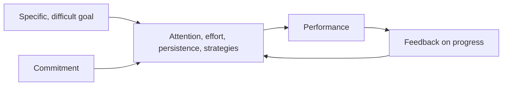

# Goal setting

## Summary

Goal-setting theory, built by Edwin Locke and Gary Latham over 35 years of studies, says that specific and difficult goals lead to higher performance than easy goals, vague goals such as "do your best" or no goals. The effect depends on commitment to the goal, feedback on progress and enough ability and resources. The theory is among the best-supported in work psychology. Goals can also backfire when they are too narrow, set for complex tasks without learning goals, or imposed without commitment.

*This note is educational.*

## Prerequisites

- [Motivation and self-determination](../../social-sciences/psychology/humanistic-and-positive/motivation-and-self-determination.md).

## Core concepts

### Definition

A *goal* is a desired result that a person intends to reach. Locke and Latham (2002) summarize the findings:

- Specific, difficult goals give higher performance than easy goals or "do your best".
- Goals work through four mechanisms: they direct attention, energize effort, increase persistence and encourage the search for strategies.
- Moderators: commitment, feedback, task complexity and situational constraints.

### SMART goals

A common checklist asks that goals be specific, measurable, achievable, relevant and time-bound. It comes from management practice and is a convenient way to apply the research on specificity. The exact meaning of the letters varies by author.

### Analogy

A goal is like a destination in a navigation system. Without it, the system cannot give directions, and with a destination that is too far or too vague the directions are not usable. The limit of the analogy is that a person also decides whether to want the destination at all.

### Mechanism

### Limits

- For complex or new tasks, a learning goal ("find three effective strategies") can work better than a performance goal, which may cause stress and narrow focus.
- Goals can encourage cutting corners when the metric is too narrow.
- A goal that conflicts with a person's values reduces commitment.

### The wheel of life

The wheel of life is a coaching tool. A person rates satisfaction with eight to ten life areas, such as health, career, relationships and finances, from 1 to 10, and plots the results on a circle. It shows imbalances and helps to choose areas for goals. It has no research base of its own, and is a way to organize reflection.

## Worked example

A student has the vague goal "get better at statistics".

| Version | Goal | Quality |
| --- | --- | --- |
| Vague | Get better at statistics | Weak: no direction |
| Specific and measurable | Solve 20 practice problems a week and score at least 75% on the mock exam | Strong |
| With a plan | If it is Tuesday or Thursday after dinner, then I do 10 problems | Adds an implementation intention |
| With feedback | Record the score each week and adjust | Adds feedback |

The first version gives no basis for choosing what to do on Tuesday, and the last one does.

## Trade offs and when to use it

Use specific goals for tasks with clear measures and where skills are known. For complex or creative work, use learning goals and process goals. Review goals regularly, since a goal that no longer fits is a reason to change it, and not a failure.

## Common mistakes

- **Setting vague goals.** They give no direction.
- **Setting too many.** Attention is limited (see [essentialism](essentialism.md)).
- **Skipping feedback.** Without it, a goal does not steer behavior.
- **Choosing goals that others expect.** Commitment is low.

## Practice

1. What kind of goals produce the highest performance, according to Locke and Latham (2002)?
2. Name two moderators.
3. When is a learning goal better than a performance goal?

### Answers

1. Specific and difficult goals, with commitment and feedback.
2. For example commitment, feedback or task complexity.
3. For complex or new tasks, where focus on outcomes can narrow attention and increase stress.

## Further reading

- Locke, E. A. and Latham, G. P. (2002). Building a practically useful theory of goal setting and task motivation: A 35-year odyssey. *American Psychologist*, 57(9), 705-717. [DOI](https://doi.org/10.1037/0003-066X.57.9.705). Summarizes 35 years of goal-setting theory.
- Gollwitzer, P. M. and Sheeran, P. (2006). Implementation Intentions and Goal Achievement: A Meta‐analysis of Effects and Processes. *Advances in Experimental Social Psychology*, 69-119. [DOI](https://doi.org/10.1016/S0065-2601(06)38002-1). A meta-analysis of implementation intentions and goal achievement.
