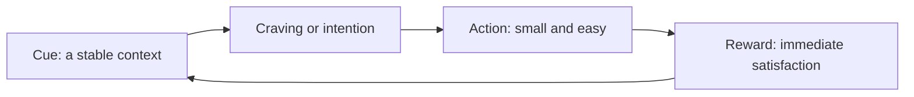

# Habit formation

## Summary

A habit is a behavior that has become automatic in a given context: the context triggers the action without a fresh decision. Research on real-life habit building finds that it takes weeks to months, with wide variation, and that missing a single day does not ruin the process. The most reliable methods are to attach the behavior to a stable cue, to make it small and easy, and to plan in an "if situation, then action" form. Motivation helps to start, and the context keeps the habit going.

*This note is educational.*

## Prerequisites

No prior notes are needed.

## Core concepts

### Definition

A *habit* is a learned association between a context cue and a response, which is carried out with little thought. Wood and Neal (2007) describe habits as responses cued by context and repeated until automatic, in contrast with goal-directed actions. *Automaticity* is the degree to which the behavior needs no deliberate intention.

### How long does it take?

Lally and colleagues (2010) followed 96 volunteers who chose a daily behavior, such as eating a piece of fruit after breakfast, for 12 weeks. For the people whose data fitted the model, the time to reach 95% of the person's final level of automaticity ranged from 18 to 254 days (the often quoted figure of 66 days is the median). Missing one opportunity did not materially affect the process, and more consistent repetition gave a better fit. Simple behaviors become automatic faster than complex ones.

### Analogy

A habit is a trail through a field: each walk along it presses the grass down, and after enough walks the path is the easiest way. A skipped day leaves the trail in place. The limit of the analogy is that a habit lives in cues and memory, and not only in repetition, so a change of environment can erase the trail.

### The habit loop

Clear (2018) turns the loop into four practical laws: make the cue obvious, the action attractive, the step easy and the reward satisfying. The framework is a practitioner synthesis and is not a tested theory, though its parts match research.

### Implementation intentions

An *implementation intention* is a plan of the form "if situation X occurs, I will do Y". In a meta-analysis of 94 studies, Gollwitzer and Sheeran (2006) found a medium-to-large effect on goal attainment, compared with intentions alone. The plan links the action to a cue in advance.

### Fresh starts

Dai, Milkman and Riis (2014) showed that people are more likely to start goal-directed behaviors at temporal landmarks such as a new week, a new month or a birthday. A landmark gives a sense of a fresh start. This helps to begin, and it does not keep a habit alive by itself.

### The "don't break the chain" method

The "Seinfeld strategy" marks each day of success on a calendar to build a chain. It is anecdotal, and its logic fits the evidence: a visible record increases consistency. Given the result of Lally and colleagues (2010), one missed day need not end the chain.

## Worked example

A person wants to stretch for five minutes each morning.

| Element | Design |
| --- | --- |
| Cue | After brushing teeth, in the bathroom |
| Implementation intention | "If I have brushed my teeth, then I roll out the mat and stretch for two minutes" |
| Small step | Two minutes, not five |
| Reward | Tick on the calendar and a glass of water |
| Rule for misses | Never miss twice in a row |
| Review | After 8 weeks, increase to five minutes |

The design follows the evidence: a stable cue, a small action, an immediate reward and a plan for lapses.

## Trade offs and when to use it

Habits save the effort of deciding and are suited to repeated, simple behaviors. They are less useful for tasks that need new decisions each time. A habit built around a context fails when the context changes, for example on holiday, so plan for a new cue. Waking up early is an example: it is easier with a fixed bedtime and morning light than with willpower, and chronotype (see [chronobiology](../../applied-sciences/medicine-and-health/physiology/chronobiology.md)) limits how much it can be changed.

## Common mistakes

- **Starting too big.** A large step needs motivation every day.
- **Expecting 21 days.** The range is 18 to 254 days in one study.
- **Treating a miss as failure.** One miss has little effect.
- **Ignoring the environment.** Cues shape behavior.

## Practice

1. What is an implementation intention?
2. What range of days did Lally and colleagues (2010) report for reaching 95% of final automaticity?
3. Why is one missed day not a disaster?

### Answers

1. A plan in the form "if situation X, then I do Y".
2. 18 to 254 days.
3. Missing one opportunity did not materially affect habit formation in that study.

## Further reading

- Lally, P., van Jaarsveld, C. H. M., Potts, H. W. W. et al. (2009). How are habits formed: Modelling habit formation in the real world. *European Journal of Social Psychology*, 40(6), 998-1009. [DOI](https://doi.org/10.1002/ejsp.674). Measures how long habits take to form in daily life.
- Wood, W. and Neal, D. T. (2007). A new look at habits and the habit-goal interface. *Psychological Review*, 114(4), 843-863. [DOI](https://doi.org/10.1037/0033-295X.114.4.843). A model of habits as context-cued responses.
- Gollwitzer, P. M. and Sheeran, P. (2006). Implementation Intentions and Goal Achievement: A Meta‐analysis of Effects and Processes. *Advances in Experimental Social Psychology*, 69-119. [DOI](https://doi.org/10.1016/S0065-2601(06)38002-1). A meta-analysis of implementation intentions and goal achievement.
- Dai, H., Milkman, K. L. and Riis, J. (2014). The Fresh Start Effect: Temporal Landmarks Motivate Aspirational Behavior. *Management Science*, 60(10), 2563-2582. [DOI](https://doi.org/10.1287/mnsc.2014.1901). Shows that goal pursuit rises at temporal landmarks such as a new year or a birthday.
- Clear, J. (2018). *Atomic Habits*. Avery. A practitioner framework of cue, craving, response and reward for building habits.
