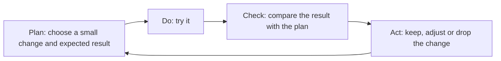
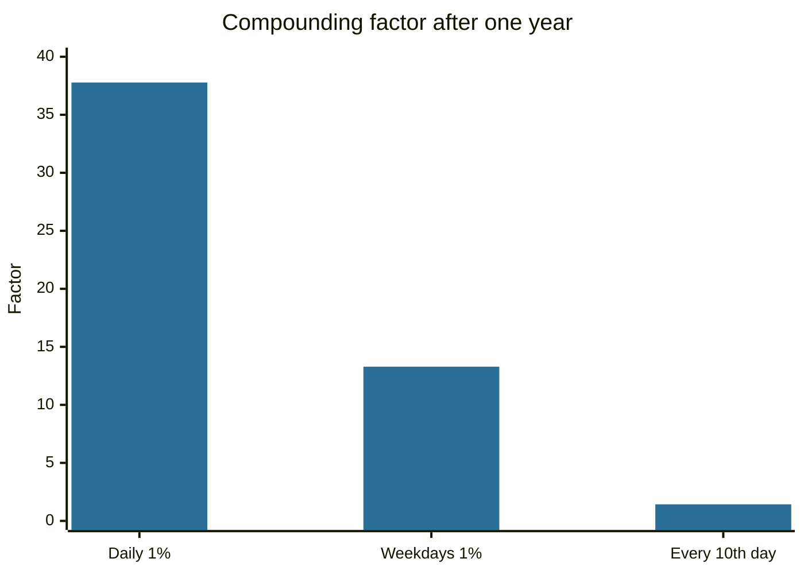

# Kaizen

## Summary

Kaizen is the Japanese word for "change for the better", and it names a management approach of continuous improvement in small steps, developed in Japanese manufacturing and described for Western readers by Masaaki Imai (1986). It rests on a few ideas: improve what exists, involve the people who do the work, remove waste, and use a repeating cycle of plan, do, check and act. In personal development, the same ideas appear as very small steps that avoid the resistance that large changes cause. The popular "1% a day" figure is arithmetic and a metaphor, and not a measured rate of improvement.

*This note is educational.*

## Prerequisites

No prior notes are needed.

## Core concepts

### Definition

*Kaizen* (改善, kai: change, zen: good) is a philosophy and a practice of continuous, incremental improvement carried out by everyone in an organization. Imai (1986) contrasts it with innovation, which brings large changes by a few people with large investment. The idea of the improvement cycle comes from the plan-do-check-act (PDCA) cycle that Deming (1986) taught in Japan.

### Analogy

Kaizen is like tending a path: every day one stone is moved or one weed is pulled. After a year the path is clear, and nobody has done a large project. The limit of the analogy is that improvement does not add up in a straight line, and some changes interact.

### Principles

| Principle | Meaning |
| --- | --- |
| Genba | Go to the place where the work happens, and observe it |
| Muda | Remove waste: waiting, extra motion, defects, over-processing |
| Standard work | Write down the current best way, so that improvements can be seen |
| Small steps | Change what can be changed without large cost or risk |
| Everyone takes part | Improvement is not only for managers |

### The PDCA cycle



### Kaizen and innovation

| Aspect | Kaizen | Innovation (kaikaku) |
| --- | --- | --- |
| Size of change | Small, frequent | Large, rare |
| Who | Everyone | Specialists and leaders |
| Risk | Low | High |
| Cost | Low per step | High |

Both have a role: kaizen improves a process, and innovation replaces it when it reaches its limit.

### Personal kaizen

Maurer (2004) proposed using very small steps in personal change, so that the change does not trigger fear and avoidance. His explanation that small steps "bypass the amygdala" is a popular theory and has not been tested directly. The practical advice (start with a step so small that it is hard to fail) is consistent with research on habit formation.

## Worked example

The arithmetic of "1% a day":

```python
# Python 3.12. The arithmetic behind "1% better every day".
for rate in (1.01, 0.99):
    print(rate, round(rate ** 365, 2))
print("5 days a week, 1% each:", round(1.01 ** (52 * 5), 2))
print("1% every 10th day:", round(1.01 ** 36, 2))
```

Output:

```text
1.01 37.78
0.99 0.03
5 days a week, 1% each: 13.29
1% every 10th day: 1.43
```

Compounding 1% for 365 days gives a factor of 37.78, and 1% worse each day gives 0.03. The figure shows the power of consistency, and it does not show that anyone improves 1% per day: most skills have diminishing returns, and the improvement per step is not measurable in most areas. The factor drops to 13.29 for a five-day week, and to 1.43 for one step every tenth day.



## Trade offs and when to use it

Kaizen works well for processes with clear steps and measures: a work routine, a study method, a workflow. It is weaker where improvement does not compound, or where a process must be replaced. In personal use, a risk is endless tinkering and the avoidance of larger decisions.

## Common mistakes

- **Taking 1% a day literally.** It is a metaphor for consistency.
- **Skipping standard work.** Without a baseline, improvement cannot be seen.
- **Using kaizen for everything.** Sometimes a large change is needed.

## Practice

1. What does PDCA stand for?
2. How do kaizen and innovation differ?
3. What is 1.01 raised to the power 365, rounded to two decimals?

### Answers

1. Plan, do, check, act.
2. Kaizen means small, frequent improvements by everyone, and innovation means large, rare changes by a few.
3. 37.78.

## Further reading

- Imai, M. (1986). *Kaizen: The Key to Japan's Competitive Success*. Random House. The book that introduced kaizen to a Western audience.
- Deming, W. E. (1986). *Out of the Crisis*. MIT Press. Source of the plan-do-check-act improvement cycle in management.
- Maurer, R. (2004). *One Small Step Can Change Your Life: The Kaizen Way*. Workman. Applies kaizen to personal change with very small steps.
