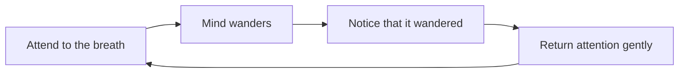

# Mindfulness

## Summary

Mindfulness is paying attention to the present moment on purpose and without judgment. It is practiced in meditation and in everyday activities, and was developed into structured programs such as mindfulness-based stress reduction. A meta-analysis of randomized trials found moderate evidence that mindfulness meditation programs improve anxiety, depression and pain, and low or insufficient evidence for other outcomes. It is a useful skill for attention and acceptance, and it is not a cure for everything.

*This note is educational. It is not medical advice.*

## Prerequisites

No prior notes are needed.

## Core concepts

### Definition

*Mindfulness* is a quality of attention in which a person notices present experience (thoughts, feelings, sensations) with openness and without immediately reacting. It contrasts with *automaticity*, in which a person acts on habit without awareness, for example driving home and not remembering the trip. Mindfulness programs, such as the eight-week mindfulness-based stress reduction course, teach formal practices (breath meditation, body scan) and informal ones (mindful eating, walking).

### Analogy

Mindfulness is like watching traffic from a bridge instead of standing in the road. The cars (thoughts) still pass, and the observer is not hit by each one. The limit of the analogy is that people also have to cross the road and make decisions.

### Evidence

Goyal and colleagues (2014) reviewed 47 trials of meditation programs in a meta-analysis and found moderate evidence of improved anxiety, depression and pain, low evidence of improved stress and quality of life, and insufficient evidence for effects on mood, attention, substance use, eating, sleep and weight. They found no evidence that meditation was better than active treatments, such as drugs, exercise or other behavioral therapies. Effects depend on the quality of the trials, and few include long-term follow-up.

### The practice cycle

The repeated return of attention is the exercise: noticing and returning is the repetition, and a wandering mind is not a failure.

## Worked example

A beginner plan for two weeks.

| Day | Practice |
| --- | --- |
| 1-3 | Five minutes of breath attention, after a fixed cue (after breakfast) |
| 4-7 | Seven minutes, and count 10 breaths |
| 8-10 | Ten minutes |
| 11-14 | Add one daily activity done with full attention, such as washing dishes |

The person notes in two lines after each session what happened. The aim is regular practice, not a calm mind: busy sessions count.

## Trade offs and when to use it

Mindfulness is cheap, can be done alone, and fits well with stress management and the treatment of depression relapse in clinical programs. Limits: effects are moderate, some people find meditation distressing, particularly with trauma or psychosis, and popular claims are far bigger than the research. People with a mental health condition should talk to a clinician before intensive practice.

## Common mistakes

- **Trying to empty the mind.** The practice is to notice and return.
- **Expecting quick calm.** Benefits build over weeks.
- **Using mindfulness in place of treatment.** It adds to it.

## Practice

1. Define mindfulness.
2. What did Goyal and colleagues (2014) find for anxiety and depression?
3. What is the repeated step in breath meditation?

### Answers

1. Paying attention to the present moment on purpose and without judgment.
2. Moderate evidence of improvement.
3. Noticing that the mind wandered and gently returning attention to the breath.

## Further reading

- Goyal, M., Singh, S., Sibinga, E. M. S. et al. (2014). Meditation Programs for Psychological Stress and Well-being. *JAMA Internal Medicine*, 174(3), 357. [DOI](https://doi.org/10.1001/jamainternmed.2013.13018). A meta-analysis of meditation programs for psychological stress.
