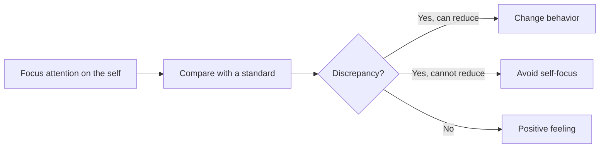

# Self-awareness

## Summary

Self-awareness is the ability to see one's own thoughts, feelings and behavior and how they affect others. Objective self-awareness theory says that attention directed at the self makes people compare themselves with their standards, which can motivate change or cause discomfort. Self-knowledge is more limited than people think, and outside feedback improves it. Practical tools include journaling, structured reflection and asking others.

*This note is educational. It is not mental health advice.*

## Prerequisites

No prior notes are needed.

## Core concepts

### Definition

In objective self-awareness theory, attention can be directed outward at the world or inward at the self. When it is directed at the self, a person compares current behavior with a standard. Silvia and Duval (2001) review the theory: the comparison creates a discrepancy, and the person either changes behavior to reduce it, or avoids self-focus if change seems impossible. Two aspects are usually distinguished: *internal* self-awareness (knowing one's values, feelings and motives) and *external* self-awareness (knowing how others see one).

### Analogy

Self-awareness is like a mirror with two sides: one shows how you look to yourself, and the other how you look to the room. Most people look into the first often and the second rarely. The limit of the analogy is that mirrors reflect accurately, and self-perception does not.

### Tools

| Tool | How it works | Evidence |
| --- | --- | --- |
| Journaling and expressive writing | Writing about experiences and feelings | Smyth (1998): a meta-analysis found positive effects on health outcomes, with moderate effects |
| Structured reflection | Regular review with fixed questions | Widely used, limited direct evidence |
| Feedback from others | Ask trusted people for specific observations | Supports external awareness (see [feedback and criticism](../skills/soft-skills/interpersonal/feedback-and-criticism.md)) |
| Values clarification | List values and compare with behavior | Used in acceptance-based therapies |
| Personality and strengths inventories | Structured self-report | Vary in quality (see [interests, values and strengths](../career/self-assessment/interests-values-and-strengths.md)) |

## Worked example

A weekly 10-minute review with four questions:

| Question | Sample answer |
| --- | --- |
| What did I do this week that I am proud of? | Finished the report early |
| When did I react in a way I did not like? | I snapped at a colleague on Wednesday |
| What triggered it? | A late request after a long day |
| What will I do differently? | Ask for time before replying when tired |

After four weeks, the person looks at the answers for repeated triggers. The record replaces memory, which is selective.

## Trade offs and when to use it

Self-awareness underlies most other skills in this field. Too much self-focus can turn into rumination, which increases low mood. A useful form is reflection that leads to action. Self-awareness grows faster with outside input than with introspection alone.

## Common mistakes

- **Equating introspection with accuracy.** People often misjudge their own motives.
- **Ruminating.** Reflection should end with a next step.
- **Asking only friendly people for feedback.** Choose people who see you in different roles.

## Practice

1. What are internal and external self-awareness?
2. According to objective self-awareness theory, what happens when attention is turned to the self?
3. Why add outside feedback?

### Answers

1. Knowing one's own values and feelings, and knowing how others see one.
2. A person compares behavior with a standard, and either reduces the discrepancy or avoids self-focus.
3. Introspection is limited, and others see behavior that the person does not.

## Further reading

- Silvia, P. J. and Duval, T. S. (2001). Objective Self-Awareness Theory: Recent Progress and Enduring Problems. *Personality and Social Psychology Review*, 5(3), 230-241. [DOI](https://doi.org/10.1207/s15327957pspr0503_4). Objective self-awareness theory revisited.
- Smyth, J. M. (1998). Written emotional expression: Effect sizes, outcome types, and moderating variables. *Journal of Consulting and Clinical Psychology*, 66(1), 174-184. [DOI](https://doi.org/10.1037/0022-006X.66.1.174). A meta-analysis of expressive writing and health outcomes.
