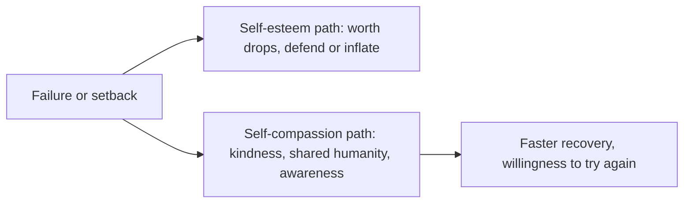

# Self-compassion

## Summary

Self-compassion is treating oneself with the kindness and understanding one would give to a friend when failing or suffering. Kristin Neff (2003) defined it with three components: self-kindness instead of self-judgment, a sense of common humanity instead of isolation, and mindfulness instead of over-identification with painful feelings. It is linked to lower anxiety and depression, and does not seem to lower motivation. It differs from self-esteem because it does not depend on evaluation.

*This note is educational. It is not mental health advice.*

## Prerequisites

- [Self-esteem and self-acceptance](self-esteem-and-self-acceptance.md).

## Core concepts

### Definition

Neff (2003) defines *self-compassion* as an attitude toward oneself in suffering, made of three paired parts:

| Component | Positive pole | Opposite |
| --- | --- | --- |
| Self-kindness | Gentle, supportive speech to oneself | Self-judgment |
| Common humanity | Seeing failure as part of the shared human experience | Isolation |
| Mindfulness | Holding painful feelings in balanced awareness | Over-identification |

### Analogy

Self-compassion is the voice of a good coach after a loss: honest about what went wrong, calm about the person and clear about the next step. The limit of the analogy is that a person must deliver the coach's lines to themselves.

### Self-compassion and self-esteem

Self-esteem depends on evaluation and tends to fall after failure. Self-compassion does not depend on the outcome, so it is more stable. A worry that it breeds complacency is not supported by the research: people high in self-compassion do not appear less motivated, and may be more willing to take responsibility.

## Worked example

After a poor presentation, a person's inner voice says: "You are hopeless." A self-compassionate response in three steps:

| Component | Response |
| --- | --- |
| Mindfulness | "This is painful, and I feel embarrassed" |
| Common humanity | "Many people have bad presentations, especially when nervous" |
| Self-kindness | "What would I say to a colleague? I would tell them what to improve and that one talk does not define them" |

The person then notes two specific improvements for next time. Compassion is combined with learning from the mistake.

## Trade offs and when to use it

Self-compassion is a skill that can be practiced with simple exercises. It is not a way to avoid responsibility or an excuse for poor work. Some people with strong self-criticism find it uncomfortable at first. For depression or trauma, use it alongside professional treatment.

## Common mistakes

- **Treating it as self-indulgence.** It includes honest accountability.
- **Confusing it with self-esteem.** It does not depend on evaluation.
- **Expecting instant relief.** It develops with practice.

## Practice

1. Name the three components of self-compassion.
2. How does it differ from self-esteem?
3. Does self-compassion reduce motivation?

### Answers

1. Self-kindness, common humanity and mindfulness.
2. It does not depend on evaluation, so it is more stable after failure.
3. The research does not indicate that it does, and responsibility-taking can be higher.

## Further reading

- Neff, K. (2003). Self-Compassion: An Alternative Conceptualization of a Healthy Attitude Toward Oneself. *Self and Identity*, 2(2), 85-101. [DOI](https://doi.org/10.1080/15298860309032). Defines self-compassion and its three components.
- Orth, U. and Robins, R. W. (2014). The Development of Self-Esteem. *Current Directions in Psychological Science*, 23(5), 381-387. [DOI](https://doi.org/10.1177/0963721414547414). Reviews how self-esteem develops across the life span.
