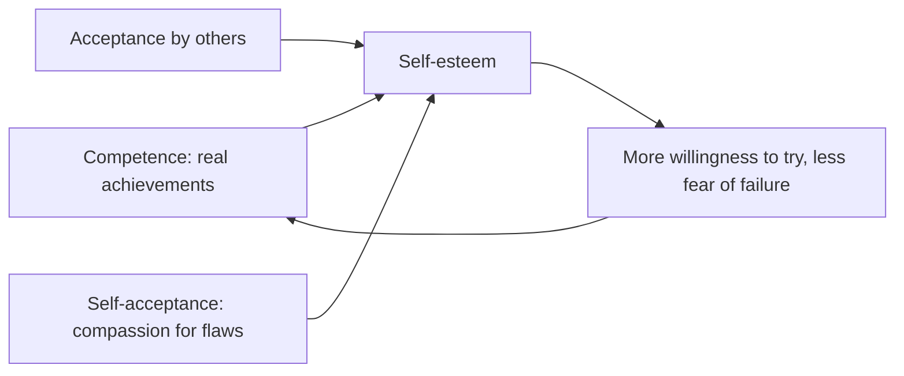

# Self-esteem and self-acceptance

## Summary

Self-esteem is a person's overall evaluation of their own worth. Longitudinal research shows that it rises from adolescence to middle age, peaks around 50 to 60 and then declines, and that it is fairly stable but can change. Whether high self-esteem causes success is debated: a major review found weaker effects than popular belief, while later longitudinal work finds that it predicts later outcomes. Self-acceptance, which means acknowledging one's traits without needing to rate them, is a related and more stable foundation.

*This note is educational. It is not mental health advice.*

## Prerequisites

- [Self-verification theory](../../social-sciences/psychology/social-psychology/self-verification-theory.md).

## Core concepts

### Definition

*Self-esteem* is the subjective evaluation of one's own worth. It can be a stable trait (global self-esteem), a state that varies with events, or a domain judgment such as academic self-esteem. *Self-acceptance* is a realistic and unconditional regard for oneself, including weaknesses. It is one of the six dimensions of psychological well-being (see [hedonic and eudaimonic well-being](../../social-sciences/psychology/humanistic-and-positive/hedonic-and-eudaimonic-well-being.md)).

### What the research says

- **Development.** Orth and Robins (2014) review longitudinal studies: self-esteem increases from adolescence to middle adulthood, peaks at about age 50 to 60, and then decreases into old age. It is relatively stable but not immutable.
- **Consequences.** They report that self-esteem prospectively predicts success and well-being in relationships, work and health. Baumeister and colleagues (2003) reviewed the literature and concluded that the evidence that high self-esteem causes better performance is weak, that it does not cause good leadership or prevent drug use, and that it makes people feel good. The two reviews disagree in emphasis, and the question of cause is open.
- **Levels.** Low self-esteem is linked to depression risk, high but fragile self-esteem to defensiveness, and secure self-esteem to stability.

### Analogy

Self-esteem is like a thermostat reading, and self-acceptance is like the insulation of the house. The reading goes up and down with the weather, and the insulation determines how much the house is affected. The limit of the analogy is that the reading also feeds back on the heating.

### Raising it

Methods with support: building skills with real, graded success, cognitive techniques that challenge harsh self-judgments (see [cognitive behavioral therapy](../../social-sciences/psychology/clinical-and-counseling/cognitive-behavioral-therapy.md)), and self-compassion (see [self-compassion](self-compassion.md)). Empty affirmations and praise without basis do not work well.

## Worked example

A person with low self-esteem avoids speaking in meetings.

| Step | Action |
| --- | --- |
| 1 | Set a small target: one comment per meeting |
| 2 | Prepare the comment in advance |
| 3 | After the meeting, write what happened and what others said |
| 4 | Compare the actual reaction with the feared one |
| 5 | After a month, raise the target |

The steps build real evidence of competence and challenge the prediction of rejection. The example is an illustration.

## Trade offs and when to use it

Aim for stable self-acceptance rather than a high number. The pursuit of high self-esteem through comparison and achievement makes it dependent on results. Persistent low self-esteem with low mood needs professional assessment.

## Common mistakes

- **Chasing self-esteem through success alone.** It makes worth conditional.
- **Using unrealistic affirmations.** They can backfire in people with low self-esteem.
- **Equating self-esteem with arrogance.** Secure self-esteem is not boastful.

## Practice

1. At what age does average self-esteem peak, according to Orth and Robins (2014)?
2. What did Baumeister and colleagues (2003) conclude about performance?
3. How does self-acceptance differ from self-esteem?

### Answers

1. About 50 to 60 years.
2. The evidence that high self-esteem causes better performance is weak.
3. Self-acceptance is an unconditional regard for oneself including weaknesses, while self-esteem is an evaluation of worth.

## Further reading

- Orth, U. and Robins, R. W. (2014). The Development of Self-Esteem. *Current Directions in Psychological Science*, 23(5), 381-387. [DOI](https://doi.org/10.1177/0963721414547414). Reviews how self-esteem develops across the life span.
- Baumeister, R. F., Campbell, J. D., Krueger, J. I. et al. (2003). Does High Self-Esteem Cause Better Performance, Interpersonal Success, Happiness, or Healthier Lifestyles?. *Psychological Science in the Public Interest*, 4(1), 1-44. [DOI](https://doi.org/10.1111/1529-1006.01431). A review that finds weak evidence that high self-esteem causes success.
- Ryff, C. D. (1989). Happiness is everything, or is it? Explorations on the meaning of psychological well-being. *Journal of Personality and Social Psychology*, 57(6), 1069-1081. [DOI](https://doi.org/10.1037/0022-3514.57.6.1069). Proposes six dimensions of psychological well-being.
