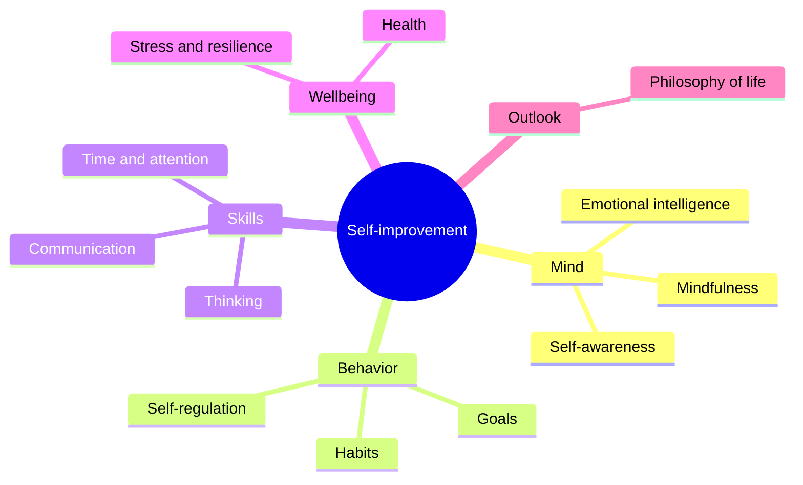

# Self-improvement

## Summary

Self-improvement is the effort to improve one's knowledge, skills, habits or character by one's own action. It covers many areas, from emotions and relationships to health, learning and work. Research supports the idea that people can change, although change is gradual and modest, and that specific methods such as goal setting, habit formation and feedback work better than general resolutions. The self-help industry makes stronger promises than the evidence supports.

*This note is educational. It is not medical or psychological advice.*

## Prerequisites

No prior notes are needed.

## Core concepts

### Definition

*Self-improvement* (also self-development) is deliberate, self-directed change aimed at a better version of oneself in some area. It differs from therapy, where a professional treats a disorder, and from education, where a teacher directs the process. A *domain* is the area targeted. The common ones are shown below.

### Can people change?

Hudson and Fraley (2015) tested whether people can change personality traits through volitional effort. In their studies, people who wanted to change a trait, and followed a plan with specific behaviors, showed changes in that trait over 16 weeks, though the changes were modest. This supports the idea of deliberate change and indicates that it needs sustained, specific action.

### Analogy

Self-improvement is like physical training. Results come from regular practice of a targeted kind, progress is slow and uneven, and a plan that suits the person works better than a generic one. The limit of the analogy is that the mind has no clear measure like weight, so progress is often judged by feeling, which is unreliable.

### What works

| Element | Why it matters |
| --- | --- |
| Specific target | Vague aims do not guide action (see [goal setting](goal-setting.md)) |
| Small repeated actions | Habits drive change (see [habit formation](habit-formation.md)) |
| Feedback | Without it, people drift or fool themselves |
| Environment | It shapes behavior more than motivation does |
| Patience | Change takes weeks to months |

## Worked example

A person wants to be a better listener at work.

| Step | Action |
| --- | --- |
| 1 | Specific target: let the other person finish, then paraphrase once per meeting |
| 2 | Habit cue: "when a colleague begins a long point, I stop typing" |
| 3 | Feedback: ask a trusted colleague after two weeks |
| 4 | Review: note progress weekly in two lines |
| 5 | Adjust: raise the target to two paraphrases after a month |

The plan uses the elements from the table, and the results are checked by outside feedback and not by feeling alone.

## Trade offs and when to use it

Self-improvement gives agency and can bring real gains. The risks: endless pursuit of change with no end, comparing oneself to a curated image, belief in quick fixes and neglect of acceptance. A person with a serious difficulty, such as persistent low mood or anxiety, should seek professional help and not rely on self-help alone.

## Common mistakes

- **Starting too many changes at once.** Pick one or two.
- **Relying on motivation.** Use the environment and habits.
- **Measuring by feeling.** Use specific indicators and outside feedback.
- **Ignoring acceptance.** Change goes better with self-compassion.

## Practice

1. Name two elements that make self-improvement work.
2. What did Hudson and Fraley (2015) find?
3. Why is self-help not a substitute for treatment?

### Answers

1. For example a specific target and small repeated actions, plus feedback.
2. People who followed a plan with specific behaviors showed modest changes in a chosen trait over 16 weeks.
3. Serious conditions need assessment and evidence-based treatment by a professional.

## Further reading

- Hudson, N. W. and Fraley, R. C. (2015). Volitional personality trait change: Can people choose to change their personality traits?. *Journal of Personality and Social Psychology*, 109(3), 490-507. [DOI](https://doi.org/10.1037/pspp0000021). Shows that people can change personality traits through volitional effort.
- Locke, E. A. and Latham, G. P. (2002). Building a practically useful theory of goal setting and task motivation: A 35-year odyssey. *American Psychologist*, 57(9), 705-717. [DOI](https://doi.org/10.1037/0003-066X.57.9.705). Summarizes 35 years of goal-setting theory.
- Lally, P., van Jaarsveld, C. H. M., Potts, H. W. W. et al. (2009). How are habits formed: Modelling habit formation in the real world. *European Journal of Social Psychology*, 40(6), 998-1009. [DOI](https://doi.org/10.1002/ejsp.674). Measures how long habits take to form in daily life.
