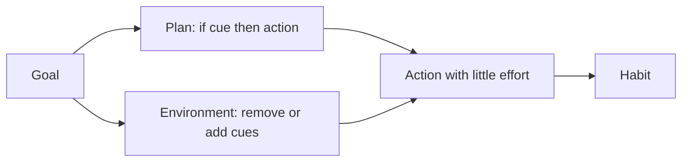

# Self-regulation, self-control and self-discipline

## Summary

Self-regulation is the ability to direct one's own thoughts, emotions and actions toward goals, especially when a tempting alternative is present. Self-control and self-discipline are close terms for resisting impulses and keeping to plans. The popular idea that willpower is a limited resource that runs out (ego depletion) failed a large preregistered replication. Evidence points to strategies that avoid the need for willpower: changing the situation, making plans in advance and building habits.

*This note is educational. It is not mental health advice.*

## Prerequisites

- [Habit formation](habit-formation.md).

## Core concepts

### Definition

*Self-regulation* is the broad process by which a person monitors and adjusts their behavior and feelings. *Self-control* is the narrower case of overriding an impulse for a longer-term goal. *Self-discipline* is the everyday word for steady self-control and for doing what one planned. *Self-management* is the use of these abilities to organize tasks and time.

### Ego depletion and what replaced it

The resource model said that self-control draws on a limited stock that is depleted by effort, so that after one hard task, the next suffers. In a registered replication with 23 laboratories and 2,141 participants, Hagger and colleagues (2016) found a small effect that was not distinguishable from zero. The model is no longer well supported as a general account.

### Situational strategies

Duckworth, Gendler and Gross (2016) review situational strategies for self-control. Instead of resisting a temptation in the moment, people change the situation:

| Strategy | Example |
| --- | --- |
| Situation selection | Do not walk past the bakery |
| Situation modification | Put the phone in another room while working |
| Attention deployment | Look away from the temptation |
| Reappraisal | See the cake as a cause of afternoon fatigue |

### Analogy

Self-control is like a diet: a person who keeps sweets in the house needs constant willpower, and a person who does not buy them needs little. The limit of the analogy is that some temptations, such as one's own thoughts, cannot be removed from the house.

### Planning

Implementation intentions ("if situation, then action") link a response to a cue in advance and reduce the demand for in-the-moment control (Gollwitzer and Sheeran, 2006).

## Worked example

A person wants to stop checking the phone while writing.

| Approach | Method | Demand for willpower |
| --- | --- | --- |
| Willpower | Keep the phone on the desk and resist | High, every few minutes |
| Situation modification | Phone in a drawer in another room | Low |
| Plan | "If I feel the urge to check, then I take three breaths and write one more sentence" | Medium |
| Both | Phone away and a plan for urges | Low and robust |

The environmental change does most of the work, and the plan covers the urges that remain.

## Trade offs and when to use it

The situational approach works for external temptations and routine goals. For internal urges, emotion regulation methods and, where needed, professional help are options (see [compulsive sexual behavior](../../social-sciences/psychology/clinical-and-counseling/compulsive-sexual-behavior.md) for an example of a loss of control). The language of "discipline" can encourage self-blame. People who seem to have more self-control often avoid temptations more, and do not resist better.

## Common mistakes

- **Relying on willpower.** Change the situation instead.
- **Believing that willpower is a battery.** The evidence for depletion is weak.
- **Blaming oneself for lapses.** Treat a lapse as information about the plan.

## Practice

1. What did Hagger and colleagues (2016) find?
2. Name two situational strategies.
3. Why do implementation intentions help?

### Answers

1. A small effect not distinguishable from zero in a registered replication of ego depletion.
2. For example situation selection and situation modification.
3. They link an action to a cue in advance, which reduces the demand for in-the-moment control.

## Further reading

- Hagger, M. S., Chatzisarantis, N. L. D., Alberts, H. et al. (2016). A Multilab Preregistered Replication of the Ego-Depletion Effect. *Perspectives on Psychological Science*, 11(4), 546-573. [DOI](https://doi.org/10.1177/1745691616652873). A multi-lab replication that did not find the ego depletion effect.
- Duckworth, A. L., Gendler, T. S. and Gross, J. J. (2016). Situational Strategies for Self-Control. *Perspectives on Psychological Science*, 11(1), 35-55. [DOI](https://doi.org/10.1177/1745691615623247). Reviews situational strategies for self-control such as changing the environment.
- Gollwitzer, P. M. and Sheeran, P. (2006). Implementation Intentions and Goal Achievement: A Meta‐analysis of Effects and Processes. *Advances in Experimental Social Psychology*, 69-119. [DOI](https://doi.org/10.1016/S0065-2601(06)38002-1). A meta-analysis of implementation intentions and goal achievement.
