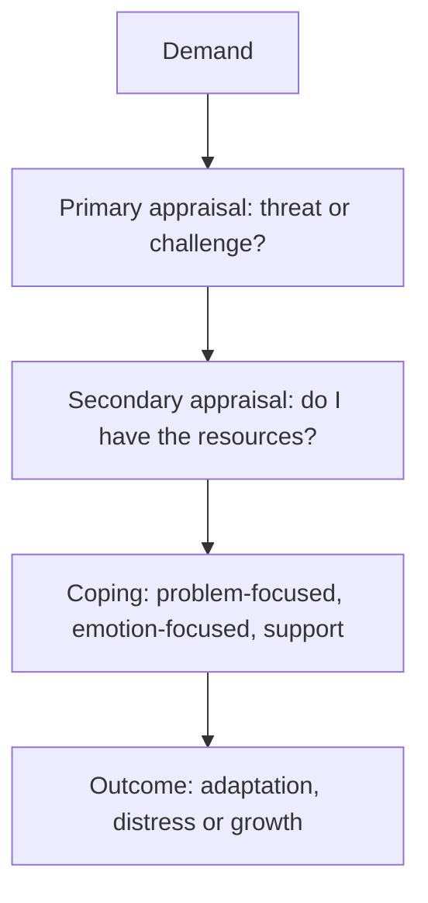

# Stress and resilience

## Summary

Stress is the reaction to demands that a person judges to exceed or strain their resources. The transactional model of Lazarus and Folkman says that the effect depends on how a demand is appraised and what coping resources are available. Resilience, the ability to keep a stable function after adversity, is more common than people expect: Bonanno (2004) argued that many people show a stable, healthy trajectory after loss. Social support, regular sleep and exercise, and coping that fits the situation are the best-supported resources.

*This note is educational. It is not medical advice. Persistent distress needs professional help.*

## Prerequisites

No prior notes are needed.

## Core concepts

### Definition

A *stressor* is a demand and *stress* is the response. In the transactional model (Lazarus and Folkman, 1984), a person first makes a *primary appraisal* (is this a threat, a harm or a challenge?) and then a *secondary appraisal* (do I have the resources to cope?). Stress arises when the demand seems to exceed the resources. *Coping* is the effort to manage the demand or the feelings it causes.

### Types of coping

| Type | Aim | Fits when |
| --- | --- | --- |
| Problem-focused | Change the situation | The situation can be changed |
| Emotion-focused | Regulate the feeling | The situation cannot be changed |
| Avoidance | Stay away from the stressor | A short break may help, but long avoidance tends to worsen things |
| Seeking support | Use others as a resource | Almost always |

Cohen and Wills (1985) reviewed evidence for the stress-buffering hypothesis: social support protects health in people under high stress.

### Analogy

A bridge carries a load: stress is the weight, and resilience is the strength and the flexibility of the bridge. A bridge fails when the load exceeds what it can bear, and maintenance makes it last. The limit of the analogy is that people can reduce the load and ask others to carry some.

### Resilience

Bonanno (2004) argued that the usual response to potentially traumatic events is a stable, healthy trajectory, and that chronic distress is a minority outcome. Recovery and resilience are separate: recovering people pass through a period of distress first, while resilient people show a stable course. Resilience is not a fixed trait, and depends on resources and context.

## Worked example

A person with a deadline and a sick parent feels overwhelmed.

| Step | Action |
| --- | --- |
| Appraise | Separate the demands: the deadline can be negotiated, the illness cannot be changed |
| Problem-focused | Ask for an extension of two days |
| Emotion-focused | Daily 15-minute walk, regular bedtime |
| Support | Tell two friends and ask a sibling to share care on weekends |
| Review | After a week, check which actions helped |

The plan applies each type of coping to the kind of demand it fits.

## Trade offs and when to use it

Coping skills help with ordinary stress and are not a replacement for treatment of anxiety, depression or trauma. Telling people that they must be resilient can place the burden on the individual, when the cause is the situation, for example overload at work. Change the load where possible.

## Common mistakes

- **Using the same coping for every problem.** Match it to the situation.
- **Treating distress after loss as failure.** Distress is common and often passes.
- **Withdrawing from others.** Support is a main protective factor.

## Practice

1. What are primary and secondary appraisal?
2. When does emotion-focused coping fit best?
3. What did Bonanno (2004) argue?

### Answers

1. Primary appraisal judges whether a demand is a threat or a challenge, and secondary appraisal judges whether one has resources to cope.
2. When the situation cannot be changed.
3. A stable, healthy course after loss is common, and chronic distress is a minority outcome.

## Further reading

- Lazarus, R. S. and Folkman, S. (1984). *Stress, Appraisal, and Coping*. Springer. The book that sets out the transactional model of stress and coping.
- Bonanno, G. A. (2004). Loss, Trauma, and Human Resilience: Have We Underestimated the Human Capacity to Thrive After Extremely Aversive Events?. *American Psychologist*, 59(1), 20-28. [DOI](https://doi.org/10.1037/0003-066X.59.1.20). Argues that resilience after loss is common.
- Cohen, S. and Wills, T. A. (1985). Stress, social support, and the buffering hypothesis. *Psychological Bulletin*, 98(2), 310-357. [DOI](https://doi.org/10.1037/0033-2909.98.2.310). Reviews evidence that social support buffers the effects of stress.
