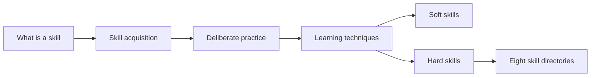

# Skills

Abilities that can be learned and practiced, and how to learn them. This field belongs to [Personal development](../README.md). It starts with notes that apply to any skill (what a skill is, how skills are acquired, how to practice and study), then divides into soft skills and hard skills. Skills cut across many domains, so a skill note links to the note that explains the underlying knowledge instead of repeating it.

## Notes in reading order

1. [What is a skill](what-is-a-skill.md): skill, knowledge, ability and competence, hard and soft skills, levels, transfer and how skills lose value.
2. [Skill acquisition](skill-acquisition.md): the stages of learning (Fitts and Posner, Anderson, Dreyfus), learning curves, feedback and arrested development.
3. [Deliberate practice](deliberate-practice.md): what it is, what the research does and does not show, and the 10,000 hour myth.
4. [Learning techniques](learning-techniques.md): retrieval practice, spacing, interleaving, worked examples and desirable difficulties.

## Map of the field

The general notes form a sequence, and both subfields build on them.

## Subfields

- [Soft skills](soft-skills/README.md): transferable skills of thinking, self-management and working with others, grouped by the National Research Council's cognitive, intrapersonal and interpersonal domains.
- [Hard skills](hard-skills/README.md): task-specific, testable skills. Each skill has its own directory: copywriting, content marketing, search engine optimization, e-commerce, social media, client acquisition, personal branding and online research.

## How to use this field

Read the four general notes first: they explain how to learn any skill in the subfields. For a specific skill, start with the fundamentals note in its directory and follow the reading order in its README. Career planning around skills is in [skills inventory and gap analysis](../career/self-assessment/skills-inventory-and-gap-analysis.md).

## Navigation

- Back to [Personal development](../README.md).
- [Table of contents](../../ToC.md).
