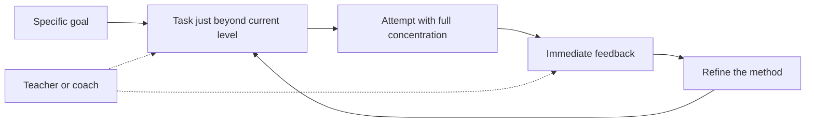
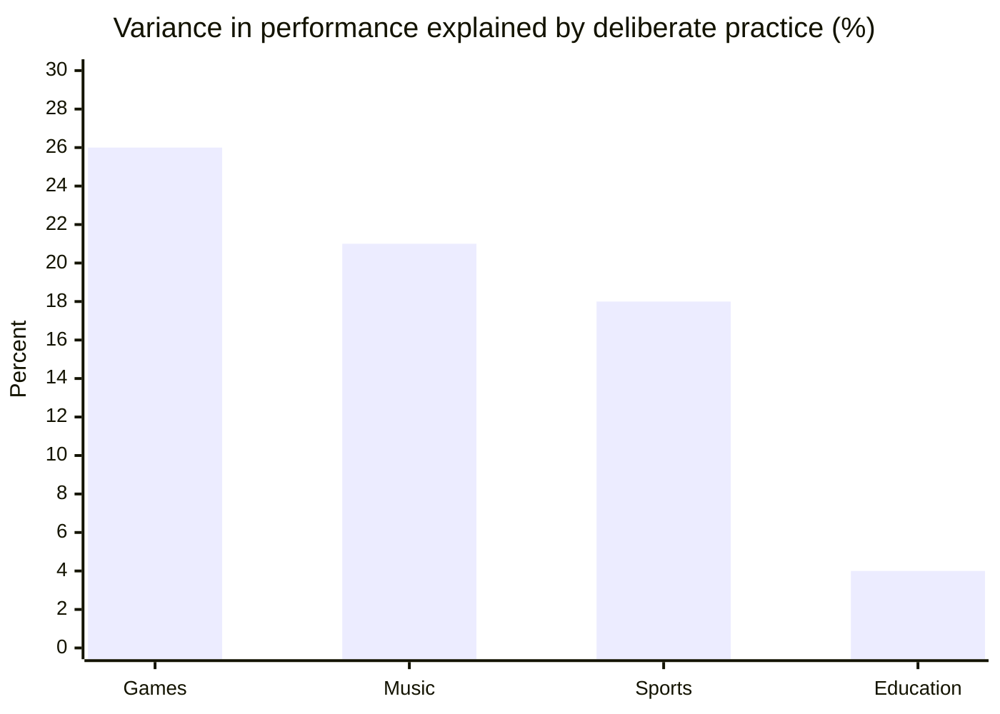

# Deliberate practice

## Summary

Deliberate practice is practice designed to improve a specific aspect of performance: a well-defined goal just beyond current ability, full concentration, immediate feedback, and repetition with refinement, often guided by a teacher. Anders Ericsson and colleagues proposed in 1993 that the amount of such practice explains most of the difference between expert and ordinary performers. Later meta-analyses found that deliberate practice matters but explains a smaller share of differences than claimed, large in games and music, small in education and very small in professions. The popular "10,000 hour rule" is a distortion of the original research.

## Prerequisites

[Skill acquisition](skill-acquisition.md) for the stages of learning and the role of feedback.

## Core concepts

### Definition

Ericsson, Krampe and Tesch-Römer (1993) defined *deliberate practice* as structured activities designed specifically to improve performance, which are effortful and not inherently enjoyable. Later descriptions by Ericsson list its features:

1. **A specific goal** for each session, focused on one aspect of performance ("open every email with the reader's problem", not "write better emails").
2. **Difficulty just beyond the current level**, so that success is possible but not certain.
3. **Full concentration.** It is mentally demanding, so sessions are limited in length.
4. **Immediate, informative feedback** on each attempt.
5. **Repetition with refinement**, adjusting the method based on feedback.
6. **Often a teacher or coach** who knows what good performance looks like and designs the tasks.

Deliberate practice is different from:

- *Play*, which is done for enjoyment,
- *work* or *performance*, where the goal is a good result now, not improvement, so you use what you can already do,
- *naive practice*, which is repetition without specific goals or feedback.

*Analogy.* A football player who plays a match every weekend gets experience. One who spends an hour after training taking 50 free kicks from the same spot, with a coach commenting on each one, and moving the ball further when 40 of 50 hit the target, is doing deliberate practice. The analogy holds for the narrow focus and feedback. It breaks for knowledge work, where the "spot" and the "target" are often unclear and feedback comes late, so designing deliberate practice there takes more effort.

The elements form a loop that repeats within each session.

### The original study

Ericsson, Krampe and Tesch-Römer (1993) studied violinists at the Music Academy of West Berlin. Students judged by their teachers as the best had accumulated more hours of solitary practice by age 18 (on average about 7,400 hours in their retrospective estimates, as reported in later reviews) than students judged good (about 5,300 hours) or students training to be music teachers (about 3,400 hours). The authors argued that individual differences in expert performance largely reflect differences in accumulated deliberate practice, not innate talent.

### The 10,000 hour rule

Malcolm Gladwell's book *Outliers* (2008) popularized a "10,000 hour rule" for becoming world class. Ericsson criticized this reading: 10,000 was roughly the average for the best violinists by age 20 in one study, not a threshold. Many of those students had fewer hours, the number differs greatly between fields, and the hours in question were deliberate practice, not any time spent in the activity. There is no evidence for a fixed number of hours that guarantees expertise.

### What later research found

Macnamara, Hambrick and Oswald (2014) meta-analyzed 88 studies with 157 effect sizes and over 11,000 participants. Deliberate practice explained:

| Domain | Share of variance in performance explained |
| --- | --- |
| Games (for example chess) | 26% |
| Music | 21% |
| Sports | 18% |
| Education | 4% |
| Professions | less than 1% |

Their conclusion: deliberate practice is important, but not as important as has been argued. Other factors matter too, such as the age at which practice started, general cognitive ability, working memory capacity and personality.

A replication of the violin study by Macnamara and Maitra (2019), with 39 violinists and a double-blind procedure, found that practice still explained a substantial share of differences (about 26% of the variance) but much less than the original study implied. The best violinists had not practiced more than the good ones.

The debate continues. Ericsson argued that many studies in the meta-analysis did not measure deliberate practice as he defined it, which would underestimate its effect. His critics answered that a narrow definition makes the claim hard to test. A fair summary as of 2026: practice is necessary for high performance in every field studied, and its structure matters, but practice hours alone do not explain who becomes an expert.

The chart shows the shares from the table for the four domains above 1%. Professions (less than 1%) are left out because the exact value is not given.

### Why the effect is small in professions

Several reasons may explain the very small effect in professional work:

- Performance in professions is hard to measure, so studies use rough proxies.
- Professional tasks vary a lot from day to day, so there is no fixed "free kick" to repeat.
- Feedback often comes late or not at all (a strategy proves right or wrong after a year).
- Most professionals do not do deliberate practice at all. They work.

This also points to an opportunity: in fields where few people practice deliberately, even a modest amount can set someone apart. That claim is an inference, not a measured result.

### Designing deliberate practice for knowledge work

Ericsson's principles can be adapted to skills such as writing, selling or analysis:

1. **Find the components.** Break the skill into parts that can be practiced separately (headlines, openings, calls to action).
2. **Find a standard.** Collect examples of excellent performance and, if possible, an expert who can comment.
3. **Create short, repeatable tasks.** Write ten headlines for one article. Rewrite one paragraph to half its length.
4. **Get fast feedback.** Compare your work with expert examples, use a mentor, or test with real audiences where possible (see [A/B testing](hard-skills/copywriting/ab-testing.md)).
5. **Focus on weaknesses.** Spend time where errors are most frequent, not where you are already good.
6. **Keep sessions short and focused.** In the original study, the best musicians practiced in sessions of about an hour and rarely more than four hours a day, with rest. This is an observation about musicians, not a rule for every skill.
7. **Record progress.** Keep a log of what you practiced, what feedback you got and what changed.

## Worked example

A salesperson wants to improve how they handle the price objection ("It is too expensive").

- **Current level:** in recorded calls, they usually respond by offering a discount within the first ten seconds.
- **Goal for two weeks:** respond to a price objection by first asking what the price is being compared with, and then linking the price to a cost of the problem the customer described.
- **Practice task:** a colleague plays a customer and raises the price objection in five different ways (budget, competitor price, "need to think", internal approval, "not a priority"). Each round takes three minutes.
- **Feedback:** the colleague and a recording. After each round: did they ask a question first? Did they connect the price to the customer's own numbers?
- **Difficulty:** once the salesperson succeeds in four of five rounds, the colleague adds pressure (interruptions, a manager joining the call).
- **Transfer check:** after two weeks, review five real calls. Count how often the new response was used and what happened next.

The example contains no figures about results, because results in sales depend on many factors. The measurable part is the behavior that is being practiced.

## Trade offs and when to use it

- **Effortful and tiring.** It cannot replace normal work and should be planned in short blocks.
- **Needs a standard.** Without examples or an expert, it is hard to know what to aim for. In new fields, deliberate practice is harder to design.
- **Best for well-defined components.** It works well for parts of a skill with clear quality criteria and less well for open-ended strategic judgment.
- **Not the only factor.** Expect large differences between people with the same practice. Use practice to improve yourself, not to predict who will become the best.

## Common mistakes

- **Counting hours.** Fix: count specific tasks completed with feedback.
- **Practicing what you are already good at.** Fix: let error logs decide what to practice.
- **No feedback.** Fix: find an expert, a reference standard or a measurable outcome before starting.
- **Believing the 10,000 hour rule.** Fix: read the original study and the meta-analyses. There is no magic number.
- **Burnout.** Fix: short, focused sessions with recovery.

## Practice

1. List the features of deliberate practice and the three activities it is distinguished from.
2. What share of variance did deliberate practice explain in games, music, sports, education and professions according to Macnamara et al. (2014)?
3. Why did Ericsson object to the 10,000 hour rule?
4. Design a two-week deliberate practice plan for one component of a skill you use at work, with goal, task, feedback and a way to raise difficulty.

Hints: question 3 concerns averages, variation between people and the type of practice.

## Further reading

- Ericsson, K. A., Krampe, R. T., & Tesch-Römer, C. (1993). The role of deliberate practice in the acquisition of expert performance. *Psychological Review*, 100(3), 363-406. [doi:10.1037/0033-295X.100.3.363](https://doi.org/10.1037/0033-295X.100.3.363). The original theory and violin study.
- Macnamara, B. N., Hambrick, D. Z., & Oswald, F. L. (2014). Deliberate practice and performance in music, games, sports, education, and professions: A meta-analysis. *Psychological Science*, 25(8), 1608-1618. [doi:10.1177/0956797614535810](https://doi.org/10.1177/0956797614535810). The main meta-analysis.
- Macnamara, B. N., & Maitra, M. (2019). The role of deliberate practice in expert performance: Revisiting Ericsson, Krampe & Tesch-Römer (1993). *Royal Society Open Science*, 6(8), 190327. [doi:10.1098/rsos.190327](https://doi.org/10.1098/rsos.190327). The replication.
- Ericsson, A., & Pool, R. (2016). *Peak: Secrets from the New Science of Expertise*. Houghton Mifflin Harcourt. Ericsson's popular account, including his critique of the 10,000 hour rule.
- Gladwell, M. (2008). *Outliers: The Story of Success*. Little, Brown. The source of the 10,000 hour rule.
